# 2026营收运营活动图谱

来源 Wiki：https://wiki.inkept.cn/pages/viewpage.action?pageId=452644191
页面总数：203
活动数：61

## 月度活动总览

### 2026年1月份活动

月度判断：
- 1月核心重点
- 【数据现状】
- 当前大盘消耗稳定、谨防周末/月末流水下降问题
- 【执行动作】
- 1、基于历史玩法的有效结论进行玩法优化、节奏调整，核心为在对应时间段上线对应提arppu活动、在流水较低时，设置互动与常规玩法配合活动维稳消耗。
- 2、互动交叉上线，弥补流水缺口及对应周末/月末维稳。
- 【大盘目标】
- 1月实际消耗10.9e钻，B目标10.62亿钻，完成度102.65%，领先2818w钻；A目标11.44亿钻，完成度95.29%，落后5392w钻。
- 【人数目标】
- 活动礼物送礼人数目标4272人，实际3770人，完成度88.25%

- [2026 开好运（1.1-1.4）](https://wiki.inkept.cn/pages/viewpage.action?pageId=452644196)
  资料：[【日报】2026开好运DAY3](https://wiki.inkept.cn/pages/viewpage.action?pageId=465052110)、[【日报】2026开好运DAY4](https://wiki.inkept.cn/pages/viewpage.action?pageId=465477169)、[【资源申请】-2026开好运](https://wiki.inkept.cn/pages/viewpage.action?pageId=462598680)、[宝剑炼化--bb版本](https://wiki.inkept.cn/pages/viewpage.action?pageId=463111407)、[【资源申请】宝剑炼化礼物配置](https://wiki.inkept.cn/pages/viewpage.action?pageId=471958000)
- [玫瑰之约（1.10-1.14）](https://wiki.inkept.cn/pages/viewpage.action?pageId=456570094)
- [守护十二星座-魔羯座（1.13-1.17）](https://wiki.inkept.cn/pages/viewpage.action?pageId=459967903)
  资料：[【上线申请】摩羯座](https://wiki.inkept.cn/pages/viewpage.action?pageId=459967907)、[【星座对对碰】资源申请](https://wiki.inkept.cn/pages/viewpage.action?pageId=465476608)、[【榜单奖励】摩羯座](https://wiki.inkept.cn/pages/viewpage.action?pageId=459967909)、[【礼物参考】摩羯座](https://wiki.inkept.cn/pages/viewpage.action?pageId=462599886)、[【资源礼物申请】摩羯座](https://wiki.inkept.cn/pages/viewpage.action?pageId=459967908)
- [冬日纪念册（1.18-1.22）](https://wiki.inkept.cn/pages/viewpage.action?pageId=459970908)
  资料：[【上线申请】冬日纪念册](https://wiki.inkept.cn/pages/viewpage.action?pageId=471958003)、[【日报】冬日纪念册day5](https://wiki.inkept.cn/pages/viewpage.action?pageId=473633116)、[【资源申请】冬日纪念册](https://wiki.inkept.cn/pages/viewpage.action?pageId=470694268)
- [集福腊八（1.23-1.26）](https://wiki.inkept.cn/pages/viewpage.action?pageId=456559661)
  资料：[【集福腊八】Day3日报-20260126](https://wiki.inkept.cn/pages/viewpage.action?pageId=476553417)
- [花火大会（1.27-1.31）](https://wiki.inkept.cn/pages/viewpage.action?pageId=458358730)
  资料：[【上线申请】花火大会](https://wiki.inkept.cn/pages/viewpage.action?pageId=473632973)、[【资源礼物申请】花火大会](https://wiki.inkept.cn/pages/viewpage.action?pageId=473630973)
- [林海雪踪（复用旋风赛车手）（1.5-1.9）](https://wiki.inkept.cn/pages/viewpage.action?pageId=452651150)
  资料：[【上线申请】林海雪踪](https://wiki.inkept.cn/pages/viewpage.action?pageId=463124998)、[【数据日报】-Day3](https://wiki.inkept.cn/pages/viewpage.action?pageId=468828123)、[【数据日报】-Day5](https://wiki.inkept.cn/pages/viewpage.action?pageId=470694025)、[【资源配置】-1.5-1.9林海雪踪-20251231](https://wiki.inkept.cn/pages/viewpage.action?pageId=463123518)

### 2026年2月份活动

月度判断：
- 预估数据现状
- 2 月上半月涵盖月初及情人节节点，2 月 16 日起正式进入春节假期，下半月全程处于假期周期。结合近四年核心数据规律，适配 2026 年节日时间节奏，2月趋势预估如下：
- 主播活跃：2 月 10 日（腊月二十二）后活跃出现下滑，2月14日（腊月二十七）活跃出现小幅回升，此后至2月18日（正月初二）为活跃最低点；正月初二至正月十一逐步回升，2 月 28 日（正月十二）基本恢复节前水平。
- 大盘消耗：2 月 10 日（腊月二十二）至除夕呈持续上升趋势，2月14日、除夕、初一三日为小高峰；正月初二至初四收礼触底，正月初五小幅回升后，初六至初七再度走低，正月初八至十一呈缓慢回升态势。
- 核心方向
- 春节聚焦主播侧，以简单直给式奖励为核心，重点干预年中日开播活跃维稳、年后开播活跃回归。
- 借情人节节日氛围，主攻 ARPPU 提升。
- 月初做好基础消耗维稳工作。
- 执行动作
- 春节主播侧分年中、年后两阶段落地：年中推行日打卡模式，发放映币奖励维稳日活；年后采用累计打卡形式，以映币激励推动活跃度回归。

- [次元小镇（2.1-2.5）](https://wiki.inkept.cn/pages/viewpage.action?pageId=476553849)
  资料：[【次元小镇】Day4日报-20260205](https://wiki.inkept.cn/pages/viewpage.action?pageId=481658043)
- [情人节活动（2.12-2.14）](https://wiki.inkept.cn/pages/viewpage.action?pageId=471957713)
- [2.5-长期  荣耀征程](https://wiki.inkept.cn/pages/viewpage.action?pageId=471957744)
- [守护十二星座-水瓶座（2.6-2.10）](https://wiki.inkept.cn/pages/viewpage.action?pageId=478984068)
  资料：[【上线申请】水瓶座](https://wiki.inkept.cn/pages/viewpage.action?pageId=481656950)、[【榜单奖励】水瓶座](https://wiki.inkept.cn/pages/viewpage.action?pageId=483790699)、[【资源礼物申请】水瓶座](https://wiki.inkept.cn/pages/viewpage.action?pageId=480968884)
- [2026年春节](https://wiki.inkept.cn/pages/viewpage.action?pageId=462598896)
  资料：[2026年春节整体方案框架梳理](https://wiki.inkept.cn/pages/viewpage.action?pageId=465477320)、[2月17日-2月21日 用户福马迎春送财运](https://wiki.inkept.cn/pages/viewpage.action?pageId=471957989)、[【数据分析需求】2026年春节](https://wiki.inkept.cn/pages/viewpage.action?pageId=462598907)、[主播嘉宾春节玩法](https://wiki.inkept.cn/pages/viewpage.action?pageId=476553571)、[小用户玩法](https://wiki.inkept.cn/pages/viewpage.action?pageId=471957761)、[【活动数据】2026年春节](https://wiki.inkept.cn/pages/viewpage.action?pageId=483794738)、[【资源申请】春节用户](https://wiki.inkept.cn/pages/viewpage.action?pageId=483786903)、[【预算申请】春节用户预算](https://wiki.inkept.cn/pages/viewpage.action?pageId=482675268) ...
- [【上线申请】阿拉丁神灯](https://wiki.inkept.cn/pages/viewpage.action?pageId=482674428)
- [春节主题礼物](https://wiki.inkept.cn/pages/viewpage.action?pageId=473630980)
- [礼物展馆二期换新](https://wiki.inkept.cn/pages/viewpage.action?pageId=470693664)

### 2026年3月份活动

月度判断：
- 预估数据现状
- 结合近两年历史数据走势，2026 年 3 月初处于春节假期后恢复期，大盘主播活跃、用户送礼人数将逐步回升，正月十五（3 月 3 日）后整体趋于稳定。钻石消耗方面，除受到对应节日节点、重点活动上线节点影响外，3 月整体基本呈现平稳趋势。
- 核心方向
- 月初（3.1–3.10）：节后的arppu提升
- 月中 + 月末：结合时间节点上线赛事及高效消耗玩法，重点刺激 ARPPU，实现消耗维稳。
- 执行动作
- 月初上线3 款活动：围绕元宵节、女神节两个节日热点，搭配低价值礼物玩法、每日送礼人数玩法，重点提升用户送礼人数、刺激付费转化。
- 月中下旬上线4 款活动：分阶段上线贩卖直播间曝光玩法、高价值小映礼物玩法、黄金矿工玩法及月末赛事，分段刺激 ARPPU。
- 常规运营手段：设置 1 款 月常规活动，搭配7 款功能玩法不间断上线，保障基础消耗稳定。
- 3月核心重点

- [春日繁花盛宴（3.14-3.18）](https://wiki.inkept.cn/pages/viewpage.action?pageId=483790250)
  资料：[【上线申请】春日繁花盛宴](https://wiki.inkept.cn/pages/viewpage.action?pageId=488346138)、[【日报】春日繁花盛宴](https://wiki.inkept.cn/pages/viewpage.action?pageId=488346972)、[【春日繁花盛宴】qa文档](https://wiki.inkept.cn/pages/viewpage.action?pageId=488346325)、[【繁花盛宴】规则更改](https://wiki.inkept.cn/pages/viewpage.action?pageId=488346052)、[【资源配置申请】春日繁花盛宴](https://wiki.inkept.cn/pages/viewpage.action?pageId=488342925)
- [假面舞会（3.19-3.22）](https://wiki.inkept.cn/pages/viewpage.action?pageId=483795095)
  资料：[【假面舞会】上线申请](https://wiki.inkept.cn/pages/viewpage.action?pageId=488347145)、[【假面舞会】资源申请](https://wiki.inkept.cn/pages/viewpage.action?pageId=488346856)、[小宝剑炼化（假面邀约）st申请](https://wiki.inkept.cn/pages/viewpage.action?pageId=488346905)
- [元宵喜乐会（3.2-3.3）](https://wiki.inkept.cn/pages/viewpage.action?pageId=478981921)
  资料：[【qa文档】元宵喜乐会](https://wiki.inkept.cn/pages/viewpage.action?pageId=483793836)、[【上线申请】元宵喜乐会](https://wiki.inkept.cn/pages/viewpage.action?pageId=483793661)、[【资源申请】元宵喜乐会](https://wiki.inkept.cn/pages/viewpage.action?pageId=483793314)
- [云端小镇  时光邮局（3.23-3.26）](https://wiki.inkept.cn/pages/viewpage.action?pageId=483790252)
  资料：[【qa】时光邮局](https://wiki.inkept.cn/pages/viewpage.action?pageId=488350647)、[【日报】时光邮局](https://wiki.inkept.cn/pages/viewpage.action?pageId=488354300)、[【时光邮局】](https://wiki.inkept.cn/pages/viewpage.action?pageId=488350187)、[【资源配置】时光邮局](https://wiki.inkept.cn/pages/viewpage.action?pageId=488347360)、[时光邮局--规则更改](https://wiki.inkept.cn/pages/viewpage.action?pageId=488350220)
- [映客全明星（3.27-3.31）](https://wiki.inkept.cn/pages/viewpage.action?pageId=483789319)
  资料：[全明星用户玩法-总榜、任务、日榜](https://wiki.inkept.cn/pages/viewpage.action?pageId=483795467)、[全明星附属玩法-5钻礼物玩法](https://wiki.inkept.cn/pages/viewpage.action?pageId=483790731)、[全明星附属玩法-功能玩法](https://wiki.inkept.cn/pages/viewpage.action?pageId=483790751)、[映客全明星上线申请](https://wiki.inkept.cn/pages/viewpage.action?pageId=488352790)
- [趣味关系（3.4-3.31）](https://wiki.inkept.cn/pages/viewpage.action?pageId=483796187)
- [女神宠爱计划（3.4-3.8）](https://wiki.inkept.cn/pages/viewpage.action?pageId=478982297)
- [守护十二星座-双鱼座（3.9-3.13）](https://wiki.inkept.cn/pages/viewpage.action?pageId=483796478)
  资料：[【上线申请】双鱼座](https://wiki.inkept.cn/pages/viewpage.action?pageId=483796482)、[【榜单奖励】双鱼座](https://wiki.inkept.cn/pages/viewpage.action?pageId=483796483)、[【资源礼物申请】双鱼座](https://wiki.inkept.cn/pages/viewpage.action?pageId=483796484)
- [基础礼物上新](https://wiki.inkept.cn/pages/viewpage.action?pageId=483793619)

### 2026年4月份活动

月度判断：
- 预估数据现状
- 结合近两年历史数据走势，4月初清明节假期期间，受付费用户数下降影响，消耗将出现下降，并处于低点；4月23日起至五一假期、付费用户数、送礼用户数、主播活跃将呈现持续下降，其他时间段，除受到对应节点和遇到异常波动外，4 月整体将基本呈现平稳趋势。
- 核心方向
- 月初（清明假期前后）：聚焦用户侧，设置小礼物玩法延缓中低层级付费人数的下滑。
- 月末（五一假期前）：预估人数下滑节点前，设置小礼物玩法延缓付费人数下滑，紧接月末设置高消耗玩法带动SAB层级用户arppu值从而维稳消耗。
- 五一假期：提前接入主播活跃玩法，维稳主播活跃。
- 执行动作
- 月初上线 2 款活动：围绕愚人节节日热点，及清明假期数据现状，设置低价值礼物玩法、每日送礼人数玩法，重点维稳用户付费人数、送礼人数；设置高价值小映，维稳假期大盘基础消耗。
- 月末上线 2 款活动：针对月末数据现状，在人数下滑节点前设置“一锤定金”玩法延缓付费人数下降，在月末以核心奖励搭配高价值礼物玩法带动SAB层级用户arppu值从而维稳消耗
- 月末上线主播活跃活动：4月30日上线针对主播假期活跃活动

- [4.1 整蛊大师](https://wiki.inkept.cn/pages/viewpage.action?pageId=488342052)
- [守护十二星座-白羊座（4.11-4.15）](https://wiki.inkept.cn/pages/viewpage.action?pageId=492701139)
  资料：[【上线申请】白羊座](https://wiki.inkept.cn/pages/viewpage.action?pageId=492701143)、[【榜单奖励】白羊座](https://wiki.inkept.cn/pages/viewpage.action?pageId=492701144)、[【礼物参考】白羊座](https://wiki.inkept.cn/pages/viewpage.action?pageId=492701534)、[【资源礼物申请】白羊座](https://wiki.inkept.cn/pages/viewpage.action?pageId=492701145)
- [白龙御空（4.16-4.19）](https://wiki.inkept.cn/pages/viewpage.action?pageId=488343075)
- [星球大战（4.16-4.21）](https://wiki.inkept.cn/pages/viewpage.action?pageId=488341652)
- [星际战车（4.16-4.21）](https://wiki.inkept.cn/pages/viewpage.action?pageId=483798772)
- [琉璃幻境（4.2-4.6）](https://wiki.inkept.cn/pages/viewpage.action?pageId=488342117)
  资料：[【客诉】琉璃幻境](https://wiki.inkept.cn/pages/viewpage.action?pageId=492702212)、[【日报】琉璃幻境](https://wiki.inkept.cn/pages/viewpage.action?pageId=492712804)、[【琉璃幻境】st申请](https://wiki.inkept.cn/pages/viewpage.action?pageId=488355608)、[【琉璃幻境】上线申请](https://wiki.inkept.cn/pages/viewpage.action?pageId=492702025)、[【资源申请】琉璃幻境](https://wiki.inkept.cn/pages/viewpage.action?pageId=492700813)、[星夜赴约-宠爱时刻换肤](https://wiki.inkept.cn/pages/viewpage.action?pageId=488355418)
- [暗影玫瑰复用（4.20-4.23）](https://wiki.inkept.cn/pages/viewpage.action?pageId=488351597)
  资料：[【上线申请】暗影玫瑰](https://wiki.inkept.cn/pages/viewpage.action?pageId=492723666)、[【资源配置】暗影玫瑰](https://wiki.inkept.cn/pages/viewpage.action?pageId=492718712)
- [雾隐仙踪（4.24-4.29）](https://wiki.inkept.cn/pages/viewpage.action?pageId=488347164)
- [荒野寻金（4.24-4.29）](https://wiki.inkept.cn/pages/viewpage.action?pageId=483798715)
- [海底争霸（4.27-4.30）](https://wiki.inkept.cn/pages/viewpage.action?pageId=488351609)
- [能量加油站--投壶需要改成bb（4.6-4.10）](https://wiki.inkept.cn/pages/viewpage.action?pageId=488351603)
- [闻香识美人（复用：平行世界）（4.7-4.10）](https://wiki.inkept.cn/pages/viewpage.action?pageId=488346218)
  资料：[【闻香识美人】上线申请](https://wiki.inkept.cn/pages/viewpage.action?pageId=492712165)、[【闻香识美人】资源礼物申请](https://wiki.inkept.cn/pages/viewpage.action?pageId=492702045)
- [令葫赐福（4.8-4.12）](https://wiki.inkept.cn/pages/viewpage.action?pageId=488351607)
- [4月脸萌道具上线](https://wiki.inkept.cn/pages/viewpage.action?pageId=488355414)
- [趣味关系](https://wiki.inkept.cn/pages/viewpage.action?pageId=492731499)

### 2026年5月份活动

月度判断：
- 预估数据现状
- 以近两年大盘数据走势情况来看，整体5月份，除赛点、节日节点外，新玩法活动上线对大盘存在提升作用，其余时间为长时间平稳消耗。
- 可能面临的问题及部分需要调整的部分：
- 1、五一假期期间除1号为自然高点外，2-4日大盘arppu、付费人数、消耗人数下降明显，今年需做好补充玩法。
- 2、五一假期后的5月6日-5月12日期间，用户arppu值基本回归到4月均值水平，但人数回升较慢，至12日基本正常，今年需要增设快速拉升的玩法。
- 3、过往两年5月28日-5月29日送礼用户数、充值用户数在赛后出现下降，30日提升至正常水平，2026年月末和周末相撞，需重点关注。
- 核心方向
- 1、五一假期期间，在主播活跃方向及用户ARPPU的方向上，做好假期期间用户付费人数、消耗人数预防下降的玩法，维稳五一期间大盘消耗及活跃稳定。
- 2、五一假期后，在以往高ARPPU有效手段沿用的基础上，匹配“一锤定金”，快速拉升付费人数、送礼人数的提升。
- 3、527赛事后，儿童节活动前置，维稳月末/周末/赛后的数据低点。

- [2026年-527](https://wiki.inkept.cn/pages/viewpage.action?pageId=492700808)
  资料：[2026-527研发文档](https://wiki.inkept.cn/pages/viewpage.action?pageId=492718684)、[2026年-527  宣讲文档](https://wiki.inkept.cn/pages/viewpage.action?pageId=492700810)、[2026年527年度正赛上线同步](https://wiki.inkept.cn/pages/viewpage.action?pageId=499520367)、[2026年527数据埋点](https://wiki.inkept.cn/pages/viewpage.action?pageId=499518915)、[【映客527】预算申请](https://wiki.inkept.cn/pages/viewpage.action?pageId=502077718)、[【资源配置】-2026年527资源申请-平台运营组-20260429](https://wiki.inkept.cn/pages/viewpage.action?pageId=497224384)、[问题点](https://wiki.inkept.cn/pages/viewpage.action?pageId=499519696)、[2026-527上线申请](https://wiki.inkept.cn/pages/viewpage.action?pageId=499520364) ...
- [五一（4.29-5.5）](https://wiki.inkept.cn/pages/viewpage.action?pageId=492718967)
  资料：[【五一放肆嗨】上线申请](https://wiki.inkept.cn/pages/viewpage.action?pageId=497224198)、[【五一放肆嗨】资源礼物申请](https://wiki.inkept.cn/pages/viewpage.action?pageId=497222848)
- [5.11   派对榜更新](https://wiki.inkept.cn/pages/viewpage.action?pageId=488343271)
- [岁御万象（5.11-5.14）](https://wiki.inkept.cn/pages/viewpage.action?pageId=492719910)
- [守护十二星座-金牛座（5.11-5.15）](https://wiki.inkept.cn/pages/viewpage.action?pageId=499518241)
  资料：[【上线申请】金牛座](https://wiki.inkept.cn/pages/viewpage.action?pageId=499518245)、[【榜单奖励】金牛座](https://wiki.inkept.cn/pages/viewpage.action?pageId=499518246)、[【礼物参考】金牛座](https://wiki.inkept.cn/pages/viewpage.action?pageId=499518247)、[【资源礼物申请】金牛座](https://wiki.inkept.cn/pages/viewpage.action?pageId=499518325)
- [心跳共振的瞬间（5.19-5.21）](https://wiki.inkept.cn/pages/viewpage.action?pageId=492731523)
  资料：[5.20-5.24 心动信号站：CP告白计划](https://wiki.inkept.cn/pages/viewpage.action?pageId=502073993)、[【520】上线申请](https://wiki.inkept.cn/pages/viewpage.action?pageId=502071955)、[【资源申请】520](https://wiki.inkept.cn/pages/viewpage.action?pageId=499523519)
- [5.23-长期-疯狂周末](https://wiki.inkept.cn/pages/viewpage.action?pageId=492731518)
- [六一：重返童趣拾光（5.30-6.1）](https://wiki.inkept.cn/pages/viewpage.action?pageId=499520103)
  资料：[【六一】上线申请](https://wiki.inkept.cn/pages/viewpage.action?pageId=504171958)、[【六一】资源礼物申请](https://wiki.inkept.cn/pages/viewpage.action?pageId=504168849)
- [迷幻森林奇遇记（5.6-5.10）](https://wiki.inkept.cn/pages/viewpage.action?pageId=492719889)
- [一锤定金（5.6-5.10）](https://wiki.inkept.cn/pages/viewpage.action?pageId=492717883)
  资料：[线上问题](https://wiki.inkept.cn/pages/viewpage.action?pageId=499519430)
- [5月品牌宣发需求](https://wiki.inkept.cn/pages/viewpage.action?pageId=492731394)
- [派对主播推荐体系](https://wiki.inkept.cn/pages/viewpage.action?pageId=488355586)
  资料：[派对主播公演体系及歌手成长体系](https://wiki.inkept.cn/pages/viewpage.action?pageId=488347342)、[派对优质主播推荐体系](https://wiki.inkept.cn/pages/viewpage.action?pageId=488347345)、[派对新主播推荐体系](https://wiki.inkept.cn/pages/viewpage.action?pageId=488347347)
- [趣味关系-黑道大佬&落难千金](https://wiki.inkept.cn/pages/viewpage.action?pageId=499519334)

### 2026年6月份活动

月度判断：
- 一、预估数据现状
- 结合近两年历史数据及近两月大盘走势判断，6 月整体消耗趋势较为稳定，在 6 月 1 日、15 日 / 30 日厅战、18 日 618 等节点出现高点，其余时段保持稳定。
- 6 月 3 日 - 6 月 10 日：全层级用户送礼人数基本稳定，大盘 ARPPU 相对较低。
- 6 月 12 日起：各层级消耗人数开始下滑，直至 6 月 15 日厅战、6 月 18 日 618 节点出现回升。
- 618 节点过后：大盘 ARPPU 与送礼人数同步回落，为月度第二低点，需重点维稳。
- 6 月 25 日 - 6 月 30 日：受底层用户送礼人数下降影响，大盘整体消耗出现下滑趋势。
- 当前秀场中腰部主播在月末开播下滑严重。
- 二、核心运营方向
- 月初：搭配中高价值小映礼物与基础任务玩法，拉升全层级用户 ARPPU。
- 月中至中下旬：618 前夕上线低价值礼物玩法，托底送礼人数；618 结束后结合节日与高价值玩法，稳住大盘消耗。

- [星河秘境（6.12-6.15）](https://wiki.inkept.cn/pages/viewpage.action?pageId=504173145)
  资料：[【资源配置】星河秘境](https://wiki.inkept.cn/pages/viewpage.action?pageId=504173241)
- [全民狂欢节（6.15-6.18）](https://wiki.inkept.cn/pages/viewpage.action?pageId=502072910)
- [粽情端午赛龙舟（6.19-6.22）](https://wiki.inkept.cn/pages/viewpage.action?pageId=504168550)
- [月末全勤计划（6.21-6.30）](https://wiki.inkept.cn/pages/viewpage.action?pageId=504173152)
- [未读的心跳（6.22-6.26）](https://wiki.inkept.cn/pages/viewpage.action?pageId=504173655)
  资料：[【上线申请】未读的心跳](https://wiki.inkept.cn/pages/viewpage.action?pageId=504173658)、[【资源礼物申请】未读的心跳](https://wiki.inkept.cn/pages/viewpage.action?pageId=504173659)
- [黄金矿工&一锤定金优化需求（6.26-6.30）](https://wiki.inkept.cn/pages/viewpage.action?pageId=504172887)
- [花漾心动（热恋巧克力换肤）（6.27-7.1）](https://wiki.inkept.cn/pages/viewpage.action?pageId=504173607)
- [5.11-5.15 守护十二星座-双子座（6.7-6.11）](https://wiki.inkept.cn/pages/viewpage.action?pageId=504173421)
  资料：[6.7-6.11【上线申请】双子座](https://wiki.inkept.cn/pages/viewpage.action?pageId=504173425)、[6.7-6.11【榜单奖励】双子座](https://wiki.inkept.cn/pages/viewpage.action?pageId=504173426)、[6.7-6.11【礼物参考】双子座](https://wiki.inkept.cn/pages/viewpage.action?pageId=504173427)、[【资源礼物申请】双子座](https://wiki.inkept.cn/pages/viewpage.action?pageId=504173503)

### 2026年7月份活动

月度判断：
- 数据现状
- 结合近两年历史数据及近两月大盘走势判断，7 月整体送礼人数偏高，送礼arppu及大盘消耗在7月1日、15 日 / 31 日厅战有高点外，其他除受功能玩法影响等相关节点外，其他相对平稳。且派对侧消耗及礼物消耗与大盘走势基本一致，秀场侧礼物消耗对秀场整体消耗影响较低，整体送礼人数呈现全月逐步降低趋势，至月末达到最低点。
- 7 月 1 日 - 7 月 4 日：受派对侧送礼人数较高及月初影响，大盘整体全层级用户送礼人数较高， 大盘送礼 ARPPU 相对稳定。
- 7 月 5 日 - 7 月 14 日：大盘及双侧送礼arppu相对稳定，但送礼人数偏低，整体大盘消耗呈现相对稳定的趋势。
- 7 月 15 日 - 7 月 24 日：大盘及派对侧送礼人数呈现自厅战前后出现增长，后基本稳定在日均16000人以上，属整月仅次于月初阶段的送礼人数高值，但送礼arppu双侧呈现缓慢下降趋势。
- 7 月 25 日 - 7 月 30 日：受底层用户送礼人数下降及秀场侧arppu下降影响，大盘整体消耗出现下滑趋势，派对侧送礼arppu相对稳定，秀场侧送礼arppu下降严重。7月31日受派对厅战影响，整体拔高
- 秀场主播活跃观察6月效果后，7月机动
- 执行动作
- 月初：7月1日-7月4日期间，基础任务活动+配合低中高全层级礼物价值，月初提升全层级arppu。
- 月上旬：7月5日-7月14日期间，搭配情爱节日+小礼物玩法促进送礼人数转化，其余时间正常维稳消耗即可。

- [岁御万象 · 第二期：二十八星宿 · 星官降临](https://wiki.inkept.cn/pages/viewpage.action?pageId=504173517)

## Mermaid 图谱

```mermaid
graph TD
root[2026营收运营活动]
root --> n452644194[2026-01]
n452644194 --> n452644196["2026 开好运"]
n452644196 --> n465052110["【日报】2026开好运DAY3"]
n452644196 --> n465477169["【日报】2026开好运DAY4"]
n452644196 --> n462598680["【资源申请】-2026开好运"]
n452644196 --> n463111407["宝剑炼化--bb版本"]
n452644196 --> n471958000["【资源申请】宝剑炼化礼物配置"]
n452644194 --> n456570094["玫瑰之约"]
n452644194 --> n459967903["守护十二星座-魔羯座"]
n459967903 --> n459967907["【上线申请】摩羯座"]
n459967903 --> n465476608["【星座对对碰】资源申请"]
n459967903 --> n459967909["【榜单奖励】摩羯座"]
n459967903 --> n462599886["【礼物参考】摩羯座"]
n459967903 --> n459967908["【资源礼物申请】摩羯座"]
n452644194 --> n459970908["冬日纪念册"]
n459970908 --> n471958003["【上线申请】冬日纪念册"]
n459970908 --> n473633116["【日报】冬日纪念册day5"]
n459970908 --> n470694268["【资源申请】冬日纪念册"]
n452644194 --> n456559661["集福腊八"]
n456559661 --> n476553417["【集福腊八】Day3日报-20260126"]
n452644194 --> n458358730["花火大会"]
n458358730 --> n473632973["【上线申请】花火大会"]
n458358730 --> n473630973["【资源礼物申请】花火大会"]
n452644194 --> n452651150["林海雪踪（复用旋风赛车手）"]
n452651150 --> n463124998["【上线申请】林海雪踪"]
n452651150 --> n468828123["【数据日报】-Day3"]
n452651150 --> n470694025["【数据日报】-Day5"]
n452651150 --> n463123518["【资源配置】-1.5-1.9林海雪踪-20251231"]
root --> n462598884[2026-02]
n462598884 --> n476553849["次元小镇"]
n476553849 --> n481658043["【次元小镇】Day4日报-20260205"]
n462598884 --> n471957713["情人节活动"]
n462598884 --> n471957744["2.5-长期  荣耀征程"]
n462598884 --> n478984068["守护十二星座-水瓶座"]
n478984068 --> n481656950["【上线申请】水瓶座"]
n478984068 --> n483790699["【榜单奖励】水瓶座"]
n478984068 --> n480968884["【资源礼物申请】水瓶座"]
n462598884 --> n462598896["2026年春节"]
n462598896 --> n465477320["2026年春节整体方案框架梳理"]
n462598896 --> n471957989["2月17日-2月21日 用户福马迎春送财运"]
n462598896 --> n462598907["【数据分析需求】2026年春节"]
n462598896 --> n476553571["主播嘉宾春节玩法"]
n462598896 --> n471957761["小用户玩法"]
n462598896 --> n483794738["【活动数据】2026年春节"]
n462598884 --> n482674428["【上线申请】阿拉丁神灯"]
n462598884 --> n473630980["春节主题礼物"]
n462598884 --> n470693664["礼物展馆二期换新"]
root --> n478981918[2026-03]
n478981918 --> n483790250["春日繁花盛宴"]
n483790250 --> n488346138["【上线申请】春日繁花盛宴"]
n483790250 --> n488346972["【日报】春日繁花盛宴"]
n483790250 --> n488346325["【春日繁花盛宴】qa文档"]
n483790250 --> n488346052["【繁花盛宴】规则更改"]
n483790250 --> n488342925["【资源配置申请】春日繁花盛宴"]
n478981918 --> n483795095["假面舞会"]
n483795095 --> n488347145["【假面舞会】上线申请"]
n483795095 --> n488346856["【假面舞会】资源申请"]
n483795095 --> n488346905["小宝剑炼化（假面邀约）st申请"]
n478981918 --> n478981921["元宵喜乐会"]
n478981921 --> n483793836["【qa文档】元宵喜乐会"]
n478981921 --> n483793661["【上线申请】元宵喜乐会"]
n478981921 --> n483793314["【资源申请】元宵喜乐会"]
n478981918 --> n483790252["云端小镇  时光邮局"]
n483790252 --> n488350647["【qa】时光邮局"]
n483790252 --> n488354300["【日报】时光邮局"]
n483790252 --> n488350187["【时光邮局】"]
n483790252 --> n488347360["【资源配置】时光邮局"]
n483790252 --> n488350220["时光邮局--规则更改"]
n478981918 --> n483789319["映客全明星"]
n483789319 --> n483795467["全明星用户玩法-总榜、任务、日榜"]
n483789319 --> n483790731["全明星附属玩法-5钻礼物玩法"]
n483789319 --> n483790751["全明星附属玩法-功能玩法"]
n483789319 --> n488352790["映客全明星上线申请"]
n478981918 --> n483796187["趣味关系"]
n478981918 --> n478982297["女神宠爱计划"]
n478981918 --> n483796478["守护十二星座-双鱼座"]
n483796478 --> n483796482["【上线申请】双鱼座"]
n483796478 --> n483796483["【榜单奖励】双鱼座"]
n483796478 --> n483796484["【资源礼物申请】双鱼座"]
n478981918 --> n483793619["基础礼物上新"]
root --> n483798763[2026-04]
n483798763 --> n488342052["4.1 整蛊大师"]
n483798763 --> n492701139["守护十二星座-白羊座"]
n492701139 --> n492701143["【上线申请】白羊座"]
n492701139 --> n492701144["【榜单奖励】白羊座"]
n492701139 --> n492701534["【礼物参考】白羊座"]
n492701139 --> n492701145["【资源礼物申请】白羊座"]
n483798763 --> n488343075["白龙御空"]
n483798763 --> n488341652["星球大战"]
n483798763 --> n483798772["星际战车"]
n483798763 --> n488342117["琉璃幻境"]
n488342117 --> n492702212["【客诉】琉璃幻境"]
n488342117 --> n492712804["【日报】琉璃幻境"]
n488342117 --> n488355608["【琉璃幻境】st申请"]
n488342117 --> n492702025["【琉璃幻境】上线申请"]
n488342117 --> n492700813["【资源申请】琉璃幻境"]
n488342117 --> n488355418["星夜赴约-宠爱时刻换肤"]
n483798763 --> n488351597["暗影玫瑰复用"]
n488351597 --> n492723666["【上线申请】暗影玫瑰"]
n488351597 --> n492718712["【资源配置】暗影玫瑰"]
n483798763 --> n488347164["雾隐仙踪"]
n483798763 --> n483798715["荒野寻金"]
n483798763 --> n488351609["海底争霸"]
n483798763 --> n488351603["能量加油站--投壶需要改成bb"]
n483798763 --> n488346218["闻香识美人（复用：平行世界）"]
n488346218 --> n492712165["【闻香识美人】上线申请"]
n488346218 --> n492702045["【闻香识美人】资源礼物申请"]
n483798763 --> n488351607["令葫赐福"]
n483798763 --> n488355414["4月脸萌道具上线"]
n483798763 --> n492731499["趣味关系"]
root --> n488343729[2026-05]
n488343729 --> n492700808["2026年-527"]
n492700808 --> n492718684["2026-527研发文档"]
n492700808 --> n492700810["2026年-527  宣讲文档"]
n492700808 --> n499520367["2026年527年度正赛上线同步"]
n492700808 --> n499518915["2026年527数据埋点"]
n492700808 --> n502077718["【映客527】预算申请"]
n492700808 --> n497224384["【资源配置】-2026年527资源申请-平台运营组-20260429"]
n488343729 --> n492718967["五一"]
n492718967 --> n497224198["【五一放肆嗨】上线申请"]
n492718967 --> n497222848["【五一放肆嗨】资源礼物申请"]
n488343729 --> n488343271["5.11   派对榜更新"]
n488343729 --> n492719910["岁御万象"]
n488343729 --> n499518241["守护十二星座-金牛座"]
n499518241 --> n499518245["【上线申请】金牛座"]
n499518241 --> n499518246["【榜单奖励】金牛座"]
n499518241 --> n499518247["【礼物参考】金牛座"]
n499518241 --> n499518325["【资源礼物申请】金牛座"]
n488343729 --> n492731523["心跳共振的瞬间"]
n492731523 --> n502073993["5.20-5.24 心动信号站：CP告白计划"]
n492731523 --> n502071955["【520】上线申请"]
n492731523 --> n499523519["【资源申请】520"]
n488343729 --> n492731518["5.23-长期-疯狂周末"]
n488343729 --> n499520103["六一：重返童趣拾光"]
n499520103 --> n504171958["【六一】上线申请"]
n499520103 --> n504168849["【六一】资源礼物申请"]
n488343729 --> n492719889["迷幻森林奇遇记"]
n488343729 --> n492717883["一锤定金"]
n492717883 --> n499519430["线上问题"]
n488343729 --> n492731394["5月品牌宣发需求"]
n488343729 --> n488355586["派对主播推荐体系"]
n488355586 --> n488347342["派对主播公演体系及歌手成长体系"]
n488355586 --> n488347345["派对优质主播推荐体系"]
n488355586 --> n488347347["派对新主播推荐体系"]
n488343729 --> n499519334["趣味关系-黑道大佬&落难千金"]
root --> n499520099[2026-06]
n499520099 --> n504173145["星河秘境"]
n504173145 --> n504173241["【资源配置】星河秘境"]
n499520099 --> n502072910["全民狂欢节"]
n499520099 --> n504168550["粽情端午赛龙舟"]
n499520099 --> n504173152["月末全勤计划"]
n499520099 --> n504173655["未读的心跳"]
n504173655 --> n504173658["【上线申请】未读的心跳"]
n504173655 --> n504173659["【资源礼物申请】未读的心跳"]
n499520099 --> n504172887["黄金矿工&一锤定金优化需求"]
n499520099 --> n504173607["花漾心动（热恋巧克力换肤）"]
n499520099 --> n504173421["5.11-5.15 守护十二星座-双子座"]
n504173421 --> n504173425["6.7-6.11【上线申请】双子座"]
n504173421 --> n504173426["6.7-6.11【榜单奖励】双子座"]
n504173421 --> n504173427["6.7-6.11【礼物参考】双子座"]
n504173421 --> n504173503["【资源礼物申请】双子座"]
root --> n504172214[2026-07]
n504172214 --> n504173517["岁御万象 · 第二期：二十八星宿 · 星官降临"]
```

