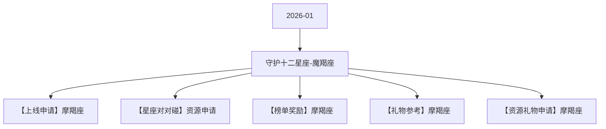

# 守护十二星座-魔羯座 活动图谱

月份：2026-01
活动时间：1.13-1.17
活动 Wiki：https://wiki.inkept.cn/pages/viewpage.action?pageId=459967903
活动页面 ID：459967903
关联资料数：5

## 活动摘要

- 星座调整：
- 1、常规上线时长缩减至5天
- 2、更换核心奖励，分为：用户（需研发）、嘉宾、主播
- 3、用户任务调整为常规送礼任务
- 4、星座小映的钱，去做玩法：小映玩法/特殊玩法（2月上线）
- 5、对对碰同期上线
- 6、活跃任务删除
- 7、兑换任务删除
- 更改部分文档已标红
- 后台：https://boc.inke.cn/react/tools/activity-data-query/index.html?module_name=constellation&month=202403白羊座守护者
- H5:https://boc.inke.cn/react/banner/202402/constellation/index.html?uid=22030647&sid=1&publisher=22030648
- 改规则的页面：https://boc.inke.cn/react/tools/page-config/index.html?key=banner_202402_constellation

## 关联资料

- [【上线申请】摩羯座](https://wiki.inkept.cn/pages/viewpage.action?pageId=459967907)
  - 页面 ID：459967907
  - 本地 Markdown：`pages/03_【上线申请】摩羯座_459967907/content.md`
- [【星座对对碰】资源申请](https://wiki.inkept.cn/pages/viewpage.action?pageId=465476608)
  - 页面 ID：465476608
  - 本地 Markdown：`pages/03_【星座对对碰】资源申请_465476608/content.md`
- [【榜单奖励】摩羯座](https://wiki.inkept.cn/pages/viewpage.action?pageId=459967909)
  - 页面 ID：459967909
  - 本地 Markdown：`pages/03_【榜单奖励】摩羯座_459967909/content.md`
- [【礼物参考】摩羯座](https://wiki.inkept.cn/pages/viewpage.action?pageId=462599886)
  - 页面 ID：462599886
  - 本地 Markdown：`pages/03_【礼物参考】摩羯座_462599886/content.md`
- [【资源礼物申请】摩羯座](https://wiki.inkept.cn/pages/viewpage.action?pageId=459967908)
  - 页面 ID：459967908
  - 本地 Markdown：`pages/03_【资源礼物申请】摩羯座_459967908/content.md`

## Mermaid 图谱

## 原始内容位置

- 活动主文档：`pages/02_1.13-1.17_守护十二星座-魔羯座_459967903/content.md`
- 【上线申请】摩羯座：`pages/03_【上线申请】摩羯座_459967907/content.md`
- 【星座对对碰】资源申请：`pages/03_【星座对对碰】资源申请_465476608/content.md`
- 【榜单奖励】摩羯座：`pages/03_【榜单奖励】摩羯座_459967909/content.md`
- 【礼物参考】摩羯座：`pages/03_【礼物参考】摩羯座_462599886/content.md`
- 【资源礼物申请】摩羯座：`pages/03_【资源礼物申请】摩羯座_459967908/content.md`
