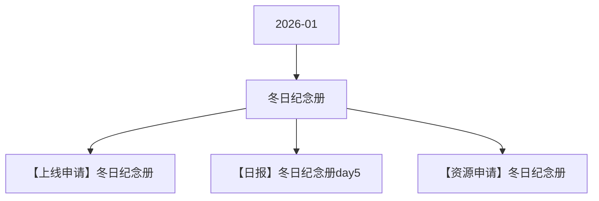

# 冬日纪念册 活动图谱

月份：2026-01
活动时间：1.18-1.22
活动 Wiki：https://wiki.inkept.cn/pages/viewpage.action?pageId=459970908
活动页面 ID：459970908
关联资料数：3

## 活动摘要

- 改文案链接：https://betaboc.inke.cn/react/tools/page-config-pro/index.html?url=https://betaboc.inke.cn/react/banner/202601/winter-note/index.html
- 修改点：
- 1、活动时间更改
- 2、活动页面换肤
- 3、所有的奖励更换
- 4、找猫猫复用
- 您申请的SourceType: [减少钻石-消耗-平台运营组-找猫猫-2025-12-01] 已经审批完成
- SourceType:759
- 起始时间：2025-12-01 14:47:17
- 结束时间：2026-12-01 14:47:17
- APP账单记录文案：直播收入
- 是否计入送礼流水：是

## 关联资料

- [【上线申请】冬日纪念册](https://wiki.inkept.cn/pages/viewpage.action?pageId=471958003)
  - 页面 ID：471958003
  - 本地 Markdown：`pages/03_【上线申请】冬日纪念册_471958003/content.md`
- [【日报】冬日纪念册day5](https://wiki.inkept.cn/pages/viewpage.action?pageId=473633116)
  - 页面 ID：473633116
  - 本地 Markdown：`pages/03_【日报】冬日纪念册day5_473633116/content.md`
- [【资源申请】冬日纪念册](https://wiki.inkept.cn/pages/viewpage.action?pageId=470694268)
  - 页面 ID：470694268
  - 本地 Markdown：`pages/03_【资源申请】冬日纪念册_470694268/content.md`

## Mermaid 图谱

## 原始内容位置

- 活动主文档：`pages/02_1.18-1.22冬日纪念册_459970908/content.md`
- 【上线申请】冬日纪念册：`pages/03_【上线申请】冬日纪念册_471958003/content.md`
- 【日报】冬日纪念册day5：`pages/03_【日报】冬日纪念册day5_473633116/content.md`
- 【资源申请】冬日纪念册：`pages/03_【资源申请】冬日纪念册_470694268/content.md`
