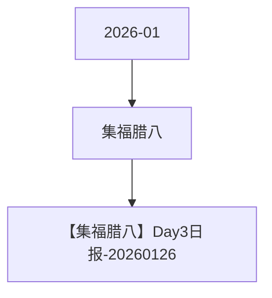

# 集福腊八 活动图谱

月份：2026-01
活动时间：1.23-1.26
活动 Wiki：https://wiki.inkept.cn/pages/viewpage.action?pageId=456559661
活动页面 ID：456559661
关联资料数：1

## 活动摘要

- 一、活动名称
- 集福腊八
- 二、活动目标
- 日均消耗达到500万钻石
- 三、活动框架
- 活动详情
- 集福腊八
- 活动时间：2026年1月23日-1月26日 每日00:00:00-23:59:59
- 玩法时间范围内，用户每送出活动专属礼物达到21钻，即可有机会抽取卡牌1张，具体按照下方表格产出，任务为日任务，每日重新开启，每日卡牌数量清零重新计算。
- 用户每送出活动专属达到21*1000钻（21000钻）自动触发直播间对应特效（特效ID：提需求）
- 每抽中一张卡牌，用户可获得卡牌所对应的奖励，奖励记录，页面飘屏（跑马灯）
- 玩法共设置6张卡牌，用户抽取卡牌达到对应数量解锁对应奖励。

## 关联资料

- [【集福腊八】Day3日报-20260126](https://wiki.inkept.cn/pages/viewpage.action?pageId=476553417)
  - 页面 ID：476553417
  - 本地 Markdown：`pages/03_【集福腊八】Day3日报-20260126_476553417/content.md`

## Mermaid 图谱

## 原始内容位置

- 活动主文档：`pages/02_1.23-1.26_集福腊八_456559661/content.md`
- 【集福腊八】Day3日报-20260126：`pages/03_【集福腊八】Day3日报-20260126_476553417/content.md`
