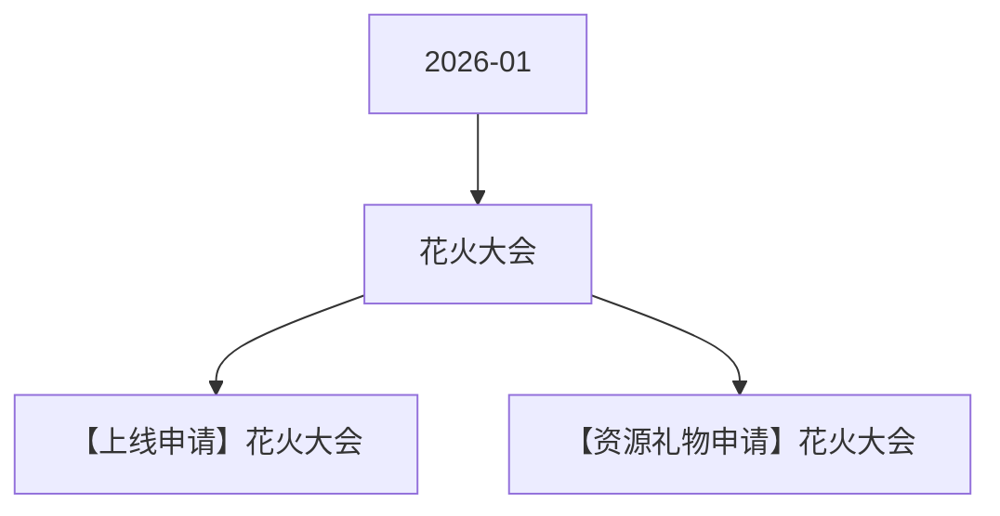

# 花火大会 活动图谱

月份：2026-01
活动时间：1.27-1.31
活动 Wiki：https://wiki.inkept.cn/pages/viewpage.action?pageId=458358730
活动页面 ID：458358730
关联资料数：2

## 活动摘要

- 一、活动时间
- 1月27日-1月31日
- 二、活动目标：
- 活动期间消耗达3500万钻；
- 三、活动框架
- 原型图：https://modao.cc/proto/U7mXRqZvt7pycsKSMOEqKM/sharing?view_mode=read_only&screen=rbpUSn4xWlfB7zri9 #花火大会-分享
- 所有礼物统计id：23840,23829,23830,23831,23832,23833,23834,23835,23836,23837,23838,23839,23827,23828
- 后台看板实时消耗礼物统计id：23840,23829,23830,23831,23832,23833,23834,23835,23836,23837,23838,23839
- 礼物墙礼物礼物名价格（钻）礼物IDurl备注
- 花火小映188823840
- 新，幸
- 流光谒夜1023829

## 关联资料

- [【上线申请】花火大会](https://wiki.inkept.cn/pages/viewpage.action?pageId=473632973)
  - 页面 ID：473632973
  - 本地 Markdown：`pages/03_【上线申请】花火大会_473632973/content.md`
- [【资源礼物申请】花火大会](https://wiki.inkept.cn/pages/viewpage.action?pageId=473630973)
  - 页面 ID：473630973
  - 本地 Markdown：`pages/03_【资源礼物申请】花火大会_473630973/content.md`

## Mermaid 图谱

## 原始内容位置

- 活动主文档：`pages/02_1.27-1.31_花火大会_458358730/content.md`
- 【上线申请】花火大会：`pages/03_【上线申请】花火大会_473632973/content.md`
- 【资源礼物申请】花火大会：`pages/03_【资源礼物申请】花火大会_473630973/content.md`
