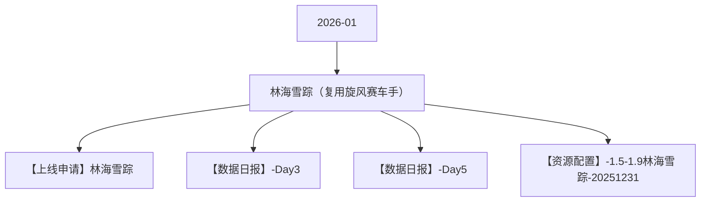

# 林海雪踪（复用旋风赛车手） 活动图谱

月份：2026-01
活动时间：1.5-1.9
活动 Wiki：https://wiki.inkept.cn/pages/viewpage.action?pageId=452651150
活动页面 ID：452651150
关联资料数：4

## 活动摘要

- 【更改点】
- （1）页面部分
- 林海雪踪（雪原+越野）
- 主页
- 首次送礼（520钻）获得初始身份，成为车手。重新设计形象，设计贴合冬季着装，主页主图为“雪原背景+越野选手”
- 榜单
- 改页面配色:见下图配色参考
- 小时竞速赛
- 限时突围赛
- 小映玩法
- 雪原小映
- （配色参考）

## 关联资料

- [【上线申请】林海雪踪](https://wiki.inkept.cn/pages/viewpage.action?pageId=463124998)
  - 页面 ID：463124998
  - 本地 Markdown：`pages/03_【上线申请】林海雪踪_463124998/content.md`
- [【数据日报】-Day3](https://wiki.inkept.cn/pages/viewpage.action?pageId=468828123)
  - 页面 ID：468828123
  - 本地 Markdown：`pages/03_【数据日报】-Day3_468828123/content.md`
- [【数据日报】-Day5](https://wiki.inkept.cn/pages/viewpage.action?pageId=470694025)
  - 页面 ID：470694025
  - 本地 Markdown：`pages/03_【数据日报】-Day5_470694025/content.md`
- [【资源配置】-1.5-1.9林海雪踪-20251231](https://wiki.inkept.cn/pages/viewpage.action?pageId=463123518)
  - 页面 ID：463123518
  - 本地 Markdown：`pages/03_【资源配置】-1.5-1.9林海雪踪-20251231_463123518/content.md`

## Mermaid 图谱

## 原始内容位置

- 活动主文档：`pages/02_1.5-1.9林海雪踪（复用旋风赛车手）_452651150/content.md`
- 【上线申请】林海雪踪：`pages/03_【上线申请】林海雪踪_463124998/content.md`
- 【数据日报】-Day3：`pages/03_【数据日报】-Day3_468828123/content.md`
- 【数据日报】-Day5：`pages/03_【数据日报】-Day5_470694025/content.md`
- 【资源配置】-1.5-1.9林海雪踪-20251231：`pages/03_【资源配置】-1.5-1.9林海雪踪-20251231_463123518/content.md`
