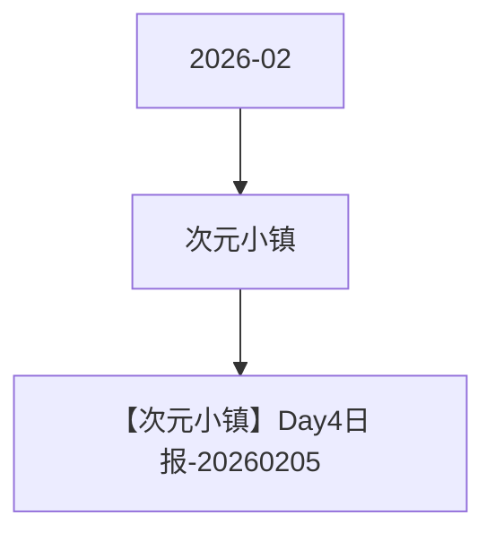

# 次元小镇 活动图谱

月份：2026-02
活动时间：2.1-2.5
活动 Wiki：https://wiki.inkept.cn/pages/viewpage.action?pageId=476553849
活动页面 ID：476553849
关联资料数：1

## 活动摘要

- 礼物ID礼物名称礼物价值（钻）URL
- 23847樱花堡10https://img.ikstatic.cn/MTY3ODk1MjA3MDUzOSMzNzYjcG5n.png
- 23848喵喵咪呀21https://img.ikstatic.cn/MTc1MDkyMzM0Mjc4NCM3ODQjcG5n.png
- 23849青空猫耳酱99https://img.ikstatic.cn/MTc1MDkyMzM3ODMwNCM4NTAjcG5n.png
- 23850云端幻境999https://img.ikstatic.cn/MTc0MzA3MzkzNjExMCMxMjAjcG5n.png
- 23851逐光之约3344https://img.ikstatic.cn/MTc0MzA2MDUxNDMxNCM2NTAjcG5n.png
- 23864王炸甜蜜13140https://img.ikstatic.cn/MTc1ODEwNDA0MDUwNSM1MTEjcG5n.png
- 23853玫瑰骑士52000https://img.ikstatic.cn/MTc0NTU2MjQyOTY3MSM2MTQjcG5n.png
- 23854海上钢琴师99999https://img.ikstatic.cn/MTczMjI2NzM0ODAxNiM5ODMjcG5n.png
- 23865与你同在520https://img.ikstatic.cn/MTY5NzY4NjQ1OTk4NCM1OTUjcG5n.png活动第3天（2.3）上线
- 23856心动雨季1314https://img.ikstatic.cn/MTc2MTI4NzE3NjUzOSMyMzQjcG5n.png
- 23857永恒相随5200https://img.ikstatic.cn/MTc2NzE3NzE3MDczMyMyNzIjcG5n.png

## 关联资料

- [【次元小镇】Day4日报-20260205](https://wiki.inkept.cn/pages/viewpage.action?pageId=481658043)
  - 页面 ID：481658043
  - 本地 Markdown：`pages/03_【次元小镇】Day4日报-20260205_481658043/content.md`

## Mermaid 图谱

## 原始内容位置

- 活动主文档：`pages/02_2.1-2.5次元小镇_476553849/content.md`
- 【次元小镇】Day4日报-20260205：`pages/03_【次元小镇】Day4日报-20260205_481658043/content.md`
