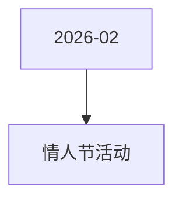

# 情人节活动 活动图谱

月份：2026-02
活动时间：2.12-2.14
活动 Wiki：https://wiki.inkept.cn/pages/viewpage.action?pageId=471957713
活动页面 ID：471957713
关联资料数：0

## 活动摘要

- 礼物名称价格礼物ID备注
- 玫瑰小映166623871banner链接已更改
- 星河玫瑰523884banner链接已更改
- 炽焰玫瑰2123947
- 指尖星光9923948
- 爱意定格52023949
- 以爱为名334423950
- 雪落倾心888823951
- 公主的骑士1314023952
- 星河女神3344023953
- 挚爱牵手5200023954
- 星辰予你99999​23955

## 关联资料

- 无子资料页面。

## Mermaid 图谱

## 原始内容位置

- 活动主文档：`pages/02_2.12-2.14-情人节活动_471957713/content.md`
