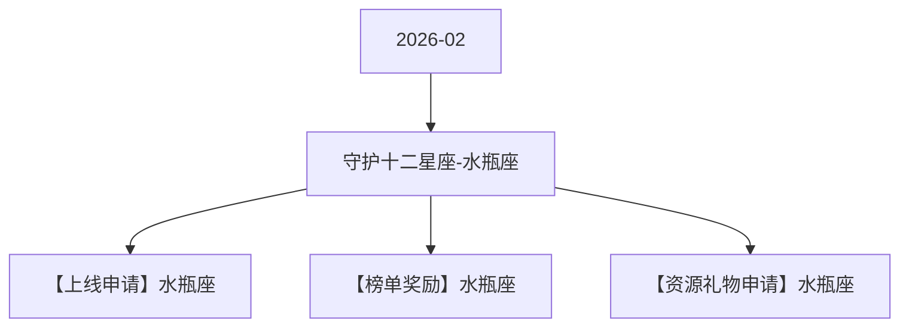

# 守护十二星座-水瓶座 活动图谱

月份：2026-02
活动时间：2.6-2.10
活动 Wiki：https://wiki.inkept.cn/pages/viewpage.action?pageId=478984068
活动页面 ID：478984068
关联资料数：3

## 活动摘要

- 后台：https://boc.inke.cn/react/tools/activity-data-query/index.html?module_name=constellation&month=202403白羊座守护者
- H5:https://boc.inke.cn/react/banner/202402/constellation/index.html?uid=22030647&sid=1&publisher=22030648
- 改规则的页面：https://boc.inke.cn/react/tools/page-config/index.html?key=banner_202402_constellation
- cj:https://boc.inke.cn/react/tools/activity-data-query/index.html?module_name=act_draw&month=200001
- 星座调整：
- 1、常规上线时长缩减至5天
- 2、更换核心奖励，分为：用户（需研发）、嘉宾、主播
- 3、用户任务调整为常规送礼任务
- 4、星座小映的钱，去做玩法：小映玩法/特殊玩法（2月上线）
- 5、对对碰同期上线
- 6、活跃任务删除
- 7、兑换任务删除

## 关联资料

- [【上线申请】水瓶座](https://wiki.inkept.cn/pages/viewpage.action?pageId=481656950)
  - 页面 ID：481656950
  - 本地 Markdown：`pages/03_【上线申请】水瓶座_481656950/content.md`
- [【榜单奖励】水瓶座](https://wiki.inkept.cn/pages/viewpage.action?pageId=483790699)
  - 页面 ID：483790699
  - 本地 Markdown：`pages/03_【榜单奖励】水瓶座_483790699/content.md`
- [【资源礼物申请】水瓶座](https://wiki.inkept.cn/pages/viewpage.action?pageId=480968884)
  - 页面 ID：480968884
  - 本地 Markdown：`pages/03_【资源礼物申请】水瓶座_480968884/content.md`

## Mermaid 图谱

## 原始内容位置

- 活动主文档：`pages/02_2.6-2.10_守护十二星座-水瓶座_478984068/content.md`
- 【上线申请】水瓶座：`pages/03_【上线申请】水瓶座_481656950/content.md`
- 【榜单奖励】水瓶座：`pages/03_【榜单奖励】水瓶座_483790699/content.md`
- 【资源礼物申请】水瓶座：`pages/03_【资源礼物申请】水瓶座_480968884/content.md`
