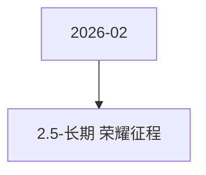

# 2.5-长期  荣耀征程 活动图谱

月份：2026-02
活动时间：未识别
活动 Wiki：https://wiki.inkept.cn/pages/viewpage.action?pageId=471957744
活动页面 ID：471957744
关联资料数：0

## 活动摘要

- 一、活动背景
- 维稳用户送礼消耗，目标维稳目标用户月消耗与2025年持平
- 二、活动时间
- 长期，月维度结算
- 三、活动详情
- 1、活动设置荣耀征程玩法，玩法设置月消耗任务，平台内每月用户达到对应消耗门槛，解锁月度福利奖励，玩法统计全平台内礼物墙中的消耗（不统计背包）
- 2、2月完成3月1日发，3月完成4月1日发
- 消耗任务门槛人数奖励奖励ID私信
- 80000052永恒双极（13140）礼物使用权、称号、勋章*1个月
- 荣耀征程  2976
- 寰宇荣耀  2185
- 礼物白名单：3026【荣耀征程】恭喜完成荣耀征程任务三，获得永恒双极礼物使用权、寰宇荣耀称号、荣耀征程勋章奖励，所有奖励有效期为自下发起至3月31日。

## 关联资料

- 无子资料页面。

## Mermaid 图谱

## 原始内容位置

- 活动主文档：`pages/02_2.5-长期_荣耀征程_471957744/content.md`
