# 2026年春节 活动图谱

月份：2026-02
活动时间：未识别
活动 Wiki：https://wiki.inkept.cn/pages/viewpage.action?pageId=462598896
活动页面 ID：462598896
关联资料数：24

## 活动摘要

- 无正文摘要，详见活动 Wiki。

## 关联资料

- [2026年春节整体方案框架梳理](https://wiki.inkept.cn/pages/viewpage.action?pageId=465477320)
  - 页面 ID：465477320
  - 本地 Markdown：`pages/03_2026年春节整体方案框架梳理_465477320/content.md`
- [2月17日-2月21日 用户福马迎春送财运](https://wiki.inkept.cn/pages/viewpage.action?pageId=471957989)
  - 页面 ID：471957989
  - 本地 Markdown：`pages/03_2月17日-2月21日_用户福马迎春送财运_471957989/content.md`
- [【数据分析需求】2026年春节](https://wiki.inkept.cn/pages/viewpage.action?pageId=462598907)
  - 页面 ID：462598907
  - 本地 Markdown：`pages/03_【数据分析需求】2026年春节_462598907/content.md`
- [主播嘉宾春节玩法](https://wiki.inkept.cn/pages/viewpage.action?pageId=476553571)
  - 页面 ID：476553571
  - 本地 Markdown：`pages/03_主播嘉宾春节玩法_476553571/content.md`
- [小用户玩法](https://wiki.inkept.cn/pages/viewpage.action?pageId=471957761)
  - 页面 ID：471957761
  - 本地 Markdown：`pages/03_小用户玩法_471957761/content.md`
- [【活动数据】2026年春节](https://wiki.inkept.cn/pages/viewpage.action?pageId=483794738)
  - 页面 ID：483794738
  - 本地 Markdown：`pages/04_【活动数据】2026年春节_483794738/content.md`
- [【资源申请】春节用户](https://wiki.inkept.cn/pages/viewpage.action?pageId=483786903)
  - 页面 ID：483786903
  - 本地 Markdown：`pages/04_【资源申请】春节用户_483786903/content.md`
- [【预算申请】春节用户预算](https://wiki.inkept.cn/pages/viewpage.action?pageId=482675268)
  - 页面 ID：482675268
  - 本地 Markdown：`pages/04_【预算申请】春节用户预算_482675268/content.md`
- [26年春节-st申请](https://wiki.inkept.cn/pages/viewpage.action?pageId=482675103)
  - 页面 ID：482675103
  - 本地 Markdown：`pages/04_26年春节-st申请_482675103/content.md`
- [26年春节预算](https://wiki.inkept.cn/pages/viewpage.action?pageId=480969095)
  - 页面 ID：480969095
  - 本地 Markdown：`pages/04_26年春节预算_480969095/content.md`
- [26春节上线申请](https://wiki.inkept.cn/pages/viewpage.action?pageId=483786929)
  - 页面 ID：483786929
  - 本地 Markdown：`pages/04_26春节上线申请_483786929/content.md`
- [数据与埋点需求](https://wiki.inkept.cn/pages/viewpage.action?pageId=482674000)
  - 页面 ID：482674000
  - 本地 Markdown：`pages/04_数据与埋点需求_482674000/content.md`
- [映币下发](https://wiki.inkept.cn/pages/viewpage.action?pageId=483885294)
  - 页面 ID：483885294
  - 本地 Markdown：`pages/04_映币下发_483885294/content.md`
- [资源礼物申请](https://wiki.inkept.cn/pages/viewpage.action?pageId=482674389)
  - 页面 ID：482674389
  - 本地 Markdown：`pages/04_资源礼物申请_482674389/content.md`
- [2.16日映币奖励下发](https://wiki.inkept.cn/pages/viewpage.action?pageId=483885298)
  - 页面 ID：483885298
  - 本地 Markdown：`pages/05_2.16日映币奖励下发_483885298/content.md`
- [2.17日映币奖励下发](https://wiki.inkept.cn/pages/viewpage.action?pageId=483885300)
  - 页面 ID：483885300
  - 本地 Markdown：`pages/05_2.17日映币奖励下发_483885300/content.md`
- [2.18日映币奖励下发](https://wiki.inkept.cn/pages/viewpage.action?pageId=483885303)
  - 页面 ID：483885303
  - 本地 Markdown：`pages/05_2.18日映币奖励下发_483885303/content.md`
- [2.19日映币奖励下发](https://wiki.inkept.cn/pages/viewpage.action?pageId=483885305)
  - 页面 ID：483885305
  - 本地 Markdown：`pages/05_2.19日映币奖励下发_483885305/content.md`
- [2.20日映币奖励下发](https://wiki.inkept.cn/pages/viewpage.action?pageId=483885307)
  - 页面 ID：483885307
  - 本地 Markdown：`pages/05_2.20日映币奖励下发_483885307/content.md`
- [2.21日映币奖励下发](https://wiki.inkept.cn/pages/viewpage.action?pageId=483885309)
  - 页面 ID：483885309
  - 本地 Markdown：`pages/05_2.21日映币奖励下发_483885309/content.md`
- [2.22日映币奖励下发](https://wiki.inkept.cn/pages/viewpage.action?pageId=483885312)
  - 页面 ID：483885312
  - 本地 Markdown：`pages/05_2.22日映币奖励下发_483885312/content.md`
- [2.23日映币奖励下发](https://wiki.inkept.cn/pages/viewpage.action?pageId=483790260)
  - 页面 ID：483790260
  - 本地 Markdown：`pages/05_2.23日映币奖励下发_483790260/content.md`
- [年中打卡奖励](https://wiki.inkept.cn/pages/viewpage.action?pageId=483790280)
  - 页面 ID：483790280
  - 本地 Markdown：`pages/05_年中打卡奖励_483790280/content.md`
- [年后打卡奖励](https://wiki.inkept.cn/pages/viewpage.action?pageId=483795282)
  - 页面 ID：483795282
  - 本地 Markdown：`pages/05_年后打卡奖励_483795282/content.md`

## Mermaid 图谱

```mermaid
graph TD
m202602["2026-02"] --> n462598896["2026年春节"]
n462598896 --> n465477320["2026年春节整体方案框架梳理"]
n462598896 --> n471957989["2月17日-2月21日 用户福马迎春送财运"]
n462598896 --> n462598907["【数据分析需求】2026年春节"]
n462598896 --> n476553571["主播嘉宾春节玩法"]
n462598896 --> n471957761["小用户玩法"]
n462598896 --> n483794738["【活动数据】2026年春节"]
n462598896 --> n483786903["【资源申请】春节用户"]
n462598896 --> n482675268["【预算申请】春节用户预算"]
n462598896 --> n482675103["26年春节-st申请"]
n462598896 --> n480969095["26年春节预算"]
n462598896 --> n483786929["26春节上线申请"]
n462598896 --> n482674000["数据与埋点需求"]
n462598896 --> n483885294["映币下发"]
n462598896 --> n482674389["资源礼物申请"]
n462598896 --> n483885298["2.16日映币奖励下发"]
n462598896 --> n483885300["2.17日映币奖励下发"]
n462598896 --> n483885303["2.18日映币奖励下发"]
n462598896 --> n483885305["2.19日映币奖励下发"]
n462598896 --> n483885307["2.20日映币奖励下发"]
n462598896 --> n483885309["2.21日映币奖励下发"]
n462598896 --> n483885312["2.22日映币奖励下发"]
n462598896 --> n483790260["2.23日映币奖励下发"]
n462598896 --> n483790280["年中打卡奖励"]
n462598896 --> n483795282["年后打卡奖励"]
```

## 原始内容位置

- 活动主文档：`pages/02_2026年春节_462598896/content.md`
- 2026年春节整体方案框架梳理：`pages/03_2026年春节整体方案框架梳理_465477320/content.md`
- 2月17日-2月21日 用户福马迎春送财运：`pages/03_2月17日-2月21日_用户福马迎春送财运_471957989/content.md`
- 【数据分析需求】2026年春节：`pages/03_【数据分析需求】2026年春节_462598907/content.md`
- 主播嘉宾春节玩法：`pages/03_主播嘉宾春节玩法_476553571/content.md`
- 小用户玩法：`pages/03_小用户玩法_471957761/content.md`
- 【活动数据】2026年春节：`pages/04_【活动数据】2026年春节_483794738/content.md`
- 【资源申请】春节用户：`pages/04_【资源申请】春节用户_483786903/content.md`
- 【预算申请】春节用户预算：`pages/04_【预算申请】春节用户预算_482675268/content.md`
- 26年春节-st申请：`pages/04_26年春节-st申请_482675103/content.md`
- 26年春节预算：`pages/04_26年春节预算_480969095/content.md`
- 26春节上线申请：`pages/04_26春节上线申请_483786929/content.md`
- 数据与埋点需求：`pages/04_数据与埋点需求_482674000/content.md`
- 映币下发：`pages/04_映币下发_483885294/content.md`
- 资源礼物申请：`pages/04_资源礼物申请_482674389/content.md`
- 2.16日映币奖励下发：`pages/05_2.16日映币奖励下发_483885298/content.md`
- 2.17日映币奖励下发：`pages/05_2.17日映币奖励下发_483885300/content.md`
- 2.18日映币奖励下发：`pages/05_2.18日映币奖励下发_483885303/content.md`
- 2.19日映币奖励下发：`pages/05_2.19日映币奖励下发_483885305/content.md`
- 2.20日映币奖励下发：`pages/05_2.20日映币奖励下发_483885307/content.md`
- 2.21日映币奖励下发：`pages/05_2.21日映币奖励下发_483885309/content.md`
- 2.22日映币奖励下发：`pages/05_2.22日映币奖励下发_483885312/content.md`
- 2.23日映币奖励下发：`pages/05_2.23日映币奖励下发_483790260/content.md`
- 年中打卡奖励：`pages/05_年中打卡奖励_483790280/content.md`
- 年后打卡奖励：`pages/05_年后打卡奖励_483795282/content.md`
