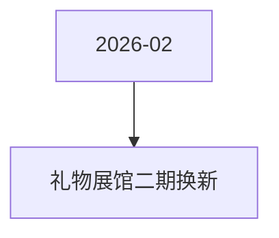

# 礼物展馆二期换新 活动图谱

月份：2026-02
活动时间：未识别
活动 Wiki：https://wiki.inkept.cn/pages/viewpage.action?pageId=470693664
活动页面 ID：470693664
关联资料数：0

## 活动摘要

- 礼物价格画风/故事线描述图片参考
- 1已
- 5已
- 5水晶苹果
- 10
- 99锦绣华球：壮锦绣球
- 288
- 蝶舞冰音：蝴蝶、唱盘、冰晶元素，蓝紫色调，梦幻华丽的画风
- 288
- 双鹊贺喜：成双喜鹊、丝带、祥云元素
- 333灵狐踏雪
- 333雪豹凌云

## 关联资料

- 无子资料页面。

## Mermaid 图谱

## 原始内容位置

- 活动主文档：`pages/02_礼物展馆二期换新_470693664/content.md`
