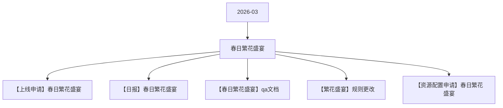

# 春日繁花盛宴 活动图谱

月份：2026-03
活动时间：3.14-3.18
活动 Wiki：https://wiki.inkept.cn/pages/viewpage.action?pageId=483790250
活动页面 ID：483790250
关联资料数：5

## 活动摘要

- 一、活动时间：
- 3月14日-3月18日
- 二  活动目标：
- 活动目标：
- 活动期间日均消耗600w，活动消耗3000w
- 礼物统计id:24126,24160,24161,24162,24163,24164,24165,24166,24167
- 所有统计的id:24126,24160,24161,24162,24163,24164,24165,24166,24167,24137,24138,24139,24140,24141,24142,24143,24144,24145,24147,24148,24149,24150
- 礼物名称价值礼物ID
- 繁花小映1888钻24126
- 金枝玉叶1024160
- 炫彩水母9924161
- 爱意定格52024162

## 关联资料

- [【上线申请】春日繁花盛宴](https://wiki.inkept.cn/pages/viewpage.action?pageId=488346138)
  - 页面 ID：488346138
  - 本地 Markdown：`pages/03_【上线申请】春日繁花盛宴_488346138/content.md`
- [【日报】春日繁花盛宴](https://wiki.inkept.cn/pages/viewpage.action?pageId=488346972)
  - 页面 ID：488346972
  - 本地 Markdown：`pages/03_【日报】春日繁花盛宴_488346972/content.md`
- [【春日繁花盛宴】qa文档](https://wiki.inkept.cn/pages/viewpage.action?pageId=488346325)
  - 页面 ID：488346325
  - 本地 Markdown：`pages/03_【春日繁花盛宴】qa文档_488346325/content.md`
- [【繁花盛宴】规则更改](https://wiki.inkept.cn/pages/viewpage.action?pageId=488346052)
  - 页面 ID：488346052
  - 本地 Markdown：`pages/03_【繁花盛宴】规则更改_488346052/content.md`
- [【资源配置申请】春日繁花盛宴](https://wiki.inkept.cn/pages/viewpage.action?pageId=488342925)
  - 页面 ID：488342925
  - 本地 Markdown：`pages/03_【资源配置申请】春日繁花盛宴_488342925/content.md`

## Mermaid 图谱

## 原始内容位置

- 活动主文档：`pages/02_3.14-3.18春日繁花盛宴_483790250/content.md`
- 【上线申请】春日繁花盛宴：`pages/03_【上线申请】春日繁花盛宴_488346138/content.md`
- 【日报】春日繁花盛宴：`pages/03_【日报】春日繁花盛宴_488346972/content.md`
- 【春日繁花盛宴】qa文档：`pages/03_【春日繁花盛宴】qa文档_488346325/content.md`
- 【繁花盛宴】规则更改：`pages/03_【繁花盛宴】规则更改_488346052/content.md`
- 【资源配置申请】春日繁花盛宴：`pages/03_【资源配置申请】春日繁花盛宴_488342925/content.md`
