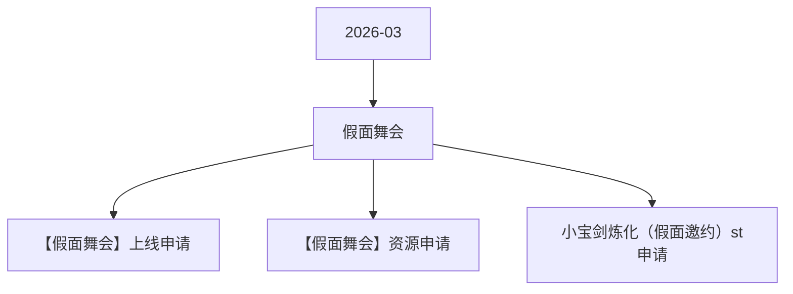

# 假面舞会 活动图谱

月份：2026-03
活动时间：3.19-3.22
活动 Wiki：https://wiki.inkept.cn/pages/viewpage.action?pageId=483795095
活动页面 ID：483795095
关联资料数：3

## 活动摘要

- 您申请的SourceType: [增加映币-赠送-活动运营-10钻版宝剑炼化-2026-03-16] 已经审批完成
- SourceType:5392
- 您申请的操作对象为：映币，请把对应的soucetype提供给“主播运营组(礼物墙管理)”，用于配置背包礼物；
- 起始时间：2026-03-16 18:29:28
- 结束时间：2027-03-16 18:29:28
- APP账单记录文案：【假面邀约】活动获得
- 是否计入送礼流水：是
- 是否计入基准流水：是
- 是否计入无背包基准映币：否
- 否计入实际映币收入：是
- 是否为赠送钻石：否
- SourceType Hash:aa7092259273546824834b33b9e315ed

## 关联资料

- [【假面舞会】上线申请](https://wiki.inkept.cn/pages/viewpage.action?pageId=488347145)
  - 页面 ID：488347145
  - 本地 Markdown：`pages/03_【假面舞会】上线申请_488347145/content.md`
- [【假面舞会】资源申请](https://wiki.inkept.cn/pages/viewpage.action?pageId=488346856)
  - 页面 ID：488346856
  - 本地 Markdown：`pages/03_【假面舞会】资源申请_488346856/content.md`
- [小宝剑炼化（假面邀约）st申请](https://wiki.inkept.cn/pages/viewpage.action?pageId=488346905)
  - 页面 ID：488346905
  - 本地 Markdown：`pages/03_小宝剑炼化（假面邀约）st申请_488346905/content.md`

## Mermaid 图谱

## 原始内容位置

- 活动主文档：`pages/02_3.19-3.22_假面舞会_483795095/content.md`
- 【假面舞会】上线申请：`pages/03_【假面舞会】上线申请_488347145/content.md`
- 【假面舞会】资源申请：`pages/03_【假面舞会】资源申请_488346856/content.md`
- 小宝剑炼化（假面邀约）st申请：`pages/03_小宝剑炼化（假面邀约）st申请_488346905/content.md`
