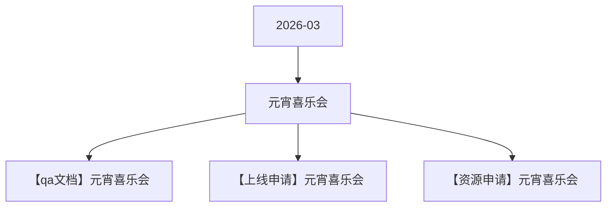

# 元宵喜乐会 活动图谱

月份：2026-03
活动时间：3.2-3.3
活动 Wiki：https://wiki.inkept.cn/pages/viewpage.action?pageId=478981921
活动页面 ID：478981921
关联资料数：3

## 活动摘要

- 原型图：https://modao.cc/proto/BJqWm6nKt9gmsf8jdcOG7D/sharing?view_mode=read_only&screen=rbpV9OJ73ZanWhsmS #未命名原型-分享
- 活动时间
- 3月2日-3月3日
- 活动逻辑
- 1、活动期间设置迎神玩法，活动期间用户送出活动专属礼物有机会迎接神仙的到来，设置1位神仙，迎接到到神仙后，用户主播双方会概率获得直播间内曝光和专属神仙资源奖励（资源上限15天）
- 礼物名称钻石数礼物id机会礼物id
- 黑芝麻元宵10240490.20%https://img.ikstatic.cn/MTY0NDgwODMzNzkzMyM0MzQjcG5n.png
- 指尖星光99240502.00%https://img.ikstatic.cn/MTc3MDM2MjA0MjE4NSM2ODMjcG5n.png
- 爱意定格5202405110.00%https://img.ikstatic.cn/MTc3MDM2MjA3ODEzNiM0NTAjcG5n.png
- 时光恋人13142405225.00%https://img.ikstatic.cn/MTc2NzA4NTc4OTcxMiM5MDAjcG5n.png
- 凤凰之约520024053100.00%https://img.ikstatic.cn/MTc2NTk0MTU5MjY1NiM3MTQjcG5n.png
- 窈窕佳人1314024054100.00%https://img.ikstatic.cn/MTc2NjY1MjY0ODkwNyM5MzUjcG5n.png

## 关联资料

- [【qa文档】元宵喜乐会](https://wiki.inkept.cn/pages/viewpage.action?pageId=483793836)
  - 页面 ID：483793836
  - 本地 Markdown：`pages/03_【qa文档】元宵喜乐会_483793836/content.md`
- [【上线申请】元宵喜乐会](https://wiki.inkept.cn/pages/viewpage.action?pageId=483793661)
  - 页面 ID：483793661
  - 本地 Markdown：`pages/03_【上线申请】元宵喜乐会_483793661/content.md`
- [【资源申请】元宵喜乐会](https://wiki.inkept.cn/pages/viewpage.action?pageId=483793314)
  - 页面 ID：483793314
  - 本地 Markdown：`pages/03_【资源申请】元宵喜乐会_483793314/content.md`

## Mermaid 图谱

## 原始内容位置

- 活动主文档：`pages/02_3.2-3.3元宵喜乐会_478981921/content.md`
- 【qa文档】元宵喜乐会：`pages/03_【qa文档】元宵喜乐会_483793836/content.md`
- 【上线申请】元宵喜乐会：`pages/03_【上线申请】元宵喜乐会_483793661/content.md`
- 【资源申请】元宵喜乐会：`pages/03_【资源申请】元宵喜乐会_483793314/content.md`
