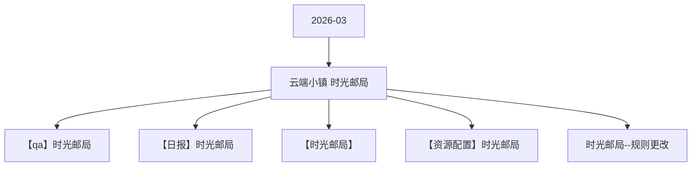

# 云端小镇  时光邮局 活动图谱

月份：2026-03
活动时间：3.23-3.26
活动 Wiki：https://wiki.inkept.cn/pages/viewpage.action?pageId=483790252
活动页面 ID：483790252
关联资料数：5

## 活动摘要

- 一、活动时间：
- 3月23日-3月26日
- 二  活动目标：
- 活动目标：
- 活动期间日均消耗600w，活动消耗2400w
- 三、活动框架
- 原型图：https://modao.cc/proto/E8KZhNbtbbk4dzwSnHPLd/sharing?view_mode=read_only&screen=rbpVCncm7aEJnfWkp #时光邮局-分享
- 名称价值礼物ID
- 飞信传情1024268https://img.ikstatic.cn/MTc3MzkwNzEyNzYzOSMgNTUjcG5n.png
- 长相思7724275https://img.ikstatic.cn/MTcyMjg0MDA0MTE1NiM4OTgjcG5n.png
- 邮来心动20024269https://img.ikstatic.cn/MTc3MzkwNzE1NDQ4MiMgNjAjcG5n.png
- 梦游仙镜52024276https://img.ikstatic.cn/MTc0MzA2MjgzMTIwMCMgNDgjcG5n.png

## 关联资料

- [【qa】时光邮局](https://wiki.inkept.cn/pages/viewpage.action?pageId=488350647)
  - 页面 ID：488350647
  - 本地 Markdown：`pages/03_【qa】时光邮局_488350647/content.md`
- [【日报】时光邮局](https://wiki.inkept.cn/pages/viewpage.action?pageId=488354300)
  - 页面 ID：488354300
  - 本地 Markdown：`pages/03_【日报】时光邮局_488354300/content.md`
- [【时光邮局】](https://wiki.inkept.cn/pages/viewpage.action?pageId=488350187)
  - 页面 ID：488350187
  - 本地 Markdown：`pages/03_【时光邮局】_488350187/content.md`
- [【资源配置】时光邮局](https://wiki.inkept.cn/pages/viewpage.action?pageId=488347360)
  - 页面 ID：488347360
  - 本地 Markdown：`pages/03_【资源配置】时光邮局_488347360/content.md`
- [时光邮局--规则更改](https://wiki.inkept.cn/pages/viewpage.action?pageId=488350220)
  - 页面 ID：488350220
  - 本地 Markdown：`pages/03_时光邮局--规则更改_488350220/content.md`

## Mermaid 图谱

## 原始内容位置

- 活动主文档：`pages/02_3.23-3.26_云端小镇_时光邮局_483790252/content.md`
- 【qa】时光邮局：`pages/03_【qa】时光邮局_488350647/content.md`
- 【日报】时光邮局：`pages/03_【日报】时光邮局_488354300/content.md`
- 【时光邮局】：`pages/03_【时光邮局】_488350187/content.md`
- 【资源配置】时光邮局：`pages/03_【资源配置】时光邮局_488347360/content.md`
- 时光邮局--规则更改：`pages/03_时光邮局--规则更改_488350220/content.md`
