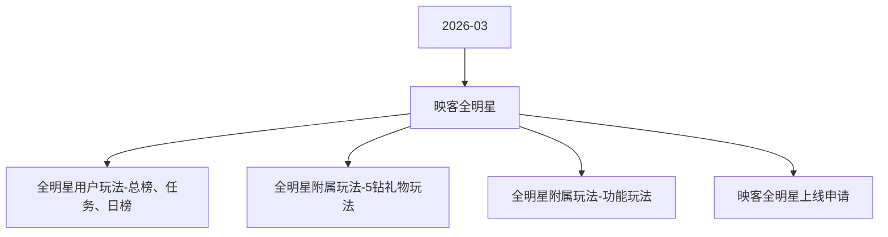

# 映客全明星 活动图谱

月份：2026-03
活动时间：3.27-3.31
活动 Wiki：https://wiki.inkept.cn/pages/viewpage.action?pageId=483789319
活动页面 ID：483789319
关联资料数：4

## 活动摘要

- 一、活动简介
- 活动目标：日均1000w钻石消耗
- 活动名称：2026年映客全明星
- 二、活动奖励
- 主播侧--核心奖励
- 特权奖励
- ai定制礼物
- 曝光及特权资源--
- 2026年第一明星头像框、映客第一明星称号、超级短位靓号、巨无霸标签
- 2026 明星主播冠亚季军
- 2026 明星嘉宾冠亚季军
- 实物–专属稀有映宝6套组合

## 关联资料

- [全明星用户玩法-总榜、任务、日榜](https://wiki.inkept.cn/pages/viewpage.action?pageId=483795467)
  - 页面 ID：483795467
  - 本地 Markdown：`pages/03_全明星用户玩法-总榜、任务、日榜_483795467/content.md`
- [全明星附属玩法-5钻礼物玩法](https://wiki.inkept.cn/pages/viewpage.action?pageId=483790731)
  - 页面 ID：483790731
  - 本地 Markdown：`pages/03_全明星附属玩法-5钻礼物玩法_483790731/content.md`
- [全明星附属玩法-功能玩法](https://wiki.inkept.cn/pages/viewpage.action?pageId=483790751)
  - 页面 ID：483790751
  - 本地 Markdown：`pages/03_全明星附属玩法-功能玩法_483790751/content.md`
- [映客全明星上线申请](https://wiki.inkept.cn/pages/viewpage.action?pageId=488352790)
  - 页面 ID：488352790
  - 本地 Markdown：`pages/03_映客全明星上线申请_488352790/content.md`

## Mermaid 图谱

## 原始内容位置

- 活动主文档：`pages/02_3.27-3.31_映客全明星_483789319/content.md`
- 全明星用户玩法-总榜、任务、日榜：`pages/03_全明星用户玩法-总榜、任务、日榜_483795467/content.md`
- 全明星附属玩法-5钻礼物玩法：`pages/03_全明星附属玩法-5钻礼物玩法_483790731/content.md`
- 全明星附属玩法-功能玩法：`pages/03_全明星附属玩法-功能玩法_483790751/content.md`
- 映客全明星上线申请：`pages/03_映客全明星上线申请_488352790/content.md`
