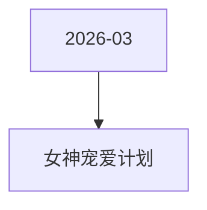

# 女神宠爱计划 活动图谱

月份：2026-03
活动时间：3.4-3.8
活动 Wiki：https://wiki.inkept.cn/pages/viewpage.action?pageId=478982297
活动页面 ID：478982297
关联资料数：0

## 活动摘要

- 1、人数根据数据重新制定，和主播对称
- 一、活动时间：
- 3月4日-3月8日
- 二  活动目标：
- 活动目标：
- 活动期间日均消耗900w，活动消耗4500w
- 三、活动框架
- 四、数据统计维度
- 数据统计维度
- 主播（主播礼）：仅统计普通视频直播间、公共直播间、PK送礼和友聊送礼渠道，其他送礼方式均不计入统计。
- 派对（嘉宾收礼）：厅主及厅内嘉宾4人视频，6人视频，9人音频房间收礼的专属礼物收入，其余方式均不计入统计。谁收算谁的。
- 五、玩法说明：

## 关联资料

- 无子资料页面。

## Mermaid 图谱

## 原始内容位置

- 活动主文档：`pages/02_3.4-3.8_女神宠爱计划_478982297/content.md`
