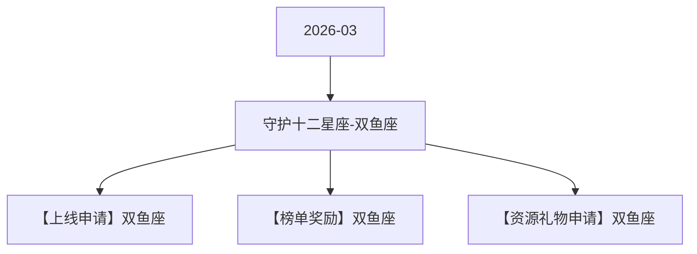

# 守护十二星座-双鱼座 活动图谱

月份：2026-03
活动时间：3.9-3.13
活动 Wiki：https://wiki.inkept.cn/pages/viewpage.action?pageId=483796478
活动页面 ID：483796478
关联资料数：3

## 活动摘要

- 后台：https://boc.inke.cn/react/tools/activity-data-query/index.html?module_name=constellation&month=202403白羊座守护者
- H5:https://boc.inke.cn/react/banner/202402/constellation/index.html?uid=22030647&sid=1&publisher=22030648
- 改规则的页面：https://boc.inke.cn/react/tools/page-config/index.html?key=banner_202402_constellation
- cj:https://boc.inke.cn/react/tools/activity-data-query/index.html?module_name=act_draw&month=200001
- 星座调整：
- 1、常规上线时长缩减至5天
- 2、更换核心奖励，分为：用户（需研发）、嘉宾、主播
- 3、用户任务调整为常规送礼任务
- 4、星座小映的钱，去做玩法：小映玩法/特殊玩法（2月上线）
- 5、对对碰同期上线
- 6、活跃任务删除
- 7、兑换任务删除

## 关联资料

- [【上线申请】双鱼座](https://wiki.inkept.cn/pages/viewpage.action?pageId=483796482)
  - 页面 ID：483796482
  - 本地 Markdown：`pages/03_【上线申请】双鱼座_483796482/content.md`
- [【榜单奖励】双鱼座](https://wiki.inkept.cn/pages/viewpage.action?pageId=483796483)
  - 页面 ID：483796483
  - 本地 Markdown：`pages/03_【榜单奖励】双鱼座_483796483/content.md`
- [【资源礼物申请】双鱼座](https://wiki.inkept.cn/pages/viewpage.action?pageId=483796484)
  - 页面 ID：483796484
  - 本地 Markdown：`pages/03_【资源礼物申请】双鱼座_483796484/content.md`

## Mermaid 图谱

## 原始内容位置

- 活动主文档：`pages/02_3.9-3.13_守护十二星座-双鱼座_483796478/content.md`
- 【上线申请】双鱼座：`pages/03_【上线申请】双鱼座_483796482/content.md`
- 【榜单奖励】双鱼座：`pages/03_【榜单奖励】双鱼座_483796483/content.md`
- 【资源礼物申请】双鱼座：`pages/03_【资源礼物申请】双鱼座_483796484/content.md`
