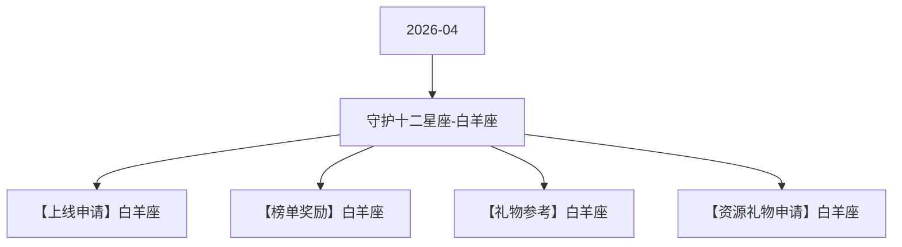

# 守护十二星座-白羊座 活动图谱

月份：2026-04
活动时间：4.11-4.15
活动 Wiki：https://wiki.inkept.cn/pages/viewpage.action?pageId=492701139
活动页面 ID：492701139
关联资料数：4

## 活动摘要

- 后台：https://boc.inke.cn/react/tools/activity-data-query/index.html?module_name=constellation&month=202403白羊座守护者
- H5:https://boc.inke.cn/react/banner/202402/constellation/index.html?uid=22030647&sid=1&publisher=22030648
- 改规则的页面：https://boc.inke.cn/react/tools/page-config/index.html?key=banner_202402_constellation
- cj:https://boc.inke.cn/react/tools/activity-data-query/index.html?module_name=act_draw&month=200001
- 星座调整：
- 1、4.11-4.15小映迭代更新，重新做新的小映礼物
- 2、加一个自动收集靓号的私信，只给总榜TOP3且积分大于30w的派对嘉宾发送
- 一、活动简介
- 活动名称：守护十二星座-对应星座；
- 活动目标：活动上线7天，活动专属礼物消耗达3500W；
- 二、活动时间
- 所有玩法统计时间均为北京时间GMT+8:00；

## 关联资料

- [【上线申请】白羊座](https://wiki.inkept.cn/pages/viewpage.action?pageId=492701143)
  - 页面 ID：492701143
  - 本地 Markdown：`pages/03_【上线申请】白羊座_492701143/content.md`
- [【榜单奖励】白羊座](https://wiki.inkept.cn/pages/viewpage.action?pageId=492701144)
  - 页面 ID：492701144
  - 本地 Markdown：`pages/03_【榜单奖励】白羊座_492701144/content.md`
- [【礼物参考】白羊座](https://wiki.inkept.cn/pages/viewpage.action?pageId=492701534)
  - 页面 ID：492701534
  - 本地 Markdown：`pages/03_【礼物参考】白羊座_492701534/content.md`
- [【资源礼物申请】白羊座](https://wiki.inkept.cn/pages/viewpage.action?pageId=492701145)
  - 页面 ID：492701145
  - 本地 Markdown：`pages/03_【资源礼物申请】白羊座_492701145/content.md`

## Mermaid 图谱

## 原始内容位置

- 活动主文档：`pages/02_4.11-4.15_守护十二星座-白羊座_492701139/content.md`
- 【上线申请】白羊座：`pages/03_【上线申请】白羊座_492701143/content.md`
- 【榜单奖励】白羊座：`pages/03_【榜单奖励】白羊座_492701144/content.md`
- 【礼物参考】白羊座：`pages/03_【礼物参考】白羊座_492701534/content.md`
- 【资源礼物申请】白羊座：`pages/03_【资源礼物申请】白羊座_492701145/content.md`
