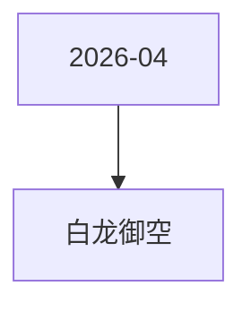

# 白龙御空 活动图谱

月份：2026-04
活动时间：4.16-4.19
活动 Wiki：https://wiki.inkept.cn/pages/viewpage.action?pageId=488343075
活动页面 ID：488343075
关联资料数：0

## 活动摘要

- 一、活动名称
- 白龙御空
- 二、活动目标
- 日均礼物消耗达到500万钻石
- 三、活动背景
- 在相对平稳阶段，设置活动，维稳大盘消耗
- 四、活动框架
- 五、活动详情
- 白龙御空
- 活动时间：4 月 16 日 00:00:00 - 4 月 19 日 23:59:59
- 玩法介绍：活动期间，用户通过累计送礼提升自身段位，段位依次为：潜龙在渊 → 云龙风虎 → 御龙凌霄，用户在对应阶段达成门槛后，解锁对应身份及阶段奖励。
- 逻辑 1：本玩法为累计送礼任务玩法，用户累计送礼达到对应阶级数值，即可解锁对应身份，并获得对应阶段奖励，同时解锁该阶段道具奖励。

## 关联资料

- 无子资料页面。

## Mermaid 图谱

## 原始内容位置

- 活动主文档：`pages/02_4.16-4.19_白龙御空_488343075/content.md`
