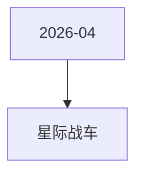

# 星际战车 活动图谱

月份：2026-04
活动时间：4.16-4.21
活动 Wiki：https://wiki.inkept.cn/pages/viewpage.action?pageId=483798772
活动页面 ID：483798772
关联资料数：0

## 活动摘要

- 您申请的SourceType: [背包礼物-赠送-平台运营组-星际战车-下发专用-2026-04-08] 已经审批完成
- SourceType:4369
- 您申请的操作对象为：背包礼物，请把对应的soucetype提供给“活动业务组”，用于下发背包礼物；
- 起始时间：2026-04-08 19:21:37
- 结束时间：2027-04-08 19:21:37
- APP账单记录文案：直播收入
- 是否计入送礼流水：是
- 是否计入基准流水：是
- 是否计入无背包基准映币：否
- 否计入实际映币收入：是
- 是否为赠送钻石：否
- SourceType Hash:bf7a91acb64dc8d6da06955997e1950b

## 关联资料

- 无子资料页面。

## Mermaid 图谱

## 原始内容位置

- 活动主文档：`pages/02_4.16-4.21_星际战车_483798772/content.md`
