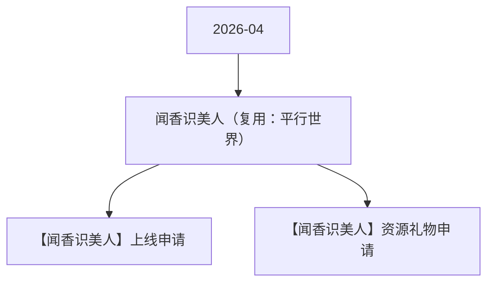

# 闻香识美人（复用：平行世界） 活动图谱

月份：2026-04
活动时间：4.7-4.10
活动 Wiki：https://wiki.inkept.cn/pages/viewpage.action?pageId=488346218
活动页面 ID：488346218
关联资料数：2

## 活动摘要

- 更改点如下：
- 1、活动主题更改：设计换肤
- 2、活动时间更改
- 3、活动资源奖励更改（整体逻辑不变）
- 一、活动目标：
- 活动消耗达到5500万钻石
- 二、活动时间
- 2025年8月5日00:00:00-8月9日23:59:59（所有玩法统计时间均为北京时间GMT+8:00）
- 三、数据统计维度：
- 个人主播收礼（主播）：仅统计普通视频直播间、公共直播间、PK送礼和友聊送礼渠道，其他送礼方式均不计入统计。
- 嘉宾收礼：厅主及厅内嘉宾4人视频，6人视频，9人音频房间收礼专属礼物收入，其余方式均不计入统计。谁收算谁。
- 四、原型图：

## 关联资料

- [【闻香识美人】上线申请](https://wiki.inkept.cn/pages/viewpage.action?pageId=492712165)
  - 页面 ID：492712165
  - 本地 Markdown：`pages/03_【闻香识美人】上线申请_492712165/content.md`
- [【闻香识美人】资源礼物申请](https://wiki.inkept.cn/pages/viewpage.action?pageId=492702045)
  - 页面 ID：492702045
  - 本地 Markdown：`pages/03_【闻香识美人】资源礼物申请_492702045/content.md`

## Mermaid 图谱

## 原始内容位置

- 活动主文档：`pages/02_4.7-4.10_闻香识美人（复用：平行世界）_488346218/content.md`
- 【闻香识美人】上线申请：`pages/03_【闻香识美人】上线申请_492712165/content.md`
- 【闻香识美人】资源礼物申请：`pages/03_【闻香识美人】资源礼物申请_492702045/content.md`
