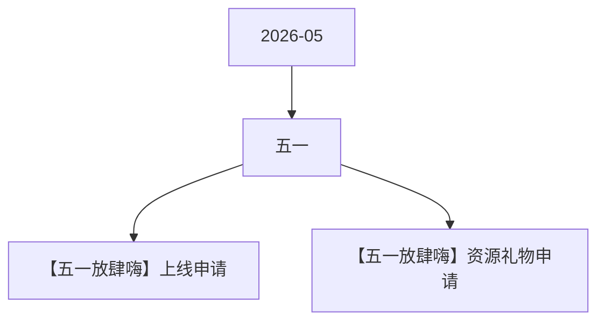

# 五一 活动图谱

月份：2026-05
活动时间：4.29-5.5
活动 Wiki：https://wiki.inkept.cn/pages/viewpage.action?pageId=492718967
活动页面 ID：492718967
关联资料数：2

## 活动摘要

- 一、活动目标：
- 参考去年五一及国庆期间趋势，日均有效开播人数环比活动前下降幅度控制在7%以内
- 二、活动时间
- 2026年4月29日00:00:00-5月5日23:59:59（所有玩法统计时间均为北京时间GMT+8:00）
- 数据统计维度：
- 个人主播收礼（主播）：仅统计普通视频直播间、公共直播间、PK送礼和友聊送礼渠道，其他送礼方式均不计入统计。
- 嘉宾收礼：厅主及厅内嘉宾4人视频，6人视频，9人音频房间收礼的专属礼物收入，其余方式均不计入统计。谁收算谁的。
- 三、活动框架：
- 原型：https://modao.cc/proto/4yjWOOZctd9tswslRHC1R3/sharing?view_mode=read_only&screen=rbpUhrFrwnmRm1KUj #26年五一-分享
- 四、玩法详情：
- 主播活跃：
- 一、【秀场主播】开播收礼得兑换点任务：主播完成每日的开播时长+收礼任务，得对应挡位的兑换点。兑换点每个档位实时下发。任务每日不循环。

## 关联资料

- [【五一放肆嗨】上线申请](https://wiki.inkept.cn/pages/viewpage.action?pageId=497224198)
  - 页面 ID：497224198
  - 本地 Markdown：`pages/03_【五一放肆嗨】上线申请_497224198/content.md`
- [【五一放肆嗨】资源礼物申请](https://wiki.inkept.cn/pages/viewpage.action?pageId=497222848)
  - 页面 ID：497222848
  - 本地 Markdown：`pages/03_【五一放肆嗨】资源礼物申请_497222848/content.md`

## Mermaid 图谱

## 原始内容位置

- 活动主文档：`pages/02_4.29-5.5_五一_492718967/content.md`
- 【五一放肆嗨】上线申请：`pages/03_【五一放肆嗨】上线申请_497224198/content.md`
- 【五一放肆嗨】资源礼物申请：`pages/03_【五一放肆嗨】资源礼物申请_497222848/content.md`
