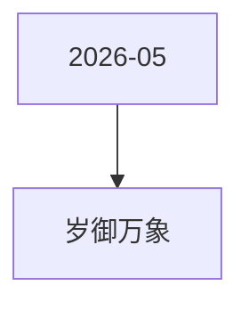

# 岁御万象 活动图谱

月份：2026-05
活动时间：5.11-5.14
活动 Wiki：https://wiki.inkept.cn/pages/viewpage.action?pageId=492719910
活动页面 ID：492719910
关联资料数：0

## 活动摘要

- 一、活动名称
- 岁御万象
- 二、活动目标
- 日均礼物消耗达到500万钻石
- 三、活动背景
- 在相对平稳阶段，设置活动，维稳大盘消耗
- 岁御万象
- 活动时间：5 月 11 日 00:00:00 - 5 月 14 日 23:59:59
- 逻辑 1：本玩法为累计送礼任务玩法，用户累计送礼达到对应阶级数值，即可解锁对应身份，并获得对应阶段奖励，同时解锁该阶段道具奖励。
- 逻辑 2：所有奖励实时下发至用户账户，奖励有效期按照对应资源规则统一计算。
- 任务机制：本任务为循环任务，用户完成当前阶段任务后，可重新进入下一循环，继续完成任务并领取对应阶段奖励。
- 循环后进度条重置为 0，保留「循环次数」展示（如：已完成 X 轮）

## 关联资料

- 无子资料页面。

## Mermaid 图谱

## 原始内容位置

- 活动主文档：`pages/02_5.11-5.14_岁御万象_492719910/content.md`
