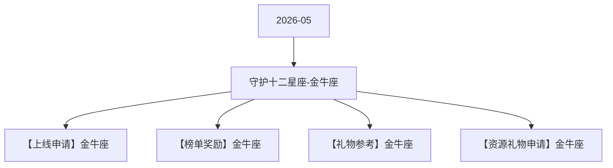

# 守护十二星座-金牛座 活动图谱

月份：2026-05
活动时间：5.11-5.15
活动 Wiki：https://wiki.inkept.cn/pages/viewpage.action?pageId=499518241
活动页面 ID：499518241
关联资料数：4

## 活动摘要

- 后台：https://boc.inke.cn/react/tools/activity-data-query/index.html?module_name=constellation&month=202403金牛座守护者
- H5:https://boc.inke.cn/react/banner/202402/constellation/index.html?uid=22030647&sid=1&publisher=22030648
- 改规则的页面：https://boc.inke.cn/react/tools/page-config/index.html?key=banner_202402_constellation
- cj:https://boc.inke.cn/react/tools/activity-data-query/index.html?module_name=act_draw&month=200001
- 一、活动简介
- 活动名称：守护十二星座-对应星座；
- 活动目标：活动上线7天，活动专属礼物消耗达3500W；
- 二、活动时间
- 所有玩法统计时间均为北京时间GMT+8:00；
- 数据统计时间：每个月月末的最后七天
- 金牛座
- 三、数据统计维度

## 关联资料

- [【上线申请】金牛座](https://wiki.inkept.cn/pages/viewpage.action?pageId=499518245)
  - 页面 ID：499518245
  - 本地 Markdown：`pages/03_【上线申请】金牛座_499518245/content.md`
- [【榜单奖励】金牛座](https://wiki.inkept.cn/pages/viewpage.action?pageId=499518246)
  - 页面 ID：499518246
  - 本地 Markdown：`pages/03_【榜单奖励】金牛座_499518246/content.md`
- [【礼物参考】金牛座](https://wiki.inkept.cn/pages/viewpage.action?pageId=499518247)
  - 页面 ID：499518247
  - 本地 Markdown：`pages/03_【礼物参考】金牛座_499518247/content.md`
- [【资源礼物申请】金牛座](https://wiki.inkept.cn/pages/viewpage.action?pageId=499518325)
  - 页面 ID：499518325
  - 本地 Markdown：`pages/03_【资源礼物申请】金牛座_499518325/content.md`

## Mermaid 图谱

## 原始内容位置

- 活动主文档：`pages/02_5.11-5.15_守护十二星座-金牛座_499518241/content.md`
- 【上线申请】金牛座：`pages/03_【上线申请】金牛座_499518245/content.md`
- 【榜单奖励】金牛座：`pages/03_【榜单奖励】金牛座_499518246/content.md`
- 【礼物参考】金牛座：`pages/03_【礼物参考】金牛座_499518247/content.md`
- 【资源礼物申请】金牛座：`pages/03_【资源礼物申请】金牛座_499518325/content.md`
