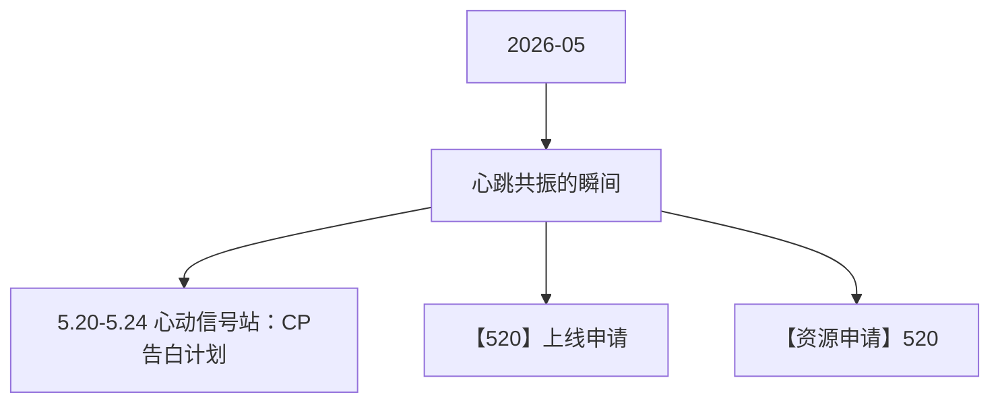

# 心跳共振的瞬间 活动图谱

月份：2026-05
活动时间：5.19-5.21
活动 Wiki：https://wiki.inkept.cn/pages/viewpage.action?pageId=492731523
活动页面 ID：492731523
关联资料数：3

## 活动摘要

- 一、活动目标：
- 活动消耗达到2400万钻石，日均消耗800w钻
- 二、活动时间
- 2026年5月19日00:00:00-5月21日23:59:59（所有玩法统计时间均为北京时间GMT+8:00）
- 三、数据统计维度：
- 个人主播收礼（主播）：仅统计普通视频直播间、公共直播间、PK送礼和友聊送礼渠道，其他送礼方式均不计入统计。
- 嘉宾收礼：厅主及厅内嘉宾4人视频，6人视频，9人音频房间收礼专属礼物收入，其余方式均不计入统计。谁收算谁。
- 四、原型图：
- 原型图： https://modao.cc/proto/77sZ3Kutduexc1R6cpvU/sharing?view_mode=read_only&screen=rbpVHQV2688xBWfgm #520-分享
- 五、玩法详情：
- 1、全程核心玩法--1V1的CP日循环任务
- 玩法时间：5月19日00:00:00-5月21日23:59:59

## 关联资料

- [5.20-5.24 心动信号站：CP告白计划](https://wiki.inkept.cn/pages/viewpage.action?pageId=502073993)
  - 页面 ID：502073993
  - 本地 Markdown：`pages/03_5.20-5.24_心动信号站：CP告白计划_502073993/content.md`
- [【520】上线申请](https://wiki.inkept.cn/pages/viewpage.action?pageId=502071955)
  - 页面 ID：502071955
  - 本地 Markdown：`pages/03_【520】上线申请_502071955/content.md`
- [【资源申请】520](https://wiki.inkept.cn/pages/viewpage.action?pageId=499523519)
  - 页面 ID：499523519
  - 本地 Markdown：`pages/03_【资源申请】520_499523519/content.md`

## Mermaid 图谱

## 原始内容位置

- 活动主文档：`pages/02_5.19-5.21_心跳共振的瞬间_492731523/content.md`
- 5.20-5.24 心动信号站：CP告白计划：`pages/03_5.20-5.24_心动信号站：CP告白计划_502073993/content.md`
- 【520】上线申请：`pages/03_【520】上线申请_502071955/content.md`
- 【资源申请】520：`pages/03_【资源申请】520_499523519/content.md`
