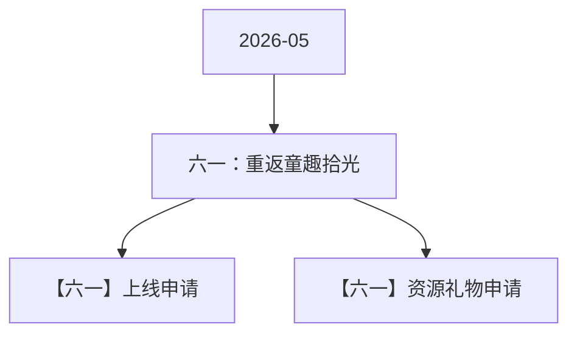

# 六一：重返童趣拾光 活动图谱

月份：2026-05
活动时间：5.30-6.1
活动 Wiki：https://wiki.inkept.cn/pages/viewpage.action?pageId=499520103
活动页面 ID：499520103
关联资料数：2

## 活动摘要

- 一、活动目标：
- 日均消耗700w钻石
- 二、活动时间
- 2026年5月30日00:00:00-6月1日23:59:59（所有玩法统计时间均为北京时间GMT+8:00）
- 数据统计维度：
- 个人主播收礼（主播）：仅统计普通视频直播间、公共直播间、PK送礼和友聊送礼渠道，其他送礼方式均不计入统计。
- 嘉宾收礼：厅主及厅内嘉宾4人视频，6人视频，9人音频房间收礼的专属礼物收入，其余方式均不计入统计。谁收算谁的。
- 三、活动框架：
- 原型： https://modao.cc/proto/0dXIZsQItexb1h4SDqvn0B/sharing?view_mode=read_only&screen=rbpVJPIgOsBQtLBxU #六一-分享
- 四、玩法详情：
- 一、用户主线的3日累计循环送礼任务
- 玩法统计时间：2026年5月30日00:00:00-6月1日23:59:59

## 关联资料

- [【六一】上线申请](https://wiki.inkept.cn/pages/viewpage.action?pageId=504171958)
  - 页面 ID：504171958
  - 本地 Markdown：`pages/03_【六一】上线申请_504171958/content.md`
- [【六一】资源礼物申请](https://wiki.inkept.cn/pages/viewpage.action?pageId=504168849)
  - 页面 ID：504168849
  - 本地 Markdown：`pages/03_【六一】资源礼物申请_504168849/content.md`

## Mermaid 图谱

## 原始内容位置

- 活动主文档：`pages/02_5.30-6.1_六一：重返童趣拾光_499520103/content.md`
- 【六一】上线申请：`pages/03_【六一】上线申请_504171958/content.md`
- 【六一】资源礼物申请：`pages/03_【六一】资源礼物申请_504168849/content.md`
