# 2026年-527 活动图谱

月份：2026-05
活动时间：未识别
活动 Wiki：https://wiki.inkept.cn/pages/viewpage.action?pageId=492700808
活动页面 ID：492700808
关联资料数：27

## 活动摘要

- 无正文摘要，详见活动 Wiki。

## 关联资料

- [2026-527研发文档](https://wiki.inkept.cn/pages/viewpage.action?pageId=492718684)
  - 页面 ID：492718684
  - 本地 Markdown：`pages/03_2026-527研发文档_492718684/content.md`
- [2026年-527  宣讲文档](https://wiki.inkept.cn/pages/viewpage.action?pageId=492700810)
  - 页面 ID：492700810
  - 本地 Markdown：`pages/03_2026年-527_宣讲文档_492700810/content.md`
- [2026年527年度正赛上线同步](https://wiki.inkept.cn/pages/viewpage.action?pageId=499520367)
  - 页面 ID：499520367
  - 本地 Markdown：`pages/03_2026年527年度正赛上线同步_499520367/content.md`
- [2026年527数据埋点](https://wiki.inkept.cn/pages/viewpage.action?pageId=499518915)
  - 页面 ID：499518915
  - 本地 Markdown：`pages/03_2026年527数据埋点_499518915/content.md`
- [【映客527】预算申请](https://wiki.inkept.cn/pages/viewpage.action?pageId=502077718)
  - 页面 ID：502077718
  - 本地 Markdown：`pages/03_【映客527】预算申请_502077718/content.md`
- [【资源配置】-2026年527资源申请-平台运营组-20260429](https://wiki.inkept.cn/pages/viewpage.action?pageId=497224384)
  - 页面 ID：497224384
  - 本地 Markdown：`pages/03_【资源配置】-2026年527资源申请-平台运营组-20260429_497224384/content.md`
- [问题点](https://wiki.inkept.cn/pages/viewpage.action?pageId=499519696)
  - 页面 ID：499519696
  - 本地 Markdown：`pages/03_问题点_499519696/content.md`
- [2026-527上线申请](https://wiki.inkept.cn/pages/viewpage.action?pageId=499520364)
  - 页面 ID：499520364
  - 本地 Markdown：`pages/04_2026-527上线申请_499520364/content.md`
- [2026-527主播赛区](https://wiki.inkept.cn/pages/viewpage.action?pageId=492718007)
  - 页面 ID：492718007
  - 本地 Markdown：`pages/04_2026-527主播赛区_492718007/content.md`
- [2026-527人气赛区](https://wiki.inkept.cn/pages/viewpage.action?pageId=492718690)
  - 页面 ID：492718690
  - 本地 Markdown：`pages/04_2026-527人气赛区_492718690/content.md`
- [2026-527公会赛区](https://wiki.inkept.cn/pages/viewpage.action?pageId=492718705)
  - 页面 ID：492718705
  - 本地 Markdown：`pages/04_2026-527公会赛区_492718705/content.md`
- [2026-527功能玩法](https://wiki.inkept.cn/pages/viewpage.action?pageId=492718688)
  - 页面 ID：492718688
  - 本地 Markdown：`pages/04_2026-527功能玩法_492718688/content.md`
- [2026-527日报](https://wiki.inkept.cn/pages/viewpage.action?pageId=502071947)
  - 页面 ID：502071947
  - 本地 Markdown：`pages/04_2026-527日报_502071947/content.md`
- [2026-527派对赛区](https://wiki.inkept.cn/pages/viewpage.action?pageId=492718692)
  - 页面 ID：492718692
  - 本地 Markdown：`pages/04_2026-527派对赛区_492718692/content.md`
- [2026-527用户赛区](https://wiki.inkept.cn/pages/viewpage.action?pageId=492718695)
  - 页面 ID：492718695
  - 本地 Markdown：`pages/04_2026-527用户赛区_492718695/content.md`
- [2026-527礼物玩法](https://wiki.inkept.cn/pages/viewpage.action?pageId=492718947)
  - 页面 ID：492718947
  - 本地 Markdown：`pages/04_2026-527礼物玩法_492718947/content.md`
- [2026-527陪陪赛区](https://wiki.inkept.cn/pages/viewpage.action?pageId=492718697)
  - 页面 ID：492718697
  - 本地 Markdown：`pages/04_2026-527陪陪赛区_492718697/content.md`
- [2026年527规则](https://wiki.inkept.cn/pages/viewpage.action?pageId=499519094)
  - 页面 ID：499519094
  - 本地 Markdown：`pages/04_2026年527规则_499519094/content.md`
- [活动页面链接-2026-527](https://wiki.inkept.cn/pages/viewpage.action?pageId=499520143)
  - 页面 ID：499520143
  - 本地 Markdown：`pages/04_活动页面链接-2026-527_499520143/content.md`
- [2026年527-宣讲](https://wiki.inkept.cn/pages/viewpage.action?pageId=492701043)
  - 页面 ID：492701043
  - 本地 Markdown：`pages/04_2026年527-宣讲_492701043/content.md`
- [【映客527】数据日报DAY11-2026](https://wiki.inkept.cn/pages/viewpage.action?pageId=504168506)
  - 页面 ID：504168506
  - 本地 Markdown：`pages/05_【映客527】数据日报DAY11-2026_504168506/content.md`
- [【映客527】数据日报DAY13-2026](https://wiki.inkept.cn/pages/viewpage.action?pageId=504172884)
  - 页面 ID：504172884
  - 本地 Markdown：`pages/05_【映客527】数据日报DAY13-2026_504172884/content.md`
- [【映客527】数据日报DAY4-2026](https://wiki.inkept.cn/pages/viewpage.action?pageId=502071949)
  - 页面 ID：502071949
  - 本地 Markdown：`pages/05_【映客527】数据日报DAY4-2026_502071949/content.md`
- [【映客527】数据日报DAY6-2026](https://wiki.inkept.cn/pages/viewpage.action?pageId=502073980)
  - 页面 ID：502073980
  - 本地 Markdown：`pages/05_【映客527】数据日报DAY6-2026_502073980/content.md`
- [【映客527】数据日报DAY7-2026](https://wiki.inkept.cn/pages/viewpage.action?pageId=502077763)
  - 页面 ID：502077763
  - 本地 Markdown：`pages/05_【映客527】数据日报DAY7-2026_502077763/content.md`
- [【映客527】数据日报两年对比](https://wiki.inkept.cn/pages/viewpage.action?pageId=504172890)
  - 页面 ID：504172890
  - 本地 Markdown：`pages/05_【映客527】数据日报两年对比_504172890/content.md`
- [功能ST申请](https://wiki.inkept.cn/pages/viewpage.action?pageId=497223784)
  - 页面 ID：497223784
  - 本地 Markdown：`pages/05_功能ST申请_497223784/content.md`

## Mermaid 图谱

```mermaid
graph TD
m202605["2026-05"] --> n492700808["2026年-527"]
n492700808 --> n492718684["2026-527研发文档"]
n492700808 --> n492700810["2026年-527  宣讲文档"]
n492700808 --> n499520367["2026年527年度正赛上线同步"]
n492700808 --> n499518915["2026年527数据埋点"]
n492700808 --> n502077718["【映客527】预算申请"]
n492700808 --> n497224384["【资源配置】-2026年527资源申请-平台运营组-20260429"]
n492700808 --> n499519696["问题点"]
n492700808 --> n499520364["2026-527上线申请"]
n492700808 --> n492718007["2026-527主播赛区"]
n492700808 --> n492718690["2026-527人气赛区"]
n492700808 --> n492718705["2026-527公会赛区"]
n492700808 --> n492718688["2026-527功能玩法"]
n492700808 --> n502071947["2026-527日报"]
n492700808 --> n492718692["2026-527派对赛区"]
n492700808 --> n492718695["2026-527用户赛区"]
n492700808 --> n492718947["2026-527礼物玩法"]
n492700808 --> n492718697["2026-527陪陪赛区"]
n492700808 --> n499519094["2026年527规则"]
n492700808 --> n499520143["活动页面链接-2026-527"]
n492700808 --> n492701043["2026年527-宣讲"]
n492700808 --> n504168506["【映客527】数据日报DAY11-2026"]
n492700808 --> n504172884["【映客527】数据日报DAY13-2026"]
n492700808 --> n502071949["【映客527】数据日报DAY4-2026"]
n492700808 --> n502073980["【映客527】数据日报DAY6-2026"]
n492700808 --> n502077763["【映客527】数据日报DAY7-2026"]
n492700808 --> n504172890["【映客527】数据日报两年对比"]
n492700808 --> n497223784["功能ST申请"]
```

## 原始内容位置

- 活动主文档：`pages/02_2026年-527_492700808/content.md`
- 2026-527研发文档：`pages/03_2026-527研发文档_492718684/content.md`
- 2026年-527  宣讲文档：`pages/03_2026年-527_宣讲文档_492700810/content.md`
- 2026年527年度正赛上线同步：`pages/03_2026年527年度正赛上线同步_499520367/content.md`
- 2026年527数据埋点：`pages/03_2026年527数据埋点_499518915/content.md`
- 【映客527】预算申请：`pages/03_【映客527】预算申请_502077718/content.md`
- 【资源配置】-2026年527资源申请-平台运营组-20260429：`pages/03_【资源配置】-2026年527资源申请-平台运营组-20260429_497224384/content.md`
- 问题点：`pages/03_问题点_499519696/content.md`
- 2026-527上线申请：`pages/04_2026-527上线申请_499520364/content.md`
- 2026-527主播赛区：`pages/04_2026-527主播赛区_492718007/content.md`
- 2026-527人气赛区：`pages/04_2026-527人气赛区_492718690/content.md`
- 2026-527公会赛区：`pages/04_2026-527公会赛区_492718705/content.md`
- 2026-527功能玩法：`pages/04_2026-527功能玩法_492718688/content.md`
- 2026-527日报：`pages/04_2026-527日报_502071947/content.md`
- 2026-527派对赛区：`pages/04_2026-527派对赛区_492718692/content.md`
- 2026-527用户赛区：`pages/04_2026-527用户赛区_492718695/content.md`
- 2026-527礼物玩法：`pages/04_2026-527礼物玩法_492718947/content.md`
- 2026-527陪陪赛区：`pages/04_2026-527陪陪赛区_492718697/content.md`
- 2026年527规则：`pages/04_2026年527规则_499519094/content.md`
- 活动页面链接-2026-527：`pages/04_活动页面链接-2026-527_499520143/content.md`
- 2026年527-宣讲：`pages/04_2026年527-宣讲_492701043/content.md`
- 【映客527】数据日报DAY11-2026：`pages/05_【映客527】数据日报DAY11-2026_504168506/content.md`
- 【映客527】数据日报DAY13-2026：`pages/05_【映客527】数据日报DAY13-2026_504172884/content.md`
- 【映客527】数据日报DAY4-2026：`pages/05_【映客527】数据日报DAY4-2026_502071949/content.md`
- 【映客527】数据日报DAY6-2026：`pages/05_【映客527】数据日报DAY6-2026_502073980/content.md`
- 【映客527】数据日报DAY7-2026：`pages/05_【映客527】数据日报DAY7-2026_502077763/content.md`
- 【映客527】数据日报两年对比：`pages/05_【映客527】数据日报两年对比_504172890/content.md`
- 功能ST申请：`pages/05_功能ST申请_497223784/content.md`
