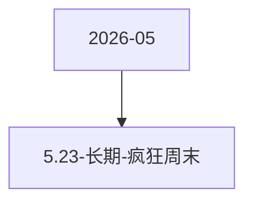

# 5.23-长期-疯狂周末 活动图谱

月份：2026-05
活动时间：未识别
活动 Wiki：https://wiki.inkept.cn/pages/viewpage.action?pageId=492731518
活动页面 ID：492731518
关联资料数：0

## 活动摘要

- 一、活动名称
- 疯狂周末
- 二、活动背景
- 针对周末消耗较低，且消耗不够连续的情况，设置玩法
- 三、活动目标
- 日均礼物消耗达到150万钻石
- 四、活动详情
- 活动时间：同整体活动时间，每周末限时开启（以服务器时间为准）
- 玩法一
- 活动设置价值188钻专属玩法礼物，用户送出后：
- 主播直接获得 1 钻石，剩余182钻石进入玩法中
- 系统根据用户当前状态进行随机奖励，奖励直接下发至主播账户，若为普通情况，则根据奖励-1进行随机，若为双倍情况，则根据奖励-2进行随机。

## 关联资料

- 无子资料页面。

## Mermaid 图谱

## 原始内容位置

- 活动主文档：`pages/02_5.23-长期-疯狂周末_492731518/content.md`
