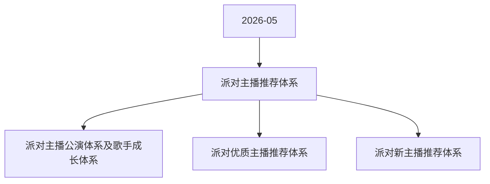

# 派对主播推荐体系 活动图谱

月份：2026-05
活动时间：未识别
活动 Wiki：https://wiki.inkept.cn/pages/viewpage.action?pageId=488355586
活动页面 ID：488355586
关联资料数：3

## 活动摘要

- 无正文摘要，详见活动 Wiki。

## 关联资料

- [派对主播公演体系及歌手成长体系](https://wiki.inkept.cn/pages/viewpage.action?pageId=488347342)
  - 页面 ID：488347342
  - 本地 Markdown：`pages/03_派对主播公演体系及歌手成长体系_488347342/content.md`
- [派对优质主播推荐体系](https://wiki.inkept.cn/pages/viewpage.action?pageId=488347345)
  - 页面 ID：488347345
  - 本地 Markdown：`pages/03_派对优质主播推荐体系_488347345/content.md`
- [派对新主播推荐体系](https://wiki.inkept.cn/pages/viewpage.action?pageId=488347347)
  - 页面 ID：488347347
  - 本地 Markdown：`pages/03_派对新主播推荐体系_488347347/content.md`

## Mermaid 图谱

## 原始内容位置

- 活动主文档：`pages/02_派对主播推荐体系_488355586/content.md`
- 派对主播公演体系及歌手成长体系：`pages/03_派对主播公演体系及歌手成长体系_488347342/content.md`
- 派对优质主播推荐体系：`pages/03_派对优质主播推荐体系_488347345/content.md`
- 派对新主播推荐体系：`pages/03_派对新主播推荐体系_488347347/content.md`
