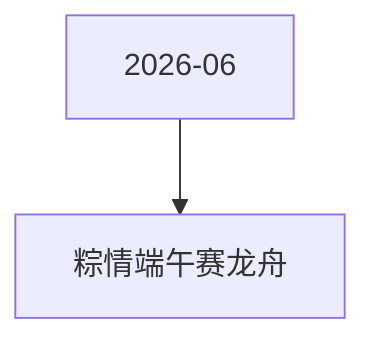

# 粽情端午赛龙舟 活动图谱

月份：2026-06
活动时间：6.19-6.22
活动 Wiki：https://wiki.inkept.cn/pages/viewpage.action?pageId=504168550
活动页面 ID：504168550
关联资料数：0

## 活动摘要

- 一、活动目标
- 活动期间日均消耗达到 800万钻石，4天累计消耗目标 3200万钻石。
- 二、活动时间
- 2026年6月19日00:00:00 - 2026年6月22日23:59:59
- 所有玩法统计时间均为北京时间 GMT+8:00。
- 三、数据统计维度
- 主播收礼：仅统计普通视频直播间、公共直播间、PK送礼和友聊送礼渠道，其他送礼方式均不计入统计。
- 嘉宾收礼：仅统计厅主及厅内嘉宾 4/6/9 人房间收取的活动专属礼物收入，谁收算谁的。
- 用户送礼：仅统计活动专属礼物及活动指定特殊礼物。
- 活动换算口径：
- 主播每收礼满 21钻，龙舟前进 1米
- 用户每送礼满 21钻，获得 1次开粽机会

## 关联资料

- 无子资料页面。

## Mermaid 图谱

## 原始内容位置

- 活动主文档：`pages/02_6.19-6.22_粽情端午赛龙舟_504168550/content.md`
