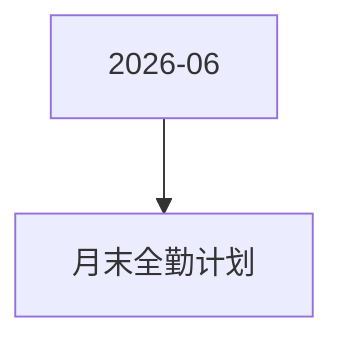

# 月末全勤计划 活动图谱

月份：2026-06
活动时间：6.21-6.30
活动 Wiki：https://wiki.inkept.cn/pages/viewpage.action?pageId=504173152
活动页面 ID：504173152
关联资料数：0

## 活动摘要

- wiki：https://modao.cc/app/gie9wZwNtfztpnIoUhibzx #月末全勤计划-分享
- 一、活动基础信息
- 1. 活动定位
- 活动类型：活跃活动
- 活动主线：自我超越任务+打卡+积分兑换+全勤奖励
- 活动目的：维稳中腰部主播活跃
- 2. 活动时间
- 活动开始时间：2026-06-21 00:00:00
- 活动结束时间：2026-06-30 23:59:59
- 全勤统计时间：2026-06-21 00:00:00 - 2026-06-30 23:59:59
- 积分兑换时间：2026-06-21 00:00:00 - 2026-06-30 23:59:59
- 所有玩法统计时间：北京时间GMT+8

## 关联资料

- 无子资料页面。

## Mermaid 图谱

## 原始内容位置

- 活动主文档：`pages/02_6.21-6.30_月末全勤计划_504173152/content.md`
