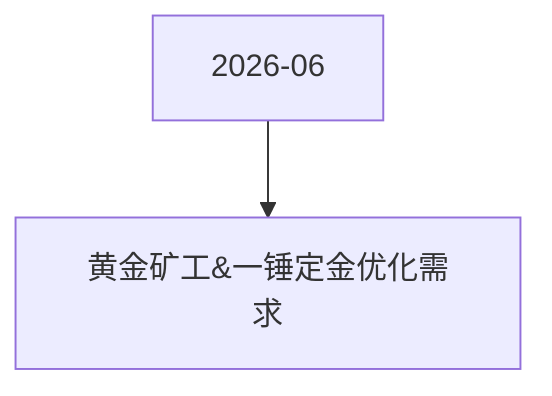

# 黄金矿工&一锤定金优化需求 活动图谱

月份：2026-06
活动时间：6.26-6.30
活动 Wiki：https://wiki.inkept.cn/pages/viewpage.action?pageId=504172887
活动页面 ID：504172887
关联资料数：0

## 活动摘要

- 一、活动名称：黄金矿工
- 二、活动时间：
- 数据统计时间： 长期
- 页面展示时间： 长期
- 三、数据统计维度： 统计直播间维度： 各类型直播间均计入统计，不进行区分； 用户送礼统计维度： 仅统计用户在直播间内送出礼物（普通视频、公共直播间、游戏、电台、四六八九多人直播间、PK、友聊、私密），私信渠道不计入；
- 四、活动逻辑
- 1、暴击礼物玩法：
- 1、用户在主播直播间送出暴击礼物，礼物价值5映币，主播收到1映币，另外4映币进入奖池，用户在送出暴击礼物的同时有获得额外钻石奖 励，钻石奖励以背包礼物的形式直接下发至用户背包中；用户触发暴击时：
- 下发私信：【黄金矿工】恭喜宝宝触发XX礼物（N钻）%S（倍数）暴击，暴击奖励%S（示意：背包礼物棒棒糖（1钻）*4）已下发至我的背包中，请至背包中查看具体信息。
- 触发直播间仅用户可见公聊---用户和主播可见：【黄金矿工】恭喜宝宝触发XX礼物（N钻）%S（倍数）暴击，暴击奖励%S已下发至我的背包中，请至背包中查看具体信息。
- 触发活动页面飘屏（活动开始时设置假数据；）：恭喜%S（用户昵称）触发%S（倍数）暴击，获得%S奖励内容。
- 特殊处理点1：---2钻百倍触发频率调整（10分钟/20分钟首次）、文案展示做区分、文案展示出对应礼物和获得的背包价值、活动页面区分展示样式（同文案）

## 关联资料

- 无子资料页面。

## Mermaid 图谱

## 原始内容位置

- 活动主文档：`pages/02_6.26-6.30_黄金矿工&一锤定金优化需求_504172887/content.md`
