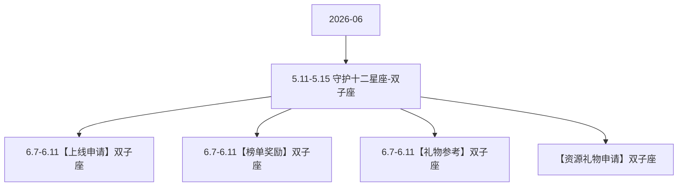

# 5.11-5.15 守护十二星座-双子座 活动图谱

月份：2026-06
活动时间：6.7-6.11
活动 Wiki：https://wiki.inkept.cn/pages/viewpage.action?pageId=504173421
活动页面 ID：504173421
关联资料数：4

## 活动摘要

- 后台：https://boc.inke.cn/react/tools/activity-data-query/index.html?module_name=constellation&month=202403金牛座守护者
- H5:https://boc.inke.cn/react/banner/202402/constellation/index.html?uid=22030647&sid=1&publisher=22030648
- 改规则的页面：https://boc.inke.cn/react/tools/page-config/index.html?key=banner_202402_constellation
- cj:https://boc.inke.cn/react/tools/activity-data-query/index.html?module_name=act_draw&month=200001
- 一、活动简介
- 活动名称：守护十二星座-对应星座；
- 活动目标：活动上线7天，活动专属礼物消耗达3500W；
- 二、活动时间
- 所有玩法统计时间均为北京时间GMT+8:00；
- 数据统计时间：每个月月末的最后七天
- 金牛座
- 三、数据统计维度

## 关联资料

- [6.7-6.11【上线申请】双子座](https://wiki.inkept.cn/pages/viewpage.action?pageId=504173425)
  - 页面 ID：504173425
  - 本地 Markdown：`pages/03_6.7-6.11【上线申请】双子座_504173425/content.md`
- [6.7-6.11【榜单奖励】双子座](https://wiki.inkept.cn/pages/viewpage.action?pageId=504173426)
  - 页面 ID：504173426
  - 本地 Markdown：`pages/03_6.7-6.11【榜单奖励】双子座_504173426/content.md`
- [6.7-6.11【礼物参考】双子座](https://wiki.inkept.cn/pages/viewpage.action?pageId=504173427)
  - 页面 ID：504173427
  - 本地 Markdown：`pages/03_6.7-6.11【礼物参考】双子座_504173427/content.md`
- [【资源礼物申请】双子座](https://wiki.inkept.cn/pages/viewpage.action?pageId=504173503)
  - 页面 ID：504173503
  - 本地 Markdown：`pages/03_【资源礼物申请】双子座_504173503/content.md`

## Mermaid 图谱

## 原始内容位置

- 活动主文档：`pages/02_6.7-6.115.11-5.15_守护十二星座-双子座_504173421/content.md`
- 6.7-6.11【上线申请】双子座：`pages/03_6.7-6.11【上线申请】双子座_504173425/content.md`
- 6.7-6.11【榜单奖励】双子座：`pages/03_6.7-6.11【榜单奖励】双子座_504173426/content.md`
- 6.7-6.11【礼物参考】双子座：`pages/03_6.7-6.11【礼物参考】双子座_504173427/content.md`
- 【资源礼物申请】双子座：`pages/03_【资源礼物申请】双子座_504173503/content.md`
