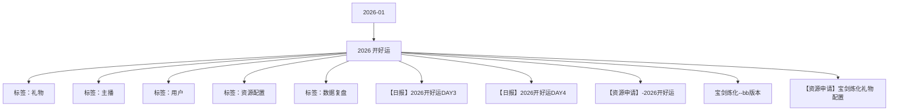

# 2026 开好运 活动知识图谱

## 核心信息

- 月份：2026-01
- 活动时间：1.1-1.4
- 活动 Wiki：https://wiki.inkept.cn/pages/viewpage.action?pageId=452644196
- 活动页面 ID：452644196
- 关联资料数：5
- 标签：礼物、主播、用户、资源配置、数据复盘

## 优化总结

### 活动概览

- 二、活动目标：（来源：活动主页面）
- 活动目标：活动钻石消耗达1.84E钻石（来源：【日报】2026开好运DAY3）
- 目标完成度：活动消耗达1.69e钻石，目标完成度为91.93%。（来源：【日报】2026开好运DAY3）
- 活动目标完成情况：（来源：【日报】2026开好运DAY3）
- 活动目标：活动钻石消耗达2800万钻石（来源：【日报】2026开好运DAY3）
- 目标完成度：活动消耗达2363万钻石，目标完成度为84%。（来源：【日报】2026开好运DAY3）
- 项目目标值活动消耗目标完成度时间进度（来源：【日报】2026开好运DAY3）
- 活动目标：活动钻石消耗达1.84E钻石（来源：【日报】2026开好运DAY4）
- 目标完成度：活动消耗达1.69e钻石，目标完成度为91.93%。（来源：【日报】2026开好运DAY4）
- 活动目标完成情况：（来源：【日报】2026开好运DAY4）

### 活动时间

- 一、活动时间：（来源：活动主页面）
- 玩法统计时间：1.1 00:00:00-1.4 23:59:59（来源：活动主页面）
- 奖励展示图片+名字+时间（来源：活动主页面）
- 任务主播奖励类型主播奖励名称主播奖励id时间取单头像还是双头像嘉宾奖励类型嘉宾奖励名称嘉宾奖励id时间取单头像还是双头像（来源：活动主页面）
- 奖励展示奖励的图片+名字+时间。（来源：活动主页面）
- 活动时间：1月2日18:00:00-1月4日23:59:59（来源：宝剑炼化--bb版本）

### 玩法规则

- 四、玩法说明：（来源：活动主页面）
- 玩法逻辑：（来源：活动主页面）
- 活动期间，主播与嘉宾共同竞争完成一系列<2026第一次>类型的任务，与助力者一起登上主播魁首墙与嘉宾魁首墙曝光。（来源：活动主页面）
- 魁首任务活动期间每天都可以争夺一次。（来源：活动主页面）
- 交互逻辑：（来源：活动主页面）
- 没有人完成该任务时，显示虚位以待。（来源：活动主页面）
- 默认展示最新日期的数据，默认任务的排序按照配置的位置排列。（来源：活动主页面）
- 魁首任务（来源：活动主页面）
- 关卡任务值资源类型资源名称资源id时长数量私信内容弹幕或公聊内容图片（来源：活动主页面）
- 第一个收到真爱团--done称号2026真爱你21147https://img.ikstatic.cn/MTc2Njk5Njg5MjA4NSM1MTUjcG5n.png【2026开好运】恭喜宝宝成为2026年第一个完成真爱团任务的魁首，获得2026真爱你称号7天！【2026开好运】哇塞，主播昵称在用户昵称的帮助下，第一个在今日完成真爱团任务，成为本任务魁首！（来源：活动主页面）
- 开播，和开贵族，陪陪不能完成称号2026守护你21167https://img.ikstatic.cn/MTc2Njk5Njk2NTE2MSMzNzcjcG5n.png【2026开好运】恭喜宝宝成为2026年第一个完成守护任务的魁首，获得2026守护你称号7天！【2026开好运】哇塞，主播昵称在用户昵称的帮助下，第一个在今日完成守护任务，成为本任务魁首！（来源：活动主页面）
- 第一个建立派对关系-公聊角标邂逅爱情公聊角标20727https://img.ikstatic.cn/MTYyMTI0NjcxMDU2NiM3MjIjcG5n.png【2026开好运】恭喜宝宝成为2026年第一个完成建立派对关系任务的魁首，获得邂逅爱情公聊角标7天！【2026开好运】哇塞，主播昵称在用户昵称的帮助下，第一个在今日完成建立派对关系任务，成为本任务魁首！（来源：活动主页面）
- 第一个收到高光礼物-done称号2026高光时刻21187https://img.ikstatic.cn/MTc2Njk5NzAzMzEwNyMzMTYjcG5n.png【2026开好运】恭喜宝宝成为2026年今日第一个完成高光礼物任务的魁首，获得2026高光时刻称号7天！【2026开好运】哇塞，主播昵称在用户昵称的帮助下，完成收到高光礼物任务，成为本任务魁首！（来源：活动主页面）
- 第一个收到展馆礼物-done公聊皮肤永浴爱河公聊皮肤44387https://img.ikstatic.cn/MTcwMDQ1MTUzOTcwNyM1NjQjcG5n.png【2026开好运】恭喜宝宝成为2026年第一个完成收到展馆礼物任务的魁首，获得永浴爱河公聊皮肤7天！【2026开好运】哇塞，主播昵称在用户昵称的帮助下，完成收到展馆礼物任务，成为本任务魁首！（来源：活动主页面）
- 第一个累积收活动专属礼物达到50w钻主页浮屏收获颇丰主页浮屏52597https://img.ikstatic.cn/MTcxODY3OTk3NTQ2OSM4NDkjcG5n.png【2026开好运】恭喜宝宝成为2026年第一个累积收活动专属礼物达到50w钻收礼任务的魁首，获得收获颇丰主页浮屏*7天！【2026开好运】哇塞，主播昵称在用户昵称的帮助下，完成累积50w钻收礼任务，成为本任务魁首！（来源：活动主页面）
- 第一个累积收活动专属礼物达到10w钻主页挂件甜蜜告白主页挂件39357https://img.ikstatic.cn/MTY4ODU0NTExNDE1NiMzNDQjcG5n.png【2026开好运】恭喜宝宝成为2026年第一个累积收活动专属礼物达到10w钻任务的魁首，获得甜蜜告白主页挂件*7天！【2026开好运】哇塞，主播昵称在用户昵称的帮助下，完成累积10w钻收礼任务，成为本任务魁首！（来源：活动主页面）
- 第一个收到真爱团称号2026真爱你21157https://img.ikstatic.cn/MTc2Njk5NjkyMjQ2MSM1MjEjcG5n.png【2026开好运】恭喜宝宝成为2026年第一个帮助主播完成真爱团任务，获得2026真爱你称号7天！（来源：活动主页面）
- 第一个收到守护称号2026守护你21177https://img.ikstatic.cn/MTc2Njk5Njk5NjAyNiM1MzEjcG5n.png【2026开好运】恭喜宝宝成为2026年第一个帮助主播完成守护任务，获得2026守护你称号7天！（来源：活动主页面）

### 奖励与资源

- 展馆礼物id:18877,18887,19265,23344,23345,18616,14923,12194,15720,18618,18301,18294,18614,18372,19010,18296,17649,18622,18297,18883,17897,18886,17896,19016,18286,18888,19021,18717,17954,18633,18634,11311,436（来源：活动主页面）
- 专属礼物：18016,23699,23700,23701,23702,23703,23704,23705,23706,23708,23709,23710（来源：活动主页面）
- 统计礼物：18016,23699,23700,23701,23702,23703,23704,23705,23706,23708,23709,23710,5506,5507,5508（来源：活动主页面）
- 设置活动特殊礼物「开好运」100钻，送出给主播，可以开出不同的特效，不同的特效可匹配对应的资源（来源：活动主页面）
- 主播获得100映币，用户获得资源奖励（来源：活动主页面）
- 用户可见的公聊：【开好运】用户昵称送出开好运礼物，开出xx符。（来源：活动主页面）
- 特效名称资源id比率奖励名称idurl（来源：活动主页面）
- 奖励id私信（来源：活动主页面）
- 类型奖励名称idurl（来源：活动主页面）
- 头像框好运连连头像框2657https://img.ikstatic.cn/MTY0MDg2NTExNzY2NiMzODkjcG5n.png改名字1小时【开好运】恭喜送开好运礼物开出好运符，获得好运连连头像框*1小时，快去查看吧～（来源：活动主页面）
- 头像框事业锦鲤王头像框516https://img.ikstatic.cn/MTU3NzE4OTkwMDg1NiM2ODgjcG5n.png改名字1小时【开好运】恭喜送开好运礼物开出事业符，获得事业锦鲤王头像框*1小时，快去查看吧～（来源：活动主页面）
- 头像框财运亨通头像框1749https://img.ikstatic.cn/MTYxMTE0NzUwNzY1NCMzNzYjcG5n.png改名字1小时【开好运】恭喜送开好运礼物开出财运符，获得财运亨通头像框*1小时，快去查看吧～（来源：活动主页面）
- 麦序框元气满满麦序框3998https://img.ikstatic.cn/MTY5MDg4MDEzMTUyNCMxMjkjcG5n.png改名字1小时【开好运】恭喜送开好运礼物开出健康符，获得元气满满麦序框*1小时，快去查看吧～（来源：活动主页面）
- 麦序框双向奔赴麦序框7566https://img.ikstatic.cn/MTc0NzM3NTk2OTYzNyMyMTAjcG5n.png改名字1小时【开好运】恭喜送开好运礼物开出姻缘符，获得双向奔赴麦序框*1小时，快去查看吧～（来源：活动主页面）
- 麦序框万象新程麦序框4803https://img.ikstatic.cn/MTcwNzAzODczMTY2MyM5MTcjcG5n.png改名字1小时【开好运】恭喜送开好运礼物开出通达符，获得万象新程麦序框*1小时，快去查看吧～（来源：活动主页面）
- 用户送出活动指定专属礼物，有机会与收礼方触发专属福神。（来源：活动主页面）
- 专属福神出现后，送礼方与收礼方将获得资源奖励。（来源：活动主页面）
- 奖池礼物 id（来源：活动主页面）

### 入口与链接

- :000 上宝剑炼化（来源：活动主页面）
- 高光id:23704,23691,23690,23689,23688,23687,23686,23685,23684,23683,23682,23676,23675,23674,23651,23650,23649,23640,23619,23618,23597,23596,23595,23594,23593,23592,23591,23590,23589,23588,23587,23586,23579,23578,23576,2357...
- 日均消耗700万钻石，活动4日消耗2800w钻石（来源：活动主页面）
- 三、活动框架：（来源：活动主页面）
- 原型图：https://modao.cc/app/vTu23uftsh46ooZ7QPiqu #2026开好运-分享（来源：活动主页面）
- 开好运100新，gif，连送23700https://img.ikstatic.cn/MTc2NzA3OTE0MDE1MSMxMjcjcG5n.png（来源：活动主页面）
- 好运符--2671020%好运连连头像框2657https://img.ikstatic.cn/MTY0MDg2NTExNzY2NiMzODkjcG5n.png改名字1小时【开好运】（来源：活动主页面）
- 事业符-1671120%事业锦鲤王头像框516https://img.ikstatic.cn/MTU3NzE4OTkwMDg1NiM2ODgjcG5n.png改名字1小时（来源：活动主页面）
- 财运符---11671220%财运亨通头像框1749https://img.ikstatic.cn/MTYxMTE0NzUwNzY1NCMzNzYjcG5n.png改名字1小时（来源：活动主页面）
- 健康符-1671310%元气满满麦序框529https://img.ikstatic.cn/MTU3OTQxODEyNDAzNSM3MzEjcG5n.png改名字1小时（来源：活动主页面）
- 姻缘符-1671415%双向奔赴麦序框4849https://img.ikstatic.cn/MTcwOTUxOTIyOTYwMCMyOTYjcG5n.png改名字1小时（来源：活动主页面）
- 通达符671515% 万象新程麦序框6987https://img.ikstatic.cn/MTc0MjM1MTQ5OTA2OSMyNDMjcG5n.png改名字1小时（来源：活动主页面）

### 上线配置

- 《2026开好运》活动于1月1日0点-1月4日24点上线，现同步Day3数据情况：（来源：【日报】2026开好运DAY3）
- 《2026开好运》活动于1月1日0点-1月4日24点上线，现同步Day4数据情况：（来源：【日报】2026开好运DAY4）

### 数据与复盘

- 【年度收官战】-当前基础数据情况（来源：【日报】2026开好运DAY3）
- 核心参与人群：派对侧收礼的主播主要集中在SB层级，秀场侧收礼的主播主要集中SB层级；（来源：【日报】2026开好运DAY3）
- 派对侧送礼的用户主要集中BD层级，秀场侧送礼的用户主要集中在SB层级；（来源：【日报】2026开好运DAY3）
- Hi all（来源：【日报】2026开好运DAY3）
- 具体数据如下：（来源：【日报】2026开好运DAY3）
- 年度收官战28,000,00023,632,68584.40%75%（来源：【日报】2026开好运DAY3）
- 大盘数据情况：（来源：【日报】2026开好运DAY3）
- 每日数据情况（来源：【日报】2026开好运DAY3）
- 月1日49,896,191 33,985,182 11,157,539 9,583,539 1,574,000 22.36%32.83%（来源：【日报】2026开好运DAY3）
- 月2日34,011,846 18,631,097 6,292,325 5,066,125 1,226,200 18.50%33.77%（来源：【日报】2026开好运DAY3）
- 月3日35,015,791 21,025,392 6,182,821 5,200,021 982,800 17.66%29.41%（来源：【日报】2026开好运DAY3）
- 合计118,923,828 73,641,671 23,632,685 19,849,685 3,783,000 19.87%32.09%（来源：【日报】2026开好运DAY3）
- 主播收礼：（来源：【日报】2026开好运DAY3）
- 送礼场景送礼钻石数（来源：【日报】2026开好运DAY3）
- 派对15,763,924 66.70%（来源：【日报】2026开好运DAY3）
- 秀场7,868,761 33.30%（来源：【日报】2026开好运DAY3）

### 其他关键信息

- 宝剑炼化（来源：宝剑炼化--bb版本）
- 若认主为至尊，则触发全站悬浮公聊&活动H5飘屏：【宝剑炼化】恭喜用户昵称被宝剑认主成功，获得至尊宝剑名称（来源：宝剑炼化--bb版本）
- 宝剑在炼化过程中有机会损坏或者升级，或者不变（来源：宝剑炼化--bb版本）
- 破碎宝剑50050.00%250（来源：宝剑炼化--bb版本）
- 宝剑100030.00%300（来源：宝剑炼化--bb版本）
- 至尊宝剑200020.00%400（来源：宝剑炼化--bb版本）
- 宝剑炼化180161005（来源：宝剑炼化--bb版本）
- 破碎宝剑500钻180015506https://img.ikstatic.cn/MTcxMjY0NTk5ODI4NCM1NjMjcG5n.png（来源：宝剑炼化--bb版本）
- 宝剑1000钻180025507https://img.ikstatic.cn/MTcxMjY0NjA5ODEyMiM1NDcjcG5n.png（来源：宝剑炼化--bb版本）
- 至尊宝剑2000钻180035508https://img.ikstatic.cn/MTcxMjY0NjE0NjE0OCM3MjAjcG5n.png（来源：宝剑炼化--bb版本）

## 资料关系图

## 资料来源

- [活动主页面](https://wiki.inkept.cn/pages/viewpage.action?pageId=452644196)
- [【日报】2026开好运DAY3](https://wiki.inkept.cn/pages/viewpage.action?pageId=465052110)
- [【日报】2026开好运DAY4](https://wiki.inkept.cn/pages/viewpage.action?pageId=465477169)
- [【资源申请】-2026开好运](https://wiki.inkept.cn/pages/viewpage.action?pageId=462598680)
- [宝剑炼化--bb版本](https://wiki.inkept.cn/pages/viewpage.action?pageId=463111407)
- [【资源申请】宝剑炼化礼物配置](https://wiki.inkept.cn/pages/viewpage.action?pageId=471958000)
