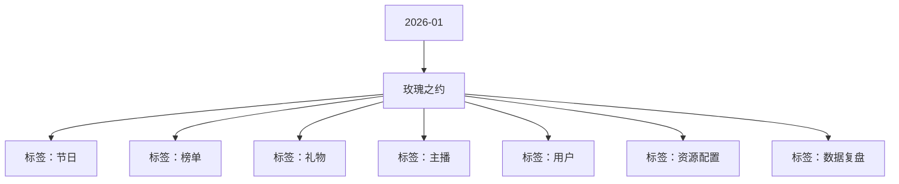

# 玫瑰之约 活动知识图谱

## 核心信息

- 月份：2026-01
- 活动时间：1.10-1.14
- 活动 Wiki：https://wiki.inkept.cn/pages/viewpage.action?pageId=456570094
- 活动页面 ID：456570094
- 关联资料数：0
- 标签：节日、榜单、礼物、主播、用户、资源配置、数据复盘

## 优化总结

### 活动概览

- 二、活动背景（来源：活动主页面）
- 二、活动目标（来源：活动主页面）

### 活动时间

- 活动时间：9月9日0点-9月12日24点（来源：活动主页面）

### 玩法规则

- 玫瑰CP任务（来源：活动主页面）
- 活动期间，用户与主播相互送礼可完成双人CP任务，达到对应阶段获得对应奖励。（来源：活动主页面）
- 活动期间，个人主播/派对嘉宾/派对厅主每日累计收礼参与日榜争夺，根据榜单排名解锁奖励。（来源：活动主页面）
- 分为大小主播及嘉宾三个榜单，仅看个人收礼。（来源：活动主页面）
- 下发榜单奖励时需判断主播/用户性别，若为女则下发女性装扮，为男则下发男性装扮，若相同性别，用户按男性算，主播按照女性算（来源：活动主页面）
- 示爱小映玩法（来源：活动主页面）
- 逻辑为全站500次为一个循环，500次内，按照全站指定的爆出次数给到当前送出小映的用户，爆出的额外奖励直接发给当前主播。（来源：活动主页面）

### 奖励与资源

- 礼物名称礼物价格新IDURL（来源：活动主页面）
- 日均礼物消耗达到700万钻石（来源：活动主页面）
- 用户每次送出活动专属礼物，均有机会触发“直播间特效-1”，按照每99钻有10%的比例触发（来源：活动主页面）
- 若两人累计玫瑰达到21/52/99次，次数不同触发奖励不同----循环（来源：活动主页面）
- 资源按照用户性别匹配下发（来源：活动主页面）
- 活动每日为主播贡献TOP1即可和主播成为CP，共同获取CP奖励（来源：活动主页面）
- 序号资源类型资源名称资源 id价值权重（来源：活动主页面）
- 礼物特效冰城玫瑰22437520233（来源：活动主页面）
- 礼物特效甜蜜520*2224381040240（来源：活动主页面）
- 礼物特效荷花仙子224392333335（来源：活动主页面）
- 礼物特效仙女秋千224402888115（来源：活动主页面）
- 礼物特效玫瑰精灵22441388848（来源：活动主页面）
- 礼物特效爱乐之境22442520015（来源：活动主页面）
- 礼物特效定情信物224431314010（来源：活动主页面）
- 礼物特效梦幻城堡22444233333（来源：活动主页面）
- 礼物特效星海童话22445666661（来源：活动主页面）
- 活动期间，用户为主播送出“示爱小映”，每次有机会触发99钻、520钻、3344钻礼物额外奖励送给主播。（来源：活动主页面）
- 每次触发不同礼物触发不同文案，文案显示在直播间公聊通知及全站悬浮公聊。（来源：活动主页面）

### 入口与链接

- 瑰梦时分9999922460https://img.ikstatic.cn/MTcyNjMwOTg2Nzg4OCMyNTQjcG5n.png（来源：活动主页面）
- 玫瑰骑士5200022456https://img.ikstatic.cn/MTc0NTU2MjQyMjMyNCM5MDQjcG5n.png（来源：活动主页面）
- 星河女神3344022461https://img.ikstatic.cn/MTc0NzIxMTE2NTczNyMxMjgjcG5n.png（来源：活动主页面）
- 甜心蜜约1314022459https://img.ikstatic.cn/MTc1MTk2NDk5Njc2OCM5NjcjcG5n.png（来源：活动主页面）
- 海岛之恋520022458https://img.ikstatic.cn/MTcxNDQ2NjcxOTU2MiM0MDMjcG5n.png（来源：活动主页面）
- 恋与玫瑰334422454https://img.ikstatic.cn/MTc1MTAxOTMyNzQ0NCM0MDAjcG5n.png（来源：活动主页面）
- 告白婚车334422457https://img.ikstatic.cn/MTY1NDU4OTg4ODgxMiM0MTQjcG5n.png（来源：活动主页面）
- 示爱小映212122436https://img.ikstatic.cn/MTczMDE5NjUwMTQ2MCMxNzMjcG5n.png（来源：活动主页面）
- 爱的橱窗131422453https://img.ikstatic.cn/MTcxNDI5NDc2NTgxMCM1OTAjcG5n.png（来源：活动主页面）
- 玫瑰女神52022452https://img.ikstatic.cn/MTcwOTI3NDExOTYyNyMgOTkjcG5n.png（来源：活动主页面）
- 梦幻蝶舞9922451https://img.ikstatic.cn/MTc0NzI5OTUxMDQyMCM5OTQjcG5n.png（来源：活动主页面）
- 超爱你1022450http://img.ikstatic.cn/MTU1NzE5Njc3MTM2MSM2NDIjcG5n.png（来源：活动主页面）

## 资料关系图

## 资料来源

- [活动主页面](https://wiki.inkept.cn/pages/viewpage.action?pageId=456570094)
