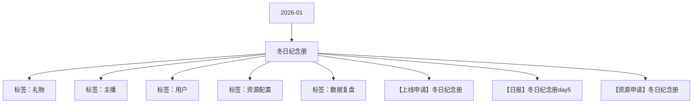

# 冬日纪念册 活动知识图谱

## 核心信息

- 月份：2026-01
- 活动时间：1.18-1.22
- 活动 Wiki：https://wiki.inkept.cn/pages/viewpage.action?pageId=459970908
- 活动页面 ID：459970908
- 关联资料数：3
- 标签：礼物、主播、用户、资源配置、数据复盘

## 优化总结

### 活动概览

- 二、活动目标：（来源：活动主页面）
- 活动目标完成情况：（来源：【日报】冬日纪念册day5）
- 活动目标：活动钻石消耗达3000w钻石（来源：【日报】冬日纪念册day5）
- 活动消耗达2399w钻石，目标完成度为79.99%。（来源：【日报】冬日纪念册day5）
- 项目目标值活动消耗目标完成度时间进度（来源：【日报】冬日纪念册day5）

### 活动时间

- 活动时间更改（来源：活动主页面）
- 起始时间：2025-12-01 14:47:17（来源：活动主页面）
- 结束时间：2026-12-01 14:47:17（来源：活动主页面）
- 一、活动时间：3.15-3.19（来源：活动主页面）
- 时间：1月18日00:00:00-1月23日23:59:59（来源：【上线申请】冬日纪念册）
- 时间：1月18日00:00:00-1月22日23:59:59（来源：【上线申请】冬日纪念册）
- 时间：1月18日00:00:00-1月19日23:59:59（来源：【上线申请】冬日纪念册）
- 活动专属称号 添加称号链接，修改上线时间及白名单配置修改为否（来源：【上线申请】冬日纪念册）

### 玩法规则

- 活动名称：冬日纪念册- 收集纸鸢赢限定装扮（来源：活动主页面）
- 四、活动玩法：（来源：活动主页面）
- 主播玩法----升级图鉴：（来源：活动主页面）
- 每关纸鸢数不清零，为累计任务。（来源：活动主页面）
- 纸鸢触发逻辑：主播收礼每满21映币即可抽取一次纸鸢。（来源：活动主页面）
- 【冬日纪念册】恭喜宝宝完成了升级图鉴任务Lv.1，获得冬日恋歌头像框5天，请注意查收，再接再厉获得更多奖励哦！（来源：活动主页面）
- Lv.2(5000)5225000幸福恋人公聊角标5天【冬日纪念册】恭喜宝宝完成了升级图鉴任务Lv.2，获得幸福恋人公聊角标5天，请注意查收，再接再厉获得更多奖励哦！（来源：活动主页面）
- Lv.3(10000)105310000冰日恋歌公聊皮肤5天【冬日纪念册】恭喜宝宝完成了升级图鉴任务Lv.3，获得冰日恋歌公聊皮肤5天，请注意查收，再接再厉获得更多奖励哦！（来源：活动主页面）
- 【冬日纪念册】恭喜宝宝完成了升级图鉴任务Lv.4，获得冬日恋歌称号5天，请注意查收，再接再厉获得更多奖励哦！（来源：活动主页面）
- Lv.5(30000)3015825000冬日恋歌挂件5天【冬日纪念册】恭喜宝宝完成了升级图鉴任务Lv.5，获得冬日恋歌挂件5天，请注意查收，再接再厉获得更多奖励哦！（来源：活动主页面）
- 关卡任务值资源类型资源名称资源id时长数量私信内容弹幕或公聊内容图片（来源：活动主页面）
- 【冬日纪念册】恭喜宝宝完成了升级图鉴任务Lv.2，获得幸福恋人公聊角标5天，请注意查收，再接再厉获得更多奖励哦！（来源：活动主页面）
- 【冬日纪念册】恭喜宝宝完成了升级图鉴任务Lv.3，获得冰日恋歌公聊皮肤5天，请注意查收，再接再厉获得更多奖励哦！（来源：活动主页面）
- 【冬日纪念册】恭喜宝宝完成了升级图鉴任务Lv.5，获得冬日恋歌挂件5天，请注意查收，再接再厉获得更多奖励哦！（来源：活动主页面）
- 冬日恋歌麦序框【冬日纪念册】恭喜宝宝完成了升级图鉴任务Lv.1，获得冬日恋歌麦序框5天，请注意查收，再接再厉获得更多奖励哦！冬日恋歌麦序框【冬日纪念册】恭喜宝宝成为嘉宾昵称XXX升级图鉴Lv.1的助力官，获得冬日恋歌麦序框5天，请注意查收。继续加油助力主播解锁更多奖励！（来源：活动主页面）
- Lv.2(5000)5225000冬日恋歌头像框【冬日纪念册】恭喜宝宝完成了升级图鉴任务Lv.2，获得冬日恋歌头像框5天，请注意查收，再接再厉获得更多奖励哦！（来源：活动主页面）
- Lv.3(10000)105310000冰日恋歌公聊皮肤【冬日纪念册】恭喜宝宝完成了升级图鉴任务Lv.3，获得冰日恋歌公聊皮肤5天，请注意查收，再接再厉获得更多奖励哦！（来源：活动主页面）
- Lv.4(20000)2010515000冬日恋歌称号【冬日纪念册】恭喜宝宝完成了升级图鉴任务Lv.4，获得冬日恋歌称号5天，请注意查收，再接再厉获得更多奖励哦！冬日恋歌称号【冬日纪念册】恭喜宝宝成为嘉宾昵称XXX升级图鉴Lv.4的助力官，获得冬日恋歌称号5天，请注意查收。继续加油助力主播解锁更多奖励！（来源：活动主页面）

### 奖励与资源

- 所有的奖励更换（来源：活动主页面）
- 礼物名称礼物价格礼物ID资源IDurl（来源：活动主页面）
- 礼物名称钻石数礼物ID（来源：活动主页面）
- 纪念册图鉴共五个等级，主播收取专属礼物可随机获得不同纸鸢。集齐指定三种纸鸢后可点亮图鉴，并与当前贡献最高得用户共同获得点亮奖励。（来源：活动主页面）
- 点亮图鉴后即可对图鉴进行升级，需集齐三种纸鸢达对应数量或累计收礼达对应门槛值可直接升级图鉴，每次升级均可与当前贡献最高得用户共同获得升级奖励。（来源：活动主页面）
- 图鉴纸鸢A数量纸鸢B数量纸鸢C数量升级收礼金额主播奖励主播私信用户奖励用户私信（来源：活动主页面）
- 【冬日纪念册】恭喜宝宝成为主播昵称XXX升级图鉴Lv.1的助力官，获得冬日恋歌头像框5天，请注意查收。继续加油助力主播解锁更多奖励！（来源：活动主页面）
- 幸福恋人公聊角标5天【冬日纪念册】恭喜宝宝成为主播昵称XXX升级图鉴Lv.2的助力官，获得幸福恋人公聊角标5天，请注意查收。继续加油助力主播解锁更多奖励！（来源：活动主页面）
- 冰日恋歌公聊皮肤5天【冬日纪念册】恭喜宝宝成为主播昵称XXX升级图鉴Lv.3的助力官，获得冰日恋歌公聊皮肤5天，请注意查收。继续加油助力主播解锁更多奖励！（来源：活动主页面）
- 冬日恋歌称号5天【冬日纪念册】恭喜宝宝成为主播昵称XXX升级图鉴Lv.4的助力官，获得冬日恋歌称号5天，请注意查收。继续加油助力主播解锁更多奖励！（来源：活动主页面）
- 冬日恋歌挂件5天【冬日纪念册】恭喜宝宝成为主播昵称XXX升级图鉴Lv.5的助力官，获得冬日恋歌挂件5天，请注意查收。继续加油助力主播解锁更多奖励！（来源：活动主页面）
- 类型资源名称idurl（来源：活动主页面）
- 【冬日纪念册】恭喜宝宝成为主播昵称XXX升级图鉴Lv.2的助力官，获得幸福恋人公聊角标5天，请注意查收。继续加油助力主播解锁更多奖励！（来源：活动主页面）
- 【冬日纪念册】恭喜宝宝成为主播昵称XXX升级图鉴Lv.3的助力官，获得冰日恋歌公聊皮肤5天，请注意查收。继续加油助力主播解锁更多奖励！（来源：活动主页面）
- 【冬日纪念册】恭喜宝宝成为主播昵称XXX升级图鉴Lv.4的助力官，获得冬日恋歌称号5天，请注意查收。继续加油助力主播解锁更多奖励！（来源：活动主页面）
- 【冬日纪念册】恭喜宝宝成为主播昵称XXX升级图鉴Lv.5的助力官，获得冬日恋歌挂件5天，请注意查收。继续加油助力主播解锁更多奖励！（来源：活动主页面）
- 图鉴纸鸢A数量纸鸢B数量纸鸢C数量升级收礼金额嘉宾奖励嘉宾私信用户奖励用户私信（来源：活动主页面）
- 冬日恋歌头像框【冬日纪念册】恭喜宝宝成为嘉宾昵称XXX升级图鉴Lv.2的助力官，获得冬日恋歌头像框5天，请注意查收。继续加油助力主播解锁更多奖励！（来源：活动主页面）

### 入口与链接

- 改文案链接：https://betaboc.inke.cn/react/tools/page-config-pro/index.html?url=https://betaboc.inke.cn/react/banner/202601/winter-note/index.html（来源：活动主页面）
- 修改点：（来源：活动主页面）
- 活动页面换肤（来源：活动主页面）
- 找猫猫复用（来源：活动主页面）
- 您申请的SourceType: [减少钻石-消耗-平台运营组-找猫猫-2025-12-01] 已经审批完成（来源：活动主页面）
- SourceType:759（来源：活动主页面）
- APP账单记录文案：直播收入（来源：活动主页面）
- 是否计入送礼流水：是（来源：活动主页面）
- 是否计入基准流水：是（来源：活动主页面）
- 是否计入无背包基准映币：是（来源：活动主页面）
- 否计入实际映币收入：是（来源：活动主页面）
- 是否为赠送钻石：否（来源：活动主页面）

### 上线配置

- Hi all，（来源：【上线申请】冬日纪念册）
- 辛苦@玉松 审批，（来源：【上线申请】冬日纪念册）
- 标题：冬日纪念册（来源：【上线申请】冬日纪念册）
- 色值：linear-gradient(90deg, #11a5ff 0%, #4dbeff 100%)（来源：【上线申请】冬日纪念册）
- 位置：第一位、22日后移（来源：【上线申请】冬日纪念册）
- 二、icon（来源：【上线申请】冬日纪念册）
- 文案：升级纪念册，赢限定装扮！（来源：【上线申请】冬日纪念册）
- 类型：普通,视频交友（来源：【上线申请】冬日纪念册）
- 位置：第一位、强挂（来源：【上线申请】冬日纪念册）
- 三、首页banner（来源：【上线申请】冬日纪念册）
- 位置：第一位（来源：【上线申请】冬日纪念册）
- 四、全站私信（来源：【上线申请】冬日纪念册）
- 月18日 00:10:00（来源：【上线申请】冬日纪念册）
- 五、金刚区（来源：【上线申请】冬日纪念册）

### 数据与复盘

- Hi all（来源：【日报】冬日纪念册day5）
- 具体数据如下：（来源：【日报】冬日纪念册day5）
- 冬日纪念册30,000,0002399675779.99%100%（来源：【日报】冬日纪念册day5）
- 大盘数据情况：（来源：【日报】冬日纪念册day5）
- 每日数据情况（来源：【日报】冬日纪念册day5）
- 月18日36,416,051 18,667,754 5,917,252 5,081,252 836,000 16.25%31.70%（来源：【日报】冬日纪念册day5）
- 月19日35,452,150 18,420,763 5,510,113 4,625,513 884,600 15.54%29.91%（来源：【日报】冬日纪念册day5）
- 月20日33,543,903 18,179,408 4,995,184 4,304,584 690,600 14.89%27.48%（来源：【日报】冬日纪念册day5）
- 月21日34,278,838 17,032,807 3,812,752 3,250,152 562,600 11.12%22.38%（来源：【日报】冬日纪念册day5）
- 月22日35779851185269313,761,456 3,221,656539,80010.51%20.30%（来源：【日报】冬日纪念册day5）
- 合计175,470,793 90,827,663 23,996,757 20,483,157 3,513,600 13.68%26.42%（来源：【日报】冬日纪念册day5）
- 主播收礼：（来源：【日报】冬日纪念册day5）
- 送礼场景送礼钻石数占比（来源：【日报】冬日纪念册day5）
- 派对1817799875.75%（来源：【日报】冬日纪念册day5）
- 秀场581875924.25%（来源：【日报】冬日纪念册day5）
- 总计23996757（来源：【日报】冬日纪念册day5）

## 资料关系图

## 资料来源

- [活动主页面](https://wiki.inkept.cn/pages/viewpage.action?pageId=459970908)
- [【上线申请】冬日纪念册](https://wiki.inkept.cn/pages/viewpage.action?pageId=471958003)
- [【日报】冬日纪念册day5](https://wiki.inkept.cn/pages/viewpage.action?pageId=473633116)
- [【资源申请】冬日纪念册](https://wiki.inkept.cn/pages/viewpage.action?pageId=470694268)
