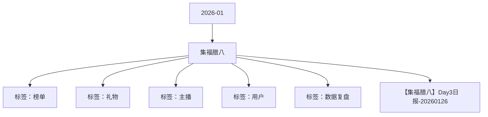

# 集福腊八 活动知识图谱

## 核心信息

- 月份：2026-01
- 活动时间：1.23-1.26
- 活动 Wiki：https://wiki.inkept.cn/pages/viewpage.action?pageId=456559661
- 活动页面 ID：456559661
- 关联资料数：1
- 标签：榜单、礼物、主播、用户、数据复盘

## 优化总结

### 活动概览

- 二、活动目标（来源：活动主页面）
- 头像框*5天、称号*5天、热门推荐卡*3张、福满腊八主页挂件*5天、福满腊八PK背景*5天（来源：活动主页面）
- 头像框*3天、称号*3天、热门推荐卡*1张、福满腊八主页挂件*3天、福满腊八PK背景*3天（来源：活动主页面）
- 头像框*2天、称号*2天、福满腊八主页挂件*2天、福满腊八PK背景*2天（来源：活动主页面）
- 头像框*1天、称号*1天、福满腊八主页挂件*1天、福满腊八PK背景*1天（来源：活动主页面）
- 活动目标完成情况：（来源：【集福腊八】Day3日报-20260126）
- 活动目标：活动钻石消耗达 2000万钻石（来源：【集福腊八】Day3日报-20260126）
- 目标完成度：截止到目前，活动消耗达1684万钻石，目标完成度为84%；（来源：【集福腊八】Day3日报-20260126）
- 活动名称活动消耗活动目标目标完成度（来源：【集福腊八】Day3日报-20260126）

### 活动时间

- 活动时间：2026年1月23日-1月26日 每日00:00:00-23:59:59（来源：活动主页面）
- 玩法时间范围内，用户每送出活动专属礼物达到21钻，即可有机会抽取卡牌1张，具体按照下方表格产出，任务为日任务，每日重新开启，每日卡牌数量清零重新计算。（来源：活动主页面）
- 逻辑1：玩法时间范围内，用户每送出活动专属礼物达到21钻，即可有机会抽取卡牌1张，主播累计在直播间内开启的卡牌数量，只算总数。（来源：活动主页面）
- 活动时间：1月23日-1月26日 每日00:00:00-23:59:59（来源：活动主页面）
- 逻辑1：玩法时间范围内，参与活动的主播累计收礼参与日榜争夺，根据榜单排名解锁奖励。（来源：活动主页面）

### 玩法规则

- 玩法共设置6张卡牌，用户抽取卡牌达到对应数量解锁对应奖励。（来源：活动主页面）
- 注：如果用户每日送礼超过10w钻以后，仍未集齐一套卡牌，后续送礼则按照逻辑补齐，补齐逻辑：送礼超过10w钻以后，后续的送礼或剩余钻石按照每21钻抽一张的逻辑将缺少的卡牌补齐。（来源：活动主页面）
- 用户每日抽中卡牌数量超过52个可进入日榜，根据卡牌数量进行排名，每日最终TOP10解锁对应奖励（来源：活动主页面）
- 主播玩法（来源：活动主页面）
- 任务区分陪陪嘉宾/主播，任务为日任务，每日重新开启，每日卡牌数量清零重新计算。（来源：活动主页面）
- 玩法逻辑：（来源：活动主页面）
- 分为大小主播及嘉宾三个榜单，仅看个人收礼。（来源：活动主页面）
- 小映玩法（来源：活动主页面）
- 用户任务数据：日期、用户层级、用户角色、完成用户数（去重）、完成次数、轮次、关卡（来源：活动主页面）
- 主播任务数据：日期、主播层级、完成主播数（去重）、完成次数、关卡（来源：活动主页面）

### 奖励与资源

- 每抽中一张卡牌，用户可获得卡牌所对应的奖励，奖励记录，页面飘屏（跑马灯）（来源：活动主页面）
- 用户每集齐一套卡牌，必得半屏座驾*1天（提需求），后续累加奖励。（来源：活动主页面）
- 礼物名价格（钻）礼物IDurl（来源：活动主页面）
- 奖励id（来源：活动主页面）
- 好运连连全站画面广播奖励（来源：活动主页面）
- 【集福腊八】恭喜用户昵称成功抽中“年福卡”，获得全站画面广播奖励！（来源：活动主页面）
- （送出活动专属礼物达10w自动补齐）（来源：活动主页面）
- 【集福腊八】「用户昵称」集齐全套卡牌，获得福气满满半屏座驾*1天奖励，过了腊八就是年，福卡加身全年顺～（来源：活动主页面）
- 解锁奖励（来源：活动主页面）
- 资源奖励（来源：活动主页面）
- 奖励资源（来源：活动主页面）
- 奖励有效期（来源：活动主页面）
- 主播奖励（来源：活动主页面）
- 专属礼物消耗：日期、礼物名称、礼物价格、消耗个数、消耗金额、区分派对/主播（来源：活动主页面）
- 主播专属礼物收礼数据：日期、层级、礼物名、收礼人数、收礼个数、收礼金额、区分派对/主播（来源：活动主页面）
- 用户专属礼物送礼数据：日期、层级、礼物名、送礼人数、送礼个数、送礼金额、区分派对/主播（来源：活动主页面）
- 资源位曝光pv、uv（来源：活动主页面）
- 活动消耗占比大盘消耗的 32.99%，专属礼物消耗占比大盘礼物消耗的42.29%；（来源：【集福腊八】Day3日报-20260126）

### 入口与链接

- 一、活动名称（来源：活动主页面）
- 集福腊八（来源：活动主页面）
- 日均消耗达到500万钻石（来源：活动主页面）
- 三、活动框架（来源：活动主页面）
- 活动详情（来源：活动主页面）
- 用户每送出活动专属达到21*1000钻（21000钻）自动触发直播间对应特效（特效ID：提需求）（来源：活动主页面）
- 原型图：https://modao.cc/proto/mZszWpakt7cqadqqnRqkN/sharing?view_mode=read_only&screen=rbpV5We3vIFZTvzkv（来源：活动主页面）
- 姻缘上上签1023812https://img.ikstatic.cn/MTc1NTg1NTI5MjY1MSM5ODUjcG5n.png（来源：活动主页面）
- 福气鼓鼓6623813https://img.ikstatic.cn/MTczNzM2OTAzOTY3MyM5OTkjcG5n.png（来源：活动主页面）
- 鲸落星海19923814https://img.ikstatic.cn/MTcyMTEyNTMyMjQ1MSM4NjMjcG5n.png（来源：活动主页面）
- 传情腊八52023815https://img.ikstatic.cn/MTYxMDUzOTY4MDU4NSM0NzYjcG5n.png（来源：活动主页面）
- 来碗腊八粥52023816https://img.ikstatic.cn/MTcwNDUyOTI3MTA0MiMxMzgjcG5n.png（来源：活动主页面）

### 上线配置

- 《集福腊八》活动于1月23日0点-1月26日24点上线，现同步Day3数据情况：（来源：【集福腊八】Day3日报-20260126）

### 数据与复盘

- Hi all，（来源：【集福腊八】Day3日报-20260126）
- 具体数据如下：（来源：【集福腊八】Day3日报-20260126）
- 集福腊八168407702000000084%（来源：【集福腊八】Day3日报-20260126）
- 大盘数据情况：（来源：【集福腊八】Day3日报-20260126）
- %51.09%（来源：【集福腊八】Day3日报-20260126）
- %37.97%（来源：【集福腊八】Day3日报-20260126）
- %36.52%（来源：【集福腊八】Day3日报-20260126）
- 合计102096388578962433368154024483840919770032.99%42.29%（来源：【集福腊八】Day3日报-20260126）
- 主播收礼：（来源：【集福腊八】Day3日报-20260126）
- 场景202601232026012420260125总计占比（来源：【集福腊八】Day3日报-20260126）
- 派对5004814357726725971431117922466.38%（来源：【集福腊八】Day3日报-20260126）
- 秀场216210318574251642018566154633.62%（来源：【集福腊八】Day3日报-20260126）
- 整体71669175434692423916116840770（来源：【集福腊八】Day3日报-20260126）
- 各层级主播收礼数据（来源：【集福腊八】Day3日报-20260126）
- 派对侧收礼的主播主要集中BS层级，秀场侧收礼的主播主要集中在B层级。（来源：【集福腊八】Day3日报-20260126）
- 主播61天动态层级派对占比秀场占比（来源：【集福腊八】Day3日报-20260126）

## 资料关系图

## 资料来源

- [活动主页面](https://wiki.inkept.cn/pages/viewpage.action?pageId=456559661)
- [【集福腊八】Day3日报-20260126](https://wiki.inkept.cn/pages/viewpage.action?pageId=476553417)
