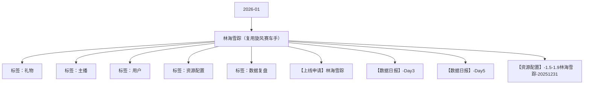

# 林海雪踪（复用旋风赛车手） 活动知识图谱

## 核心信息

- 月份：2026-01
- 活动时间：1.5-1.9
- 活动 Wiki：https://wiki.inkept.cn/pages/viewpage.action?pageId=452651150
- 活动页面 ID：452651150
- 关联资料数：4
- 标签：礼物、主播、用户、资源配置、数据复盘

## 优化总结

### 活动概览

- 首次送礼（520钻）获得初始身份，成为车手。重新设计形象，设计贴合冬季着装，主页主图为“雪原背景+越野选手”（来源：活动主页面）
- 极地征服者称号/头像框/背景（来源：活动主页面）
- 林海雪踪称号/头像框/背景（来源：活动主页面）
- 二、活动目标：（来源：活动主页面）
- 极地征服者PK背景*2天（来源：活动主页面）
- 【林海雪踪】恭喜您完成主播任务一，获得极地征服者PK背景*2天奖励，快去看看吧~（来源：活动主页面）
- 极地征服者派对背景*2天（来源：活动主页面）
- 【林海雪踪】恭喜您完成主播任务一，获得极地征服者派对背景*2天奖励，快去看看吧~（来源：活动主页面）
- PK背景（来源：活动主页面）
- 极地征服者PK背景（来源：活动主页面）

### 活动时间

- 三、活动时间（来源：活动主页面）
- 年1月5日00:00:00-1月9日23:59:59，共五天（所有玩法统计时间均为北京时间GMT+8:00）（来源：活动主页面）
- 统计时间：2026年1月5日00:00:00-1月9日23:59:59（来源：活动主页面）
- 礼物名称价格idURLid有效时间（来源：活动主页面）
- 时间：1月5日00:00:00-1月10日23:59:59（来源：【上线申请】林海雪踪）
- 时间：1月5日00:00:00-1月9日23:59:59（来源：【上线申请】林海雪踪）
- 活动专属称号 添加称号链接，修改上线时间及白名单配置修改为否（来源：【上线申请】林海雪踪）

### 玩法规则

- 小映玩法（来源：活动主页面）
- 玩法详情：（来源：活动主页面）
- 核心玩法-我的萌宠（来源：活动主页面）
- 玩法逻辑：（来源：活动主页面）
- 用户获得初始身份后，每送礼达到1钻即可获得1点车手经验值，达到指定点数获得奖励，完成对应任务即可获得车手身份匹配的奖励。（来源：活动主页面）
- 赛车手身份合计有2个，性别不同的赛车手对应的任务奖励不同，用户可选择更换1次身份，即用户获得身份后，可选择更换1次身份，后续则为该用户下发新的身份奖励，若用户更换新的身份后，采取积分继承。（来源：活动主页面）
- 当用户达到对应阶段后，用户可在活动页面中，选择自己关注的主播，或者输入UID和主播建立甜蜜队友关系，共享奖励，自动获得用户完成任务时的奖励。-按照当前阶段下发。且为主播及用户下发私信，用户私信：【林海雪踪】宝宝已成功为你的好友%s开通奖励共享，现在完成任务后你的好友将和你共享奖励；主播私信：您的好友%s已成功为您开通奖励共享，现在TA完成任务后你将TA共享奖励。（来源：活动主页面）
- 共享后逻辑：（来源：活动主页面）
- 用户进出主播直播间/所在厅，触发提醒逻辑–直播间公聊：【林海雪踪】欢迎我的队友用户昵称来到直播间~（来源：活动主页面）
- 任务数值（来源：活动主页面）
- 【林海雪踪】恭喜您完成车手任务一，获得公聊角标*1天奖励，快去看看吧~（来源：活动主页面）
- 【林海雪踪】恭喜您完成车手任务二，获得麦序框*1天奖励，快去看看吧~（来源：活动主页面）
- 【林海雪踪】恭喜您完成车手任务三，获得头像框*1天奖励，快去看看吧~（来源：活动主页面）
- 【林海雪踪】恭喜您完成车手任务四，获得公聊皮肤*1天奖励，快去看看吧~（来源：活动主页面）
- 【林海雪踪】恭喜您完成车手任务五，获得称号*1天奖励，快去看看吧~（来源：活动主页面）
- 【林海雪踪】恭喜您完成车手任务六，获得发言波纹*1天奖励，快去看看吧~（来源：活动主页面）
- 【林海雪踪】恭喜您完成车手任务七，获得主页挂件*1天奖励，快去看看吧~（来源：活动主页面）
- 【林海雪踪】恭喜您完成车手任务八，获得半屏座驾*1天奖励，快去看看吧~（来源：活动主页面）

### 奖励与资源

- （2）资源部分（来源：活动主页面）
- 礼物名称价格idURLid（来源：活动主页面）
- 礼物名称礼物价格礼物IDurl（来源：活动主页面）
- 嘉宾收礼：厅主及厅内嘉宾4人视频，6人视频，9人音频房间收礼的专属礼物收入，其余方式均不计入统计。谁收算谁的。（来源：活动主页面）
- 用户完成首次送礼获得初始身份，并直播间&私信提醒（公聊控件）：恭喜宝宝成为雪原赛车手，送礼解锁半屏座驾！私信文案：【林海雪踪】恭喜宝宝成为雪原赛车手，送专属礼物升级身份，解锁半屏座驾奖励。（来源：活动主页面）
- 累计收礼解锁对应奖励。（来源：活动主页面）
- 资源类型（来源：活动主页面）
- 资源名称（来源：活动主页面）
- 资源ID（来源：活动主页面）
- 全站悬浮公聊需要消耗大于50000钻：【林海雪踪】恭喜用户昵称成为本轮小时竞速赛TOP1，获得对应奖励（来源：活动主页面）
- 【林海雪踪】恭喜宝宝成为本轮限时突围赛TOP1，获得雪原王者头像框*1天、雪原王者麦序框*1天奖励，小时消耗大于5w钻石，还可获得全站公聊公示奖励。（来源：活动主页面）
- 【林海雪踪】恭喜宝宝成为本轮限时突围赛TOP3，获得雪原王者头像框*12小时、雪原王者麦序框*12小时奖励。（来源：活动主页面）
- 主播奖励（来源：活动主页面）
- 【林海雪踪】恭喜宝宝成为用户日榜TOP1，获得林海雪踪头像框*5天，林海雪踪麦序框*5天、林海雪踪称号*5天、林海雪踪主页挂件*5天、为爱奔赴资料卡浮屏*3天奖励，继续加油啊~（来源：活动主页面）
- 【林海雪踪】恭喜宝宝成为用户日榜TOP5，获得林海雪踪头像框*3天，林海雪踪麦序框*3天、林海雪踪称号*3天、林海雪踪主页挂件*3天奖励，继续加油啊~（来源：活动主页面）
- 资源IDURL（来源：活动主页面）
- 资源卡浮屏（来源：活动主页面）
- 每次扣除100钻进入奖励中，按照500次核算，预计每500次可进入奖励中50000钻，根据情况对50000钻进行拆分，分别下发给相应的用户（来源：活动主页面）

### 入口与链接

- 【更改点】（来源：活动主页面）
- （1）页面部分（来源：活动主页面）
- 林海雪踪（雪原+越野）（来源：活动主页面）
- 改页面配色:见下图配色参考（来源：活动主页面）
- 小时竞速赛（来源：活动主页面）
- 限时突围赛（来源：活动主页面）
- 雪原小映（来源：活动主页面）
- （配色参考）（来源：活动主页面）
- （形象参考）（来源：活动主页面）
- 注：形象再设计上，可以在人物周围加入”雪花“”流光“元素，增强季节属性（来源：活动主页面）
- （页面底图/边框参考）（来源：活动主页面）
- 字体可以做覆雪/冰块效果（来源：活动主页面）

### 上线配置

- Hi all，（来源：【上线申请】林海雪踪）
- 辛苦@玉松 审批，（来源：【上线申请】林海雪踪）
- 标题：林海雪踪（来源：【上线申请】林海雪踪）
- 色值：linear-gradient(90deg, #0c1223 0%, #052142 100%)（来源：【上线申请】林海雪踪）
- 位置：第一位（来源：【上线申请】林海雪踪）
- 二、icon（来源：【上线申请】林海雪踪）
- 文案：踏雪赛车赢座驾（来源：【上线申请】林海雪踪）
- 三、首页banner（来源：【上线申请】林海雪踪）
- 四、全站私信（来源：【上线申请】林海雪踪）
- 月5日 00:00:00（来源：【上线申请】林海雪踪）
- 文案：【林海雪踪】装扮上新！送礼解锁车手身份，升级焕新专属形象！（来源：【上线申请】林海雪踪）
- 月7日 20:00:00（来源：【上线申请】林海雪踪）
- 月9日 00:00:00（来源：【上线申请】林海雪踪）
- 文案：【林海雪踪】赛程倒计时1天！抓住最后机会，半屏进房座驾等你来拿！（来源：【上线申请】林海雪踪）

### 数据与复盘

- Hi all，（来源：【数据日报】-Day3）
- 具体数据如下：（来源：【数据日报】-Day3）
- 林海雪踪160128574000000040%（来源：【数据日报】-Day3）
- 大盘数据情况：（来源：【数据日报】-Day3）
- %18.59%（来源：【数据日报】-Day3）
- %20.87%（来源：【数据日报】-Day3）
- %12.12%（来源：【数据日报】-Day3）
- 合计107757516590344971601285710160257585260014.86%17.21%（来源：【数据日报】-Day3）
- 主播收礼：（来源：【数据日报】-Day3）
- 场景202601052026010620260107总计占比（来源：【数据日报】-Day3）
- 派对3659000400529724158761008017364.72%（来源：【数据日报】-Day3）
- 秀场200251619380901554378549498435.28%（来源：【数据日报】-Day3）
- 整体56615165943387397025415575157（来源：【数据日报】-Day3）
- 各层级主播收礼数据（来源：【数据日报】-Day3）
- 派对侧收礼的主播主要集中BN层级，秀场侧收礼的主播主要集中在B层级。（来源：【数据日报】-Day3）
- 主播61日动态层级派对占比秀场占比（来源：【数据日报】-Day3）

## 资料关系图

## 资料来源

- [活动主页面](https://wiki.inkept.cn/pages/viewpage.action?pageId=452651150)
- [【上线申请】林海雪踪](https://wiki.inkept.cn/pages/viewpage.action?pageId=463124998)
- [【数据日报】-Day3](https://wiki.inkept.cn/pages/viewpage.action?pageId=468828123)
- [【数据日报】-Day5](https://wiki.inkept.cn/pages/viewpage.action?pageId=470694025)
- [【资源配置】-1.5-1.9林海雪踪-20251231](https://wiki.inkept.cn/pages/viewpage.action?pageId=463123518)
