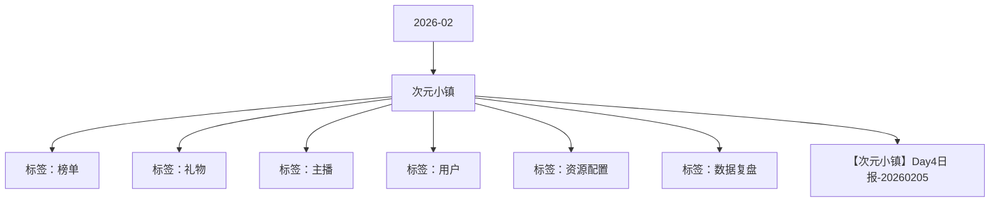

# 次元小镇 活动知识图谱

## 核心信息

- 月份：2026-02
- 活动时间：2.1-2.5
- 活动 Wiki：https://wiki.inkept.cn/pages/viewpage.action?pageId=476553849
- 活动页面 ID：476553849
- 关联资料数：1
- 标签：榜单、礼物、主播、用户、资源配置、数据复盘

## 优化总结

### 活动概览

- 二、活动目标（来源：活动主页面）
- 活动目标完成情况：（来源：【次元小镇】Day4日报-20260205）
- 活动目标：活动钻石消耗达 2000万钻石（来源：【次元小镇】Day4日报-20260205）
- 目标完成度：截止到目前，活动消耗达1684万钻石，目标完成度为84%；（来源：【次元小镇】Day4日报-20260205）
- 次元小镇活动消耗活动目标目标完成度（来源：【次元小镇】Day4日报-20260205）

### 活动时间

- 活动时间：2月1日 00:00:00-2月5日23:59:59（来源：活动主页面）
- 逻辑1：玩法时间范围内，主播收礼达到520钻可根据性别解锁自身专属的二次元形象并获得进入次元小镇的机会，未解锁的主播每日首次开播触发直播间提醒：提醒：【次元小镇】恭喜宝宝获得解锁二次元形象的解锁机会，收集520钻即可获取形象解锁奖励！（来源：活动主页面）
- 逻辑1：玩法时间范围内，活动期间用户每帮助主播前进10米（每送礼达到520钻）即可有机会获取小镇地图碎片1块，用户累计解锁小镇进度获取对应奖励，按进度解锁。完成1轮次后全部清空，重新计算（来源：活动主页面）
- 活动时间：2月1日-2月5日 每日00:00:00-23:59:59（来源：活动主页面）
- 逻辑1：玩法时间范围内，参与活动的主播累计收礼参与日榜争夺，根据榜单排名解锁奖励。（来源：活动主页面）

### 玩法规则

- 逻辑2：主播进入小镇后，每收礼达到52钻，即可在小镇中穿梭前进1米，同时走到对应地点可解锁指定奖励，任务为循环任务（来源：活动主页面）
- 逻辑4：主播获得形象后，依据性别确定形象，并获得奖励及私信通知：【次元小镇】恭喜宝宝获得二次元专属形象，现在完成探索任务即可解锁形象对应奖励~（来源：活动主页面）
- 主播获得形象后通过完成任务即可获取对应的专属特权奖励（来源：活动主页面）
- 形象合计有2个，分为男女性别，不同的性别对应的奖励不同，主播可选择更换1次，后续则为该下发新的奖励，更换新后，采取积分继承（来源：活动主页面）
- 关卡任务值资源类型资源名称资源id时长数量私信内容（来源：活动主页面）
- 公聊角标傲娇黑执事公聊角标794211【次元小镇】恭喜宝宝完成次元小镇任务第一关，获得傲娇黑执事公聊角标*1天奖励~（来源：活动主页面）
- 麦序框傲娇黑执事麦序框793611【次元小镇】恭喜宝宝完成次元小镇任务第二关，获得傲娇黑执事麦序框*1天奖励~（来源：活动主页面）
- 头像框傲娇黑执事头像框793411【次元小镇】恭喜宝宝完成次元小镇任务第三关，获得傲娇黑执事头像框*1天奖励~（来源：活动主页面）
- 称号傲娇黑执事186511【次元小镇】恭喜宝宝完成次元小镇任务第四关，获得傲娇黑执事称号*1天奖励~（来源：活动主页面）
- 公聊皮肤傲娇黑执事公聊皮肤794411【次元小镇】恭喜宝宝完成次元小镇任务第五关，获得傲娇黑执事公聊皮肤*1天奖励~（来源：活动主页面）
- 发言波纹傲娇黑执事发言波纹793811【次元小镇】恭喜宝宝完成次元小镇任务第六关，获得傲娇黑执事发言波纹*1天奖励~（来源：活动主页面）
- 上麦动效傲娇黑执事上麦动效794011【次元小镇】恭喜宝宝完成次元小镇任务第七关，获得傲娇黑执事上麦动效*1天奖励~（来源：活动主页面）
- 主页挂件傲娇黑执事主页挂件794911【次元小镇】恭喜宝宝完成次元小镇任务第八关，获得傲娇黑执事主页挂件*1天奖励~（来源：活动主页面）
- 进房座驾傲娇黑执事进房座驾794711【次元小镇】恭喜宝宝完成次元小镇任务第九关，获得傲娇黑执事进房座驾*1天奖励~（来源：活动主页面）
- 公聊角标元樱大小姐公聊角标794311【次元小镇】恭喜宝宝完成次元小镇任务第一关，获得元樱大小姐公聊角标*1天奖励~（来源：活动主页面）
- 麦序框元樱大小姐麦序框793711【次元小镇】恭喜宝宝完成次元小镇任务第二关，获得元樱大小姐麦序框*1天奖励~（来源：活动主页面）
- 头像框元樱大小姐头像框793511【次元小镇】恭喜宝宝完成次元小镇任务第三关，获得元樱大小姐头像框*1天奖励~（来源：活动主页面）
- 称号元樱大小姐186611【次元小镇】恭喜宝宝完成次元小镇任务第四关，获得元樱大小姐称号*1天奖励~（来源：活动主页面）

### 奖励与资源

- 礼物ID礼物名称礼物价值（钻）URL（来源：活动主页面）
- 推荐卡热13推荐卡8443【次元小镇】恭喜宝宝成为当红主播日榜TOP1，获得次元过家家头像框*5天、次元过家家主页挂件*5天、次元过家家称号*5天、热13推荐卡*3张奖励，奖励已发放，快去看看吧~（来源：活动主页面）
- 推荐卡热13推荐卡8441【次元小镇】恭喜宝宝成为当红主播日榜TOP5，获得次元过家家头像框*3天、次元过家家主页挂件*3天、次元过家家称号*3天、热13推荐卡*1张奖励，奖励已发放，快去看看吧~（来源：活动主页面）
- 主页挂件次元过家家主页挂件404821【次元小镇】恭喜宝宝成为当红主播日榜TOP10，获得次元过家家头像框*2天、次元过家家主页挂件*2天、次元过家家称号*2天奖励，奖励已发放，快去看看吧~（来源：活动主页面）
- 推荐卡热13推荐卡8441【次元小镇】恭喜宝宝成为新秀主播日榜TOP1，获得次元过家家头像框*3天、次元过家家主页挂件*3天、次元过家家称号*3天、热13推荐卡*1张奖励，奖励已发放，快去看看吧~（来源：活动主页面）
- 主页挂件次元过家家主页挂件795121【次元小镇】恭喜宝宝成为新秀主播日榜TOP5，获得次元过家家头像框*2天、次元过家家主页挂件*2天、次元过家家称号*2天奖励，奖励已发放，快去看看吧~（来源：活动主页面）
- 称号次元过家家186811【次元小镇】恭喜宝宝成为新秀主播日榜TOP10，获得次元过家家头像框*1天、次元过家家称号*1天奖励，奖励已发放，快去看看吧~（来源：活动主页面）
- 发言波纹次元过家家发言波纹605451【次元小镇】恭喜宝宝成为派对嘉宾日榜TOP1，获得次元过家家麦序框*5天、次元过家家主页挂件*5天、次元过家家称号*5天、次元过家家发言波纹*5天奖励，奖励已发放，快去看看吧~（来源：活动主页面）
- 发言波纹次元过家家发言波纹605431【次元小镇】恭喜宝宝成为派对嘉宾日榜TOP5，获得次元过家家麦序框*3天、次元过家家主页挂件*3天、次元过家家称号*3天、次元过家家发言波纹*3天奖励，奖励已发放，快去看看吧~（来源：活动主页面）
- 主页挂件次元过家家主页挂件795121【次元小镇】恭喜宝宝成为派对嘉宾日榜TOP10，获得次元过家家麦序框*2天、次元过家家主页挂件*2天、次元过家家称号*2天奖励，奖励已发放，快去看看吧~（来源：活动主页面）
- 公聊皮肤次元过家家公聊皮肤328851【次元小镇】恭喜宝宝成为用户日榜TOP1，获得次元过家家麦序框*5天、次元过家家公聊皮肤*5天、次元过家家上麦动效*5天、次元过家家主页挂件*5天、次元过家家称号*5天、次元过家家发言波纹*5天奖励，奖励已发放，快去看看吧~（来源：活动主页面）
- 发言波纹次元过家家发言波纹605431【次元小镇】恭喜宝宝成为用户日榜TOP5，获得次元过家家麦序框*3天、次元过家家主页挂件*3天、次元过家家公聊皮肤*3天、次元过家家上麦动效*3天、次元过家家称号*3天、次元过家家发言波纹*3天奖励，奖励已发放，快去看看吧~（来源：活动主页面）
- 公聊皮肤次元过家家公聊皮肤328821【次元小镇】恭喜宝宝成为用户日榜TOP10，获得次元过家家麦序框*2天、次元过家家主页挂件*2天、次元过家家公聊皮肤*2天、次元过家家称号*2天奖励，奖励已发放，快去看看吧~（来源：活动主页面）
- 活动消耗占比大盘消耗的9.36%，专属礼物消耗占比大盘礼物消耗的17.26%。（来源：【次元小镇】Day4日报-20260205）
- 主板消耗 礼物消耗活动消耗礼物消耗 小映礼物消耗活动占主板礼物消耗占比（来源：【次元小镇】Day4日报-20260205）
- 全部礼物，派对和秀场主播的收礼占比为：75 : 25。（来源：【次元小镇】Day4日报-20260205）

### 入口与链接

- 樱花堡10https://img.ikstatic.cn/MTY3ODk1MjA3MDUzOSMzNzYjcG5n.png（来源：活动主页面）
- 喵喵咪呀21https://img.ikstatic.cn/MTc1MDkyMzM0Mjc4NCM3ODQjcG5n.png（来源：活动主页面）
- 青空猫耳酱99https://img.ikstatic.cn/MTc1MDkyMzM3ODMwNCM4NTAjcG5n.png（来源：活动主页面）
- 云端幻境999https://img.ikstatic.cn/MTc0MzA3MzkzNjExMCMxMjAjcG5n.png（来源：活动主页面）
- 逐光之约3344https://img.ikstatic.cn/MTc0MzA2MDUxNDMxNCM2NTAjcG5n.png（来源：活动主页面）
- 王炸甜蜜13140https://img.ikstatic.cn/MTc1ODEwNDA0MDUwNSM1MTEjcG5n.png（来源：活动主页面）
- 玫瑰骑士52000https://img.ikstatic.cn/MTc0NTU2MjQyOTY3MSM2MTQjcG5n.png（来源：活动主页面）
- 海上钢琴师99999https://img.ikstatic.cn/MTczMjI2NzM0ODAxNiM5ODMjcG5n.png（来源：活动主页面）
- 与你同在520https://img.ikstatic.cn/MTY5NzY4NjQ1OTk4NCM1OTUjcG5n.png活动第3天（2.3）上线（来源：活动主页面）
- 心动雨季1314https://img.ikstatic.cn/MTc2MTI4NzE3NjUzOSMyMzQjcG5n.png（来源：活动主页面）
- 永恒相随5200https://img.ikstatic.cn/MTc2NzE3NzE3MDczMyMyNzIjcG5n.png（来源：活动主页面）
- 恋与玫瑰3344https://img.ikstatic.cn/MTc1MTAxOTMzNDU0NyMyMjgjcG5n.png（来源：活动主页面）

### 上线配置

- 《次元小镇》活动于2月1日0点-2月5日24点上线，现同步Day4数据情况：（来源：【次元小镇】Day4日报-20260205）

### 数据与复盘

- Hi all，（来源：【次元小镇】Day4日报-20260205）
- 具体数据如下：（来源：【次元小镇】Day4日报-20260205）
- 合计137278723000000046%（来源：【次元小镇】Day4日报-20260205）
- 大盘数据情况：（来源：【次元小镇】Day4日报-20260205）
- %17.11%（来源：【次元小镇】Day4日报-20260205）
- %16.04%（来源：【次元小镇】Day4日报-20260205）
- %16.55%（来源：【次元小镇】Day4日报-20260205）
- %19.23%（来源：【次元小镇】Day4日报-20260205）
- 合计14665504179523253137278721372787209.36%17.26%（来源：【次元小镇】Day4日报-20260205）
- 主播收礼：（来源：【次元小镇】Day4日报-20260205）
- 场景20260201202602022026020320260204总计占比（来源：【次元小镇】Day4日报-20260205）
- 派对27873592311859216820729317101019913574.60%（来源：【次元小镇】Day4日报-20260205）
- 秀场1388362550798711237822436347283325.40%（来源：【次元小镇】Day4日报-20260205）
- 整体417572128626572879444375414613671968（来源：【次元小镇】Day4日报-20260205）
- 各层级主播收礼数据（来源：【次元小镇】Day4日报-20260205）
- 派对侧收礼的主播主要集中BN层级，秀场侧收礼的主播主要集中在B层级。（来源：【次元小镇】Day4日报-20260205）

## 资料关系图

## 资料来源

- [活动主页面](https://wiki.inkept.cn/pages/viewpage.action?pageId=476553849)
- [【次元小镇】Day4日报-20260205](https://wiki.inkept.cn/pages/viewpage.action?pageId=481658043)
