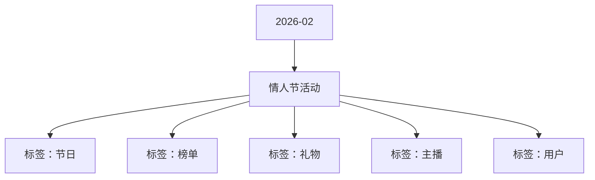

# 情人节活动 活动知识图谱

## 核心信息

- 月份：2026-02
- 活动时间：2.12-2.14
- 活动 Wiki：https://wiki.inkept.cn/pages/viewpage.action?pageId=471957713
- 活动页面 ID：471957713
- 关联资料数：0
- 标签：节日、榜单、礼物、主播、用户

## 优化总结

### 活动概览

- 一、活动背景（来源：活动主页面）
- 二、活动目标（来源：活动主页面）

### 活动时间

- 三、活动时间（来源：活动主页面）
- 起始时间：2026-01-29 16:19:27（来源：活动主页面）
- 结束时间：2026-05-28 16:19:27（来源：活动主页面）
- 起始时间：2026-01-29 16:18:01（来源：活动主页面）
- 结束时间：2026-05-28 16:18:01（来源：活动主页面）
- 时间段不同礼包内容不同（来源：活动主页面）

### 玩法规则

- CP任务（来源：活动主页面）
- 活动期间，用户为主播送出活动专属礼物，即可与主播完成CP任务，用户每为主播送礼达到X值即可触发一次直播间画面及榜单积分加成及全站告白。（来源：活动主页面）
- 用户完成任务时需判断主播/用户性别，若为女则下发女性装扮，为男则下发男性装扮，若相同性别，就按照各自性别发，榜单同理。（来源：活动主页面）
- 阶段八无限任务（来源：活动主页面）
- 用户私信【情人节】恭喜宝宝和主播昵称完成任务一，获得奖励名称*5天奖励，快去看看吧~【情人节】恭喜宝宝和主播昵称完成任务二，获得奖励名称*5天奖励，快去看看吧~【情人节】恭喜宝宝和主播昵称完成任务三，获得奖励名称*5天奖励，快去看看吧~【情人节】恭喜宝宝和主播昵称完成任务四，获得奖励名称*5天奖励，快去看看吧~【情人节】恭喜宝宝和主播昵称完成任务五，获得奖励名称*5天奖励，快去看看吧~【情人节】恭喜宝宝和主播昵称完成任务六，获得奖励名...
- 【情人节】恭喜您携手主播昵称完成任务，获得全站告白和全站双头像画面告白奖励，快去看看吧~（来源：活动主页面）
- 主播私信【情人节】恭喜宝宝和用户昵称完成任务一，获得奖励名称*5天奖励，快去看看吧~【情人节】恭喜宝宝和用户昵称完成任务二，获得奖励名称*5天奖励，快去看看吧~【情人节】恭喜宝宝和用户昵称完成任务三，获得奖励名称*5天奖励，快去看看吧~【情人节】恭喜宝宝和用户昵称完成任务四，获得奖励名称*5天奖励，快去看看吧~【情人节】恭喜宝宝和用户昵称完成任务五，获得奖励名称*5天奖励，快去看看吧~【情人节】恭喜宝宝和用户昵称完成任务六，获得奖励名...
- 霸屏玩法（来源：活动主页面）
- 活动全程玩法（来源：活动主页面）
- 榜单玩法（来源：活动主页面）
- 玩法逻辑：（来源：活动主页面）
- 大R用户玩法---弹窗（来源：活动主页面）
- 任务充值档位解锁奖励（来源：活动主页面）
- 任务一3999元解锁礼物送出权（来源：活动主页面）
- 任务二6999元解锁礼物送出权（来源：活动主页面）
- 任务三9999元解锁专属告白套装（来源：活动主页面）
- 任务四19999元解锁礼物使用权（来源：活动主页面）

### 奖励与资源

- 礼物名称价格礼物ID备注（来源：活动主页面）
- 活动期间，用户每次在直播间做出发送公聊、送出免费小映等（礼物ID：3039）两个活跃行为，每次均有10%概率获得1朵花瓣道具、每日活跃获得玫瑰花行为获得上限为10朵，获得道具后下发至背包；每日首次获得触发仅自己可见公聊提醒：（来源：活动主页面）
- 发送公聊【情人节】恭喜宝宝完成发送公聊消息行为，获得花瓣道具*1，送出道具达到对应数值可成为爱神丘比特哦~（来源：活动主页面）
- 送出免费小映【情人节】恭喜宝宝完成送出免费小映行为，获得花瓣道具*1，送出道具达到对应数值可成为爱神丘比特哦~（来源：活动主页面）
- 活动期间，用户每送出活动专属礼物达到21钻均有机会获得花瓣道具，机会按照下表随机下发，每日首次获得触发仅自己可见公聊提醒：【情人节】恭喜宝宝送礼行为，获得花瓣道具*对应数量，送出道具达到对应数值可成为爱神丘比特哦~（来源：活动主页面）
- 活动期间，用户送出花瓣道具给到主播达到对应数量可解锁对应奖励，每送出999朵必得直播间画面，每送出9999朵解锁“爱神丘比特”身份*2小时，解锁以下奖励：（来源：活动主页面）
- 注：爱神奖励下发为累计，资源按照正常下发即可，进房通知、进房动效奖励可延续至2月14日23:59:59结束；（来源：活动主页面）
- 资源奖励（来源：活动主页面）
- 资源奖励资源IDURL（来源：活动主页面）
- 活动期间，主播每收取玫瑰花达到999朵，可参与一次奖励抽取，具体如下：（来源：活动主页面）
- 主播奖品机会陪陪奖品机会机会（来源：活动主页面）
- 您申请的SourceType: [背包礼物-赠送-平台运营组-情人节小映、礼包专用-2026-01-29] 已经审批完成（来源：活动主页面）
- 您申请的操作对象为：背包礼物，请把对应的soucetype提供给“活动业务组”，用于下发背包礼物；（来源：活动主页面）
- 活动期间，用户每日可通过购买情人节礼包获取特权、背包礼物奖励，每日购买上限为5次，每次限制购买1个。（来源：活动主页面）
- 情人节礼包，用户花费2钻石购买礼包，礼包内包含头像框*12小时、有机会获得10钻礼物。（来源：活动主页面）
- 心动时刻头像框，心动时刻麦序框，概率获得10钻礼物（来源：活动主页面）
- 序号资源类型资源名称背包ID价值权重图片url（来源：活动主页面）
- 背包礼物璀璨星河66811020https://img.ikstatic.cn/MTY3NTkxMzk1MDI4MyMgODMjcG5n.png（来源：活动主页面）

### 入口与链接

- 玫瑰小映166623871banner链接已更改（来源：活动主页面）
- 星河玫瑰523884banner链接已更改（来源：活动主页面）
- 炽焰玫瑰2123947（来源：活动主页面）
- 指尖星光9923948（来源：活动主页面）
- 爱意定格52023949（来源：活动主页面）
- 以爱为名334423950（来源：活动主页面）
- 雪落倾心888823951（来源：活动主页面）
- 公主的骑士1314023952（来源：活动主页面）
- 星河女神3344023953（来源：活动主页面）
- 挚爱牵手5200023954（来源：活动主页面）
- 星辰予你99999​23955（来源：活动主页面）
- 在情人节期间，设置“情人节专属”活动，带动消耗。（来源：活动主页面）

## 资料关系图

## 资料来源

- [活动主页面](https://wiki.inkept.cn/pages/viewpage.action?pageId=471957713)
