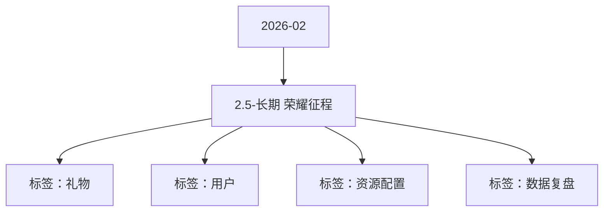

# 2.5-长期  荣耀征程 活动知识图谱

## 核心信息

- 月份：2026-02
- 活动时间：未识别
- 活动 Wiki：https://wiki.inkept.cn/pages/viewpage.action?pageId=471957744
- 活动页面 ID：471957744
- 关联资料数：0
- 标签：礼物、用户、资源配置、数据复盘

## 优化总结

### 活动概览

- 一、活动背景（来源：活动主页面）
- 维稳用户送礼消耗，目标维稳目标用户月消耗与2025年持平（来源：活动主页面）

### 活动时间

- 二、活动时间（来源：活动主页面）

### 玩法规则

- 活动设置荣耀征程玩法，玩法设置月消耗任务，平台内每月用户达到对应消耗门槛，解锁月度福利奖励，玩法统计全平台内礼物墙中的消耗（不统计背包）（来源：活动主页面）
- 消耗任务门槛人数奖励奖励ID私信（来源：活动主页面）
- 礼物白名单：3026【荣耀征程】恭喜完成荣耀征程任务三，获得永恒双极礼物使用权、寰宇荣耀称号、荣耀征程勋章奖励，所有奖励有效期为自下发起至3月31日。（来源：活动主页面）
- 礼物白名单：3027【荣耀征程】恭喜完成荣耀征程任务二，获得誓约星城礼物使用权、盛世荣耀称号奖励 ，所有奖励有效期为自下发起至3月31日。（来源：活动主页面）
- 礼物白名单：3028【荣耀征程】恭喜完成荣耀征程任务一，获得御风共冕礼物使用权、星途荣耀称号奖励 ，所有奖励有效期为自下发起至3月31日。（来源：活动主页面）

### 奖励与资源

- 永恒双极（13140）礼物使用权、称号、勋章*1个月（来源：活动主页面）
- 誓约星城（5200）礼物使用权、称号*1个月（来源：活动主页面）
- 御风共冕（3344）礼物使用权、称号*1个月（来源：活动主页面）
- 三款礼物均为PAG格式礼物，送礼具有用户定制文案，默认显示用户昵称+文案，且13140礼物送出自动触发全站悬浮公聊通知。（来源：活动主页面）
- 礼物IDPAG文案（来源：活动主页面）
- 资源类型资源名称资源IDurl（来源：活动主页面）

### 入口与链接

- 长期，月维度结算（来源：活动主页面）
- 三、活动详情（来源：活动主页面）
- 月完成3月1日发，3月完成4月1日发（来源：活动主页面）
- 荣耀征程 2976（来源：活动主页面）
- 寰宇荣耀 2185（来源：活动主页面）
- 盛世荣耀 2186（来源：活动主页面）
- 星途荣耀 2187（来源：活动主页面）
- PAG文案：（来源：活动主页面）
- 十方皆瞩目，寰宇荣耀用户“用户昵称”驾临（来源：活动主页面）
- 万象皆生辉，盛世荣耀用户“用户昵称”降临（来源：活动主页面）
- 荣光初绽放，星途荣耀用户“用户昵称”登场（来源：活动主页面）
- 用户昵称开启荣耀征程，霸主天下（来源：活动主页面）

## 资料关系图

## 资料来源

- [活动主页面](https://wiki.inkept.cn/pages/viewpage.action?pageId=471957744)
