# 2026年春节 活动知识图谱

## 核心信息

- 月份：2026-02
- 活动时间：未识别
- 活动 Wiki：https://wiki.inkept.cn/pages/viewpage.action?pageId=462598896
- 活动页面 ID：462598896
- 关联资料数：24
- 标签：节日、礼物、主播、用户、数据复盘

## 优化总结

### 活动概览

- ①自我超越玩法的设定，活动期间主播针对春节期间开播时长自我超越达成目标，领取奖励、收入达成目标，领取奖励。--下发下去逻辑漏洞（来源：2026年春节整体方案框架梳理）
- 数据需求背景：（来源：【数据分析需求】2026年春节）
- 三、活动目标：（来源：主播嘉宾春节玩法）
- 一、背景（来源：小用户玩法）
- 二、目标（来源：小用户玩法）
- 进房率目标（来源：小用户玩法）
- 公聊互动率目标（来源：小用户玩法）
- 一、活动目标：（来源：26年春节-st申请）
- 年春节活动总共16天（2月16日-3月3日），年中每日开播门槛任务和收礼任务得映币奖励，目标为日均有效开播主播数环比活动前下降幅度控制在15%以内；年后每日开播门槛任务和收礼任务得映币 累计打卡按比例解锁，目标为有效开播人数对比活动前回升幅度为5%。（来源：26年春节-st申请）
- 年春节活动总共16天（2月16日-3月3日），年中每日开播门槛任务和收礼任务得映币奖励，目标为日均有效开播主播数环比活动前下降幅度控制在15%以内；年后每日开播门槛任务和收礼任务得映币 累计打卡按比例解锁，目标为有效开播人数对比活动前回升幅度为5%。（来源：26年春节预算）

### 活动时间

- 起始时间：2026-02-11 11:45:26（来源：2月17日-2月21日 用户福马迎春送财运）
- 结束时间：2026-03-04 11:45:26（来源：2月17日-2月21日 用户福马迎春送财运）
- 活动时间（来源：2月17日-2月21日 用户福马迎春送财运）
- 【福马迎春送财运】恭喜您完成送礼任务一，已获得59 钻财运钻石券 ×1 张！有效期内单次充值 598 元档位即可自动使用，使用时间：2 月 17 日 —2 月 28 日，快去查看吧～（来源：2月17日-2月21日 用户福马迎春送财运）
- 【福马迎春送财运】恭喜您完成送礼任务二，已获得59 钻财运钻石券 ×2 张！有效期内单次充值 598 元档位即可自动使用，使用时间：2 月 17 日 —2 月 28 日，快去查看吧～（来源：2月17日-2月21日 用户福马迎春送财运）
- ,377 199 1 274,023 27,402 【福马迎春送财运】恭喜您完成送礼任务三，已获得199 钻财运钻石券 ×1 张！有效期内单次充值 998 元档位即可自动使用，使用时间：2 月 17 日 —2 月 28 日，快去查看吧～（来源：2月17日-2月21日 用户福马迎春送财运）
- ,161 199 2 462,078 46,208 【福马迎春送财运】恭喜您完成送礼任务四，已获得199 钻财运钻石券 ×2 张！有效期内单次充值 998 元档位即可自动使用，使用时间：2 月 17 日 —2 月 28 日，快去查看吧～（来源：2月17日-2月21日 用户福马迎春送财运）
- ,998 1 992 899 1 891,808 89,181 【福马迎春送财运】恭喜您完成送礼任务五，已获得899 钻财运钻石券 ×1 张！有效期内单次充值 2998 元档位即可自动使用，使用时间：2 月 17 日 —2 月 28 日，快去查看吧～（来源：2月17日-2月21日 用户福马迎春送财运）

### 玩法规则

- ①登录进房即时领激励，达标即可抽奖（钻石、特权），完成互动、观看时长任务，奖励加码（来源：2026年春节整体方案框架梳理）
- ① 登录进房即时领激励，达标即可抽奖（钻石、特权），完成互动、观看时长任务，奖励加码。（来源：2026年春节整体方案框架梳理）
- ②自我超越任务与主播月任务绑定---节后主播完成自我超越任务，可补签2月结算所缺失的天数（核心针对2月距离月任务相差3-5天的主播，具体看2月开播情况）（来源：2026年春节整体方案框架梳理）
- ②消耗玩法，礼物玩法、功能玩法分阶段上线–堆过往有效玩法拉消耗。（来源：2026年春节整体方案框架梳理）
- 没有完成任务的（来源：2026年春节整体方案框架梳理）
- 活动逻辑（来源：2月17日-2月21日 用户福马迎春送财运）
- 活动期间设置迎五神（财福禄寿喜）玩法，活动期间用户送出活动专属礼物有机会迎接五神的到来，每日设置1位神仙，迎接到到神仙后，用户主播双方会概率获得直播间内曝光和专属神仙资源奖励（资源上限15天）（来源：2月17日-2月21日 用户福马迎春送财运）
- 初五为特殊玩法–迎财神，迎接五路财神，正月初五期间，用户送出活动专属礼物有机会迎接五路财神的到来，迎接到神仙后用户主播双方会概率获得直播间内曝光和专属神仙资源奖励，（来源：2月17日-2月21日 用户福马迎春送财运）
- 活动期间设置五神送财玩法，用户在活动期间完成对应任务可获得返钻券奖励，奖励任务设置两个：（来源：2月17日-2月21日 用户福马迎春送财运）
- 任务是循环任务，完成一轮之后开启下一轮，研发下发的已标红（来源：2月17日-2月21日 用户福马迎春送财运）
- 任务数值下发档位发放张数预估下发人数财运钻石券（返钻券）-单张价值发放张数合计钻石数合计人民币私信（来源：2月17日-2月21日 用户福马迎春送财运）
- 【福马迎春送财运】恭喜您完成送礼人数任务一，已获得59 钻财运钻石券 ×2 张！有效期内单次充值 598 元档位即（来源：2月17日-2月21日 用户福马迎春送财运）
- 【福马迎春送财运】恭喜您完成送礼人数任务二，已获得199 钻财运钻石券 ×2张！有效期内单次充值 998 元档位即可自动使用，（来源：2月17日-2月21日 用户福马迎春送财运）
- 【福马迎春送财运】恭喜您完成送礼人数任务三，已获得899 钻财运钻石券 ×2 张！有效期内单次充值 2998 元档位即可自动使用，（来源：2月17日-2月21日 用户福马迎春送财运）
- 【福马迎春送财运】恭喜您完成送礼人数任务四，已获得600 钻财运钻石券 ×2 张！有效期内单次充值 5998 元档位即可自动使用，（来源：2月17日-2月21日 用户福马迎春送财运）
- 返钻券逻辑，显示在页面当中（来源：2月17日-2月21日 用户福马迎春送财运）
- 钻石返利下发逻辑：充值指定档位及以上档位可以获得钻石返利，直接下发钻石到用户的背包（来源：2月17日-2月21日 用户福马迎春送财运）
- 券包使用逻辑（来源：2月17日-2月21日 用户福马迎春送财运）

### 奖励与资源

- ②临近过年期间，利用年度回馈噱头，依据用户的年消耗金额设定门槛，搭配曝光等全站广播的方式进行背包专属礼物下发白给（来源：2026年春节整体方案框架梳理）
- ③消耗专属礼物达标给返钻券（来源：2026年春节整体方案框架梳理）
- 用户侧：核心重点——高性价比激励拉动回流，恢复日常活跃；核心策略——回归高感知奖励（来源：2026年春节整体方案框架梳理）
- ① 首次登录进房领取什么奖励？看播达标领取什么奖励？，送礼达标领取什么奖励？--短信+私信召回（来源：2026年春节整体方案框架梳理）
- ③KA用户：领取礼物奖励进行召回（来源：2026年春节整体方案框架梳理）
- 活跃及其他—特定专属礼物使用权，针对消耗水准下发 长期性，高档 中档（来源：2026年春节整体方案框架梳理）
- 正月初五当天，用户集齐五路财神，可获得勋章奖励–财神到我家（来源：2月17日-2月21日 用户福马迎春送财运）
- 勋章奖励：（来源：2月17日-2月21日 用户福马迎春送财运）
- 勋章财神到我家2982https://img.ikstatic.cn/MTc3MDc3NjE5MTgzMiM2NDUjcG5n.png用户，唯一型。2026年春节福马迎春送财运活动获得～【福马迎春送财运】恭喜用户昵称成功迎接五路财神！获得财神到我家勋章（永久）奖励，快去看看吧~（来源：2月17日-2月21日 用户福马迎春送财运）
- 礼物名称礼物价格id几率（来源：2月17日-2月21日 用户福马迎春送财运）
- 获得奖励，则获得仅自己可见的直播间公聊消息（来源：2月17日-2月21日 用户福马迎春送财运）
- 【福马迎春送财运】恭喜用户昵称喜迎五神获得奖励名称，快去看看吧～（来源：2月17日-2月21日 用户福马迎春送财运）
- 序号资源类型资源名称-主播、用户、嘉宾都发这个奖励背包ID时长数量价值权重全站广播H5跑马灯用户上限全站每日上限图片url私信内容（来源：2月17日-2月21日 用户福马迎春送财运）
- 每日送出活动专属礼物达到对应数值可解锁对应的返钻券奖励。（来源：2月17日-2月21日 用户福马迎春送财运）
- 每日送出活动专属礼物达到对应人数可解锁对应的返钻券奖励（来源：2月17日-2月21日 用户福马迎春送财运）
- 返钻券奖励设置多个价位，每个价位的返钻券限制可充值的档位，最低598元起可使用。（来源：2月17日-2月21日 用户福马迎春送财运）
- 每天发放的返钻券以五神的名义进行下发，用户获得下发对应的私信。（来源：2月17日-2月21日 用户福马迎春送财运）
- 充值598可以使用59【福马迎春送财运】恭喜您成功充值598元档位（已使用59钻财运钻石券），额外赠送的59钻石已发放至您的余额，快去查看吧！（来源：2月17日-2月21日 用户福马迎春送财运）

### 入口与链接

- 类型名称idurl备注私信（来源：2月17日-2月21日 用户福马迎春送财运）
- 直播间弹幕-20%直播间公聊-20%（来源：2月17日-2月21日 用户福马迎春送财运）
- 喜神喜神直播间画面id：5913【福马迎春送财运】恭喜用户昵称携手主播昵称开门见喜神！喜上眉梢，好运连连~【福马迎春送财运】恭喜用户昵称携手主播昵称开门见喜神！喜上眉梢，好运连连~【福马迎春送财运】恭喜用户昵称携手主播昵称开门见喜神！喜上眉梢，好运连连~【福马迎春送财运】恭喜用户昵称携手主播昵称开门见喜神！喜上眉梢，好运连连~（来源：2月17日-2月21日 用户福马迎春送财运）
- 寿神寿神直播间画面id：5914【福马迎春送财运】恭喜用户昵称携手主播昵称开门见寿神！福寿安康，岁岁平安~【福马迎春送财运】恭喜用户昵称携手主播昵称开门见寿神！福寿安康，岁岁平安~【福马迎春送财运】恭喜用户昵称携手主播昵称开门见寿神！福寿安康，岁岁平安~【福马迎春送财运】恭喜用户昵称携手主播昵称开门见寿神！福寿安康，岁岁平安~（来源：2月17日-2月21日 用户福马迎春送财运）
- 禄神禄神直播间画面id：5915【福马迎春送财运】恭喜用户昵称携手主播昵称开门见禄神！禄星高照，步步高升~【福马迎春送财运】恭喜用户昵称携手主播昵称开门见禄神！禄星高照，步步高升~【福马迎春送财运】恭喜用户昵称携手主播昵称开门见禄神！禄星高照，步步高升~【福马迎春送财运】恭喜用户昵称携手主播昵称开门见禄神！禄星高照，步步高升~（来源：2月17日-2月21日 用户福马迎春送财运）
- 福神福神直播间画面id：5916【福马迎春送财运】恭喜用户昵称携手主播昵称开门见福神！福星高照，吉祥如意~【福马迎春送财运】恭喜用户昵称携手主播昵称开门见福神！福星高照，吉祥如意~【福马迎春送财运】恭喜用户昵称携手主播昵称开门见福神！福星高照，吉祥如意~【福马迎春送财运】恭喜用户昵称携手主播昵称开门见福神！福星高照，吉祥如意~（来源：2月17日-2月21日 用户福马迎春送财运）
- 直播间弹幕直播间公聊（来源：2月17日-2月21日 用户福马迎春送财运）
- 喜神20%喜神直播间画面id：5913【福马迎春送财运】恭喜用户昵称携手主播昵称开门见喜神！喜上眉梢，好运连连~（来源：2月17日-2月21日 用户福马迎春送财运）
- 寿神20%寿神直播间画面id：5914（来源：2月17日-2月21日 用户福马迎春送财运）
- 禄神20%禄神直播间画面id：5915（来源：2月17日-2月21日 用户福马迎春送财运）
- 福神20%福神直播间画面id：5916（来源：2月17日-2月21日 用户福马迎春送财运）
- 财神20%财神直播间画面id：5917（来源：2月17日-2月21日 用户福马迎春送财运）

### 上线配置

- 维稳春节期间不同类型、不同层级用户主播的活跃（来源：【数据分析需求】2026年春节）
- 要依据春节假期期间前中后的不同数据情况和数据趋势做出对应的策略（来源：【数据分析需求】2026年春节）
- 一、秀场侧（来源：【数据分析需求】2026年春节）
- 分析角度：各层级主播、各类型主播（来源：【数据分析需求】2026年春节）
- 秀场各层级、各类型/各层级主播活跃：春节假期前的下降趋势、春节节中的活跃趋势、春节节后的回升趋势。以25年春节、25年五一、25年十一为例。（来源：【数据分析需求】2026年春节）
- 秀场各层级主播收礼：春节节假日前后，各层级主播收礼趋势。以25年春节、25年五一、25年十一为例。（来源：【数据分析需求】2026年春节）
- 二、派对侧（来源：【数据分析需求】2026年春节）
- 分析角度：陪陪个人、派对厅（来源：【数据分析需求】2026年春节）
- 派对各层级嘉宾/派对厅活跃：春节假期前的下降趋势、春节节中的活跃趋势、春节节后的回升趋势。以25年春节、25年五一、25年十一为例。（来源：【数据分析需求】2026年春节）
- 派对各层级嘉宾/派对厅收礼：春节节假日前后，各层级嘉宾收礼趋势。以25年春节、25年五一、25年十一为例。（来源：【数据分析需求】2026年春节）
- 三、用户侧（来源：【数据分析需求】2026年春节）
- 分析角度：整体用户、大KA用户、小KA用户、普通用户（来源：【数据分析需求】2026年春节）
- 各层级用户活跃：春节假期前的下降趋势、春节节中的活跃趋势、春节节后的回升趋势。以25年春节、25年五一、25年十一为例。（来源：【数据分析需求】2026年春节）
- 各层级用户送礼：春节节假日前后，各层级用户送礼趋势。以25年春节、25年五一、25年十一为例。（来源：【数据分析需求】2026年春节）

### 数据与复盘

- 年后（初七至元宵--节后回归期及可预见的消耗低点）：（来源：2026年春节整体方案框架梳理）
- 主播侧：核心重点——推动回流开播，提升活跃与收入，维稳2月末活跃消耗（来源：2026年春节整体方案框架梳理）
- 新主播全勤奖给钱 -给补偿看数据（来源：2026年春节整体方案框架梳理）
- 是否计入送礼流水：是（来源：2月17日-2月21日 用户福马迎春送财运）
- 是否计入基准流水：是（来源：2月17日-2月21日 用户福马迎春送财运）
- 数据埋点：（来源：2月17日-2月21日 用户福马迎春送财运）
- 用户下发勋情况，按照层级、人数、（来源：2月17日-2月21日 用户福马迎春送财运）
- 用户迎接财神情况，按照层级、人数、次数、分日期（来源：2月17日-2月21日 用户福马迎春送财运）
- 财运钻石券（返钻券）下发情况，分档位、人数、次数、汇总（去重）（来源：2月17日-2月21日 用户福马迎春送财运）
- 财运钻石券（返钻券）使用情况，分档位、人数、次数、汇总（去重）-2.22-2.28（来源：2月17日-2月21日 用户福马迎春送财运）
- 活动期间（初一-初五，5日）合计消耗2212万钻，日均消耗442万钻；（来源：【活动数据】2026年春节）
- 秀场和派对的消耗77:23，其中派对厅消耗1699万，秀场消耗512万；（来源：【活动数据】2026年春节）
- 年春节环比2025年春节，整体的消耗日均下降802万（-64.47），送礼人数下降423（-14.17%），arppu下降2446钻（-58.60）。（来源：【活动数据】2026年春节）
- 由于2025年春节的初四初五在月初，2026年春节和2025年春节同比整体的消耗、送礼人数走势前期基本一致，初四初五不太一致。（来源：【活动数据】2026年春节）
- 年春节期间，返钻券设置充值档位降幅（-31.33%）高于25年春节期间的降幅（-14.75%）；26年春节各个层级的充值金额降幅均高于25年春节，其中25年春节S层级充值金额属于提升的趋势，26年属于下降的趋势；（来源：【活动数据】2026年春节）
- 年春节覆盖的充值档位，下降幅度也均高于25年下降幅度。整体返钻券的使用比率在15%-27%，设置消耗获得返钻券并未有效刺激春节期间的充值。（来源：【活动数据】2026年春节）

### 其他关键信息

- 当前现状（来源：2026年春节整体方案框架梳理）
- 近四年主播活跃趋势来看，腊月二十二前后开始出现明显降幅，腊月二十七前后至大年初二为主播活跃最低点，正月初二至正月十一，活跃回升。正月十一左右，基本恢复年前活跃状态。（来源：2026年春节整体方案框架梳理）
- 近四年主播收礼趋势来看，腊月二十–除夕，主播收礼呈上升趋势；除夕、春节当日为主播收礼小高点；初二、初三、初四为主播收礼低点；大年初五收礼有回升后，初六、初七再次回低，初八–正月十一收礼缓慢回升。（来源：2026年春节整体方案框架梳理）
- 核心方向：（来源：2026年春节整体方案框架梳理）
- 用户侧：延缓拉升假期登录观看、拉动节后回流。（来源：2026年春节整体方案框架梳理）
- 主播侧：采用简单直给式激励，年中刺激主播每日活跃，每日开播，年后回归（来源：2026年春节整体方案框架梳理）
- 年前（腊月二十至腊月二十八--活跃下降期）：（来源：2026年春节整体方案框架梳理）
- 主播侧：核心重点—延缓开播活跃度下滑；核心策略—简单直给激励（来源：2026年春节整体方案框架梳理）
- 核心刺激点：（来源：2026年春节整体方案框架梳理）
- 方案1：（来源：2026年春节整体方案框架梳理）

## 资料关系图

```mermaid
graph TD
m202602["2026-02"] --> n462598896["2026年春节"]
n462598896 --> tag节日["标签：节日"]
n462598896 --> tag礼物["标签：礼物"]
n462598896 --> tag主播["标签：主播"]
n462598896 --> tag用户["标签：用户"]
n462598896 --> tag数据复盘["标签：数据复盘"]
n462598896 --> n465477320["2026年春节整体方案框架梳理"]
n462598896 --> n471957989["2月17日-2月21日 用户福马迎春送财运"]
n462598896 --> n462598907["【数据分析需求】2026年春节"]
n462598896 --> n476553571["主播嘉宾春节玩法"]
n462598896 --> n471957761["小用户玩法"]
n462598896 --> n483794738["【活动数据】2026年春节"]
n462598896 --> n483786903["【资源申请】春节用户"]
n462598896 --> n482675268["【预算申请】春节用户预算"]
n462598896 --> n482675103["26年春节-st申请"]
n462598896 --> n480969095["26年春节预算"]
n462598896 --> n483786929["26春节上线申请"]
n462598896 --> n482674000["数据与埋点需求"]
n462598896 --> n483885294["映币下发"]
n462598896 --> n482674389["资源礼物申请"]
n462598896 --> n483885298["2.16日映币奖励下发"]
n462598896 --> n483885300["2.17日映币奖励下发"]
n462598896 --> n483885303["2.18日映币奖励下发"]
n462598896 --> n483885305["2.19日映币奖励下发"]
n462598896 --> n483885307["2.20日映币奖励下发"]
n462598896 --> n483885309["2.21日映币奖励下发"]
n462598896 --> n483885312["2.22日映币奖励下发"]
n462598896 --> n483790260["2.23日映币奖励下发"]
n462598896 --> n483790280["年中打卡奖励"]
n462598896 --> n483795282["年后打卡奖励"]
```

## 资料来源

- [活动主页面](https://wiki.inkept.cn/pages/viewpage.action?pageId=462598896)
- [2026年春节整体方案框架梳理](https://wiki.inkept.cn/pages/viewpage.action?pageId=465477320)
- [2月17日-2月21日 用户福马迎春送财运](https://wiki.inkept.cn/pages/viewpage.action?pageId=471957989)
- [【数据分析需求】2026年春节](https://wiki.inkept.cn/pages/viewpage.action?pageId=462598907)
- [主播嘉宾春节玩法](https://wiki.inkept.cn/pages/viewpage.action?pageId=476553571)
- [小用户玩法](https://wiki.inkept.cn/pages/viewpage.action?pageId=471957761)
- [【活动数据】2026年春节](https://wiki.inkept.cn/pages/viewpage.action?pageId=483794738)
- [【资源申请】春节用户](https://wiki.inkept.cn/pages/viewpage.action?pageId=483786903)
- [【预算申请】春节用户预算](https://wiki.inkept.cn/pages/viewpage.action?pageId=482675268)
- [26年春节-st申请](https://wiki.inkept.cn/pages/viewpage.action?pageId=482675103)
- [26年春节预算](https://wiki.inkept.cn/pages/viewpage.action?pageId=480969095)
- [26春节上线申请](https://wiki.inkept.cn/pages/viewpage.action?pageId=483786929)
- [数据与埋点需求](https://wiki.inkept.cn/pages/viewpage.action?pageId=482674000)
- [映币下发](https://wiki.inkept.cn/pages/viewpage.action?pageId=483885294)
- [资源礼物申请](https://wiki.inkept.cn/pages/viewpage.action?pageId=482674389)
- [2.16日映币奖励下发](https://wiki.inkept.cn/pages/viewpage.action?pageId=483885298)
- [2.17日映币奖励下发](https://wiki.inkept.cn/pages/viewpage.action?pageId=483885300)
- [2.18日映币奖励下发](https://wiki.inkept.cn/pages/viewpage.action?pageId=483885303)
- [2.19日映币奖励下发](https://wiki.inkept.cn/pages/viewpage.action?pageId=483885305)
- [2.20日映币奖励下发](https://wiki.inkept.cn/pages/viewpage.action?pageId=483885307)
- [2.21日映币奖励下发](https://wiki.inkept.cn/pages/viewpage.action?pageId=483885309)
- [2.22日映币奖励下发](https://wiki.inkept.cn/pages/viewpage.action?pageId=483885312)
- [2.23日映币奖励下发](https://wiki.inkept.cn/pages/viewpage.action?pageId=483790260)
- [年中打卡奖励](https://wiki.inkept.cn/pages/viewpage.action?pageId=483790280)
- [年后打卡奖励](https://wiki.inkept.cn/pages/viewpage.action?pageId=483795282)
