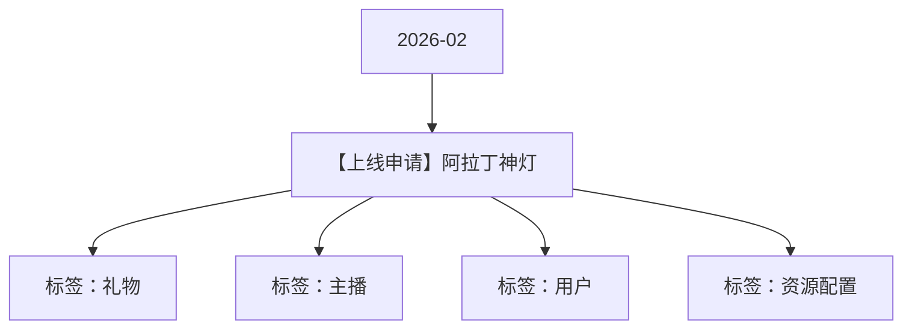

# 【上线申请】阿拉丁神灯 活动知识图谱

## 核心信息

- 月份：2026-02
- 活动时间：未识别
- 活动 Wiki：https://wiki.inkept.cn/pages/viewpage.action?pageId=482674428
- 活动页面 ID：482674428
- 关联资料数：0
- 标签：礼物、主播、用户、资源配置

## 优化总结

### 活动时间

- 上线时间：（来源：活动主页面）
- 生效时间：2026年2月23日00:00:00-2月25日23:59:59（来源：活动主页面）

### 奖励与资源

- 【阿拉丁神灯】现申请相关资源及礼物配置，及上线申请。（来源：活动主页面）
- 辛苦@灿灿配置并返回相关id。（来源：活动主页面）
- 礼物名称礼物价值礼物id资源id备注描述（来源：活动主页面）
- 主播获得1映币，标签，幸阿拉丁神灯，用户送给主播，主播获得1映币，剩余参与阿拉丁神灯魔法，最高可获得99999钻礼物。https://boc.inke.cn/react/banner/202506/alading-light/index.html?from=plugin&ik_halfdisplay=1&half_screen=1（来源：活动主页面）
- 气泡：活动礼物（来源：活动主页面）
- 定位礼物：阿拉灯神灯（id：21991）（来源：活动主页面）
- 文案：【阿拉灯神灯】上线啦~最高可拆出99999热力值礼物，快来参与吧~（来源：活动主页面）

### 入口与链接

- Hi all，（来源：活动主页面）
- 辛苦@叶导 审批，（来源：活动主页面）
- 阿拉丁神灯（来源：活动主页面）
- 阿拉丁神灯2021991（来源：活动主页面）
- 年2月23日00:00:00-2月25日23:59:59（来源：活动主页面）
- 推荐墙首页，（来源：活动主页面）
- 上新气泡：（来源：活动主页面）
- 气泡类型：默认（来源：活动主页面）
- 生效场景：所有（来源：活动主页面）
- 生效人群：all（来源：活动主页面）
- 生效批次：首次（来源：活动主页面）
- 优先级：1（来源：活动主页面）

## 资料关系图

## 资料来源

- [活动主页面](https://wiki.inkept.cn/pages/viewpage.action?pageId=482674428)
