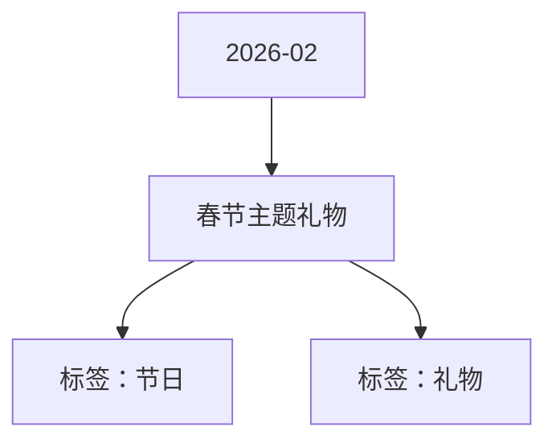

# 春节主题礼物 活动知识图谱

## 核心信息

- 月份：2026-02
- 活动时间：未识别
- 活动 Wiki：https://wiki.inkept.cn/pages/viewpage.action?pageId=473630980
- 活动页面 ID：473630980
- 关联资料数：0
- 标签：节日、礼物

## 优化总结

### 活动概览

- （3）背景，金币、红包洒落（来源：活动主页面）

### 奖励与资源

- 礼物价格画风/故事线描述图片参考（来源：活动主页面）
- 注意：风格不是参考图片的水墨风格；和后续的礼物风格（3d）保持一致。（来源：活动主页面）

### 入口与链接

- 【马年大吉】（来源：活动主页面）
- 小马+红包（来源：活动主页面）
- 小马跳出来，拿着红包左右晃（来源：活动主页面）
- 【马上来财】（来源：活动主页面）
- （1）小马载着从后女孩奔来，逐渐变大，抬前腿，后腿刹停（2）推镜头到女孩：女孩抱着金元宝；（来源：活动主页面）
- 方向：盛大的烟花，右图为样式参考（来源：活动主页面）
- 要求：绚丽丰富（来源：活动主页面）
- 【火树银花】（来源：活动主页面）
- 【新年焰语】（来源：活动主页面）
- 方向：双人、灯展/聚会（来源：活动主页面）
- 要求：年味足（来源：活动主页面）
- （1）双人互动*2：（来源：活动主页面）

## 资料关系图

## 资料来源

- [活动主页面](https://wiki.inkept.cn/pages/viewpage.action?pageId=473630980)
