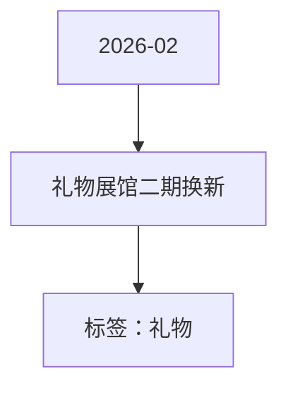

# 礼物展馆二期换新 活动知识图谱

## 核心信息

- 月份：2026-02
- 活动时间：未识别
- 活动 Wiki：https://wiki.inkept.cn/pages/viewpage.action?pageId=470693664
- 活动页面 ID：470693664
- 关联资料数：0
- 标签：礼物

## 优化总结

### 奖励与资源

- 礼物价格画风/故事线描述图片参考（来源：活动主页面）

### 入口与链接

- 水晶苹果（来源：活动主页面）
- 锦绣华球：壮锦绣球（来源：活动主页面）
- 蝶舞冰音：蝴蝶、唱盘、冰晶元素，蓝紫色调，梦幻华丽的画风（来源：活动主页面）
- 双鹊贺喜：成双喜鹊、丝带、祥云元素（来源：活动主页面）
- 灵狐踏雪（来源：活动主页面）
- 雪豹凌云（来源：活动主页面）
- 一路生花（来源：活动主页面）
- 柿柿如意（来源：活动主页面）
- 童话巡礼：一个精致的旋转木马装置，身着长裙的女孩置身期间；梦幻唯美的画风（来源：活动主页面）
- 蝶梦水谣:闪蝶、竖琴、冰山元素（来源：活动主页面）
- 【烟火盛会】（来源：活动主页面）
- 镜头1:旋转木马（来源：活动主页面）

## 资料关系图

## 资料来源

- [活动主页面](https://wiki.inkept.cn/pages/viewpage.action?pageId=470693664)
