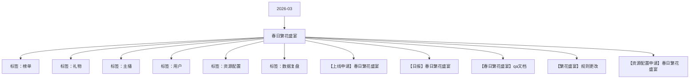

# 春日繁花盛宴 活动知识图谱

## 核心信息

- 月份：2026-03
- 活动时间：3.14-3.18
- 活动 Wiki：https://wiki.inkept.cn/pages/viewpage.action?pageId=483790250
- 活动页面 ID：483790250
- 关联资料数：5
- 标签：榜单、礼物、主播、用户、资源配置、数据复盘

## 优化总结

### 活动概览

- 二 活动目标：（来源：活动主页面）
- 活动目标：（来源：活动主页面）
- 目标完成度（来源：【日报】春日繁花盛宴）
- 消耗目标3000万钻，活动上线3天，消耗2028万钻，目标完成度67.61%。（来源：【日报】春日繁花盛宴）
- 消耗目标消耗钻石数目标完成度时间进度（来源：【日报】春日繁花盛宴）

### 活动时间

- 一、活动时间：（来源：活动主页面）
- 时间礼物名称礼物 id礼物价格资源 id奖池图片url（来源：活动主页面）
- 活动时间：3.14-3.18（来源：活动主页面）
- 时间：3月14日00:00:00-3月19日23:59:59（来源：【上线申请】春日繁花盛宴）
- 时间：3月14日00:00:00-3月18日23:59:59（来源：【上线申请】春日繁花盛宴）
- 时间：3月14日00:00:00-3月15日23:59:59（来源：【上线申请】春日繁花盛宴）
- 添加称号链接，修改上线时间及白名单配置修改为否（来源：【上线申请】春日繁花盛宴）
- 时间礼物名称礼物 id礼物价格资源 id奖池（来源：【春日繁花盛宴】qa文档）

### 玩法规则

- 主播玩法：（来源：活动主页面）
- 收礼任务玩法逻辑：（来源：活动主页面）
- 活动期间，每次收礼达到21钻石即可获得1朵玫瑰花，累计次数达到对应阶段，解锁对应的曝光奖励，为活动期间累计循环任务（来源：活动主页面）
- 主播人数任务：活动设置主播被收礼人数打卡任务，收集不同人数达到不同阶段，解锁对应奖励，（打卡奖励任务区分主播/陪陪），为活动期间累计循环任务（来源：活动主页面）
- 主播收礼人数任务（来源：活动主页面）
- 关卡任务值资源类型资源名称资源id时长数量私信内容弹幕或公聊内容图片（来源：活动主页面）
- 陪陪收礼人数任务（来源：活动主页面）
- 用户贡献榜单（来源：活动主页面）
- 主播完成日收礼任务达到第二阶段后，即可开启用户贡献榜单奖励，用户每日贡献达到TOP3即可获得奖励。（来源：活动主页面）
- 排名资源类型资源名称资源id时长数量私信内容（来源：活动主页面）
- 玩法逻辑：（来源：活动主页面）
- 活动期间，当红主播/新秀主播/派对嘉宾每日累计收礼参与日榜争夺，根据榜单排名点亮奖励。（来源：活动主页面）
- 用户玩法（来源：活动主页面）
- 主播直播间 “冲刺任务”：用户给单个主播（派对厅算陪陪为单个主播）单日消耗满 2000积分，（每天每个主播限制1次），则算作1次，累计次数获得对应的资源奖励，活动期间的累计循环任务（来源：活动主页面）
- 【春日繁花盛宴】恭喜您完成送礼人数任务一，已获得锦绣赏客头像框 ×2 天，请注意查收。（来源：活动主页面）
- 【春日繁花盛宴】恭喜您完成送礼人数任务二，已获得锦绣赏客麦序框 ×2 天，请注意查收。（来源：活动主页面）
- 【春日繁花盛宴】恭喜您完成送礼人数任务三，已获得锦绣赏客公聊皮肤×2 天，请注意查收。（来源：活动主页面）
- 【春日繁花盛宴】恭喜您完成送礼人数任务四，已获得锦绣赏客称号 ×2 天，请注意查收。（来源：活动主页面）

### 奖励与资源

- 礼物统计id:24126,24160,24161,24162,24163,24164,24165,24166,24167（来源：活动主页面）
- 礼物名称价值礼物ID（来源：活动主页面）
- 派对（嘉宾收礼）：厅主及厅内嘉宾4人视频，6人视频，9人音频房间收礼的专属礼物收入，其余方式均不计入统计。谁收算谁的。（来源：活动主页面）
- 累计次数成本奖励（来源：活动主页面）
- 【春日繁花盛宴】恭喜宝宝获得主播日贡献榜TOP1，获得花间闪耀头像框*2天、花间闪耀麦序框*2天、花间闪耀称号*2天、花间闪耀公聊皮肤*2天、花间闪耀公聊角标*2天奖励，奖励已下发，快去看看吧～（来源：活动主页面）
- 【春日繁花盛宴】恭喜宝宝获得主播日贡献榜TOP3，获得花间闪耀头像框*1天、花间闪耀麦序框*1天、花间闪耀称号*1天、花间闪耀公聊角标*1天奖励，奖励已下发，快去看看吧～（来源：活动主页面）
- 奖励与私信由研发实时下发（来源：活动主页面）
- 【春日繁花盛宴】恭喜宝宝获得当红主播日榜TOP1，获得繁花加冕称号*5天、繁花加冕主页挂件*5天、繁花加冕动态头像框*5天、热13推荐卡*3张奖励，奖励已下发，快去看看吧～（来源：活动主页面）
- 【春日繁花盛宴】恭喜宝宝获得当红主播日贡献榜TOP5，获得繁花加冕称号*3天、繁花加冕主页挂件*3天、繁花加冕动态头像框*3天、热13推荐卡*1张奖励，奖励已下发，快去看看吧～（来源：活动主页面）
- 【春日繁花盛宴】恭喜宝宝获得当红主播日贡献榜TOP10，获得繁花加冕称号*2天、繁花加冕主页挂件*2天、繁花加冕头像框*2天奖励，奖励已下发，快去看看吧～（来源：活动主页面）
- 【春日繁花盛宴】恭喜宝宝获得新秀主播日榜TOP1，获得繁花加冕称号*3天、繁花加冕主页挂件*3天、繁花加冕动态头像框*3天、热13推荐卡*2张奖励，奖励已下发，快去看看吧～（来源：活动主页面）
- 【春日繁花盛宴】恭喜宝宝获得新秀主播日贡献榜TOP5，获得繁花加冕称号*2天、繁花加冕主页挂件*2天、繁花加冕动态头像框*2天奖励，奖励已下发，快去看看吧～（来源：活动主页面）
- 【春日繁花盛宴】恭喜宝宝获得新秀主播日贡献榜TOP10，获得繁花加冕称号*1天、繁花加冕主页挂件*1天、繁花加冕动态头像框*1天奖励，奖励已下发，快去看看吧～（来源：活动主页面）
- 【春日繁花盛宴】恭喜宝宝获得心动嘉宾日榜TOP1，获得繁花加冕称号*5天、繁花加冕动态头像框*5天、繁花加冕上麦动效*5天、繁花加冕主页挂件*5天奖励，奖励已下发，快去看看吧～（来源：活动主页面）
- 【春日繁花盛宴】恭喜宝宝获得繁花加冕称号*3天、繁花加冕动态头像框*3天、繁花加冕上麦动效*3天、繁花加冕主页挂件*3奖励，奖励已下发，快去看看吧～（来源：活动主页面）
- 【春日繁花盛宴】恭喜宝宝获得心动嘉宾日贡献榜TOP10，获得繁花加冕称号*2天、繁花加冕动态头像框*2天、繁花加冕上麦动效*2天奖励，奖励已下发，快去看看吧～（来源：活动主页面）
- 用户日榜奖励（来源：活动主页面）
- 【春日繁花盛宴】恭喜宝宝获得用户日榜TOP1，获得盛世芳华动态头像框*5天、盛世芳华称号*5天、盛世芳华挂件*5天、爱意绵绵资料卡浮屏*5天奖励，奖励已下发，快去看看吧～（来源：活动主页面）

### 入口与链接

- 月14日-3月18日（来源：活动主页面）
- 活动期间日均消耗600w，活动消耗3000w（来源：活动主页面）
- 所有统计的id:24126,24160,24161,24162,24163,24164,24165,24166,24167,24137,24138,24139,24140,24141,24142,24143,24144,24145,24147,24148,24149,24150（来源：活动主页面）
- 繁花小映1888钻24126（来源：活动主页面）
- 金枝玉叶1024160（来源：活动主页面）
- 炫彩水母9924161（来源：活动主页面）
- 爱意定格52024162（来源：活动主页面）
- 时光恋人131424163（来源：活动主页面）
- 凤凰之约520024164（来源：活动主页面）
- 梦幻世纪1314024165（来源：活动主页面）
- 烟海缠绵5200024166（来源：活动主页面）
- 璀璨盛宴9999924167（来源：活动主页面）

### 上线配置

- Hi all，（来源：【上线申请】春日繁花盛宴）
- 辛苦@叶导 审批，（来源：【上线申请】春日繁花盛宴）
- 星愿兔兔5224205（来源：【上线申请】春日繁花盛宴）
- 鲸跃星空99924206（来源：【上线申请】春日繁花盛宴）
- 星辰邂逅334424207（来源：【上线申请】春日繁花盛宴）
- 爪爪联萌3344024208（来源：【上线申请】春日繁花盛宴）
- 以上，如有问题，随时沟通。（来源：【上线申请】春日繁花盛宴）
- 标题：春日繁花盛宴（来源：【上线申请】春日繁花盛宴）
- 色值：linear-gradient(90deg, #f6ca9f4 0%, #4d92ff 100%)；（来源：【上线申请】春日繁花盛宴）
- 位置：第一位，（来源：【上线申请】春日繁花盛宴）
- 二、icon（来源：【上线申请】春日繁花盛宴）
- 位置：第一位（来源：【上线申请】春日繁花盛宴）
- 三、首页banner（来源：【上线申请】春日繁花盛宴）
- 四、全站私信（来源：【上线申请】春日繁花盛宴）

### 数据与复盘

- Hi all（来源：【日报】春日繁花盛宴）
- ,000,00020,282,89567.61%60.00%（来源：【日报】春日繁花盛宴）
- ,750,910 17,132,859 7,354,064 4,039,272 2,480,832 833,960 24.72%38.06%（来源：【日报】春日繁花盛宴）
- ,544,899 20,499,187 6,989,534 4,558,326 1,974,848 456,360 20.23%31.87%（来源：【日报】春日繁花盛宴）
- ,208,710 16,895,215 5,955,972 3,591,344 1,984,288 380,340 17.41%33.00%（来源：【日报】春日繁花盛宴）
- 合计98,504,519 54,527,261 20,299,570 12,188,942 6,439,968 1,670,660 20.61%34.16%（来源：【日报】春日繁花盛宴）
- 场景主播分布：（来源：【日报】春日繁花盛宴）
- 场景消耗钻石数占比（来源：【日报】春日繁花盛宴）
- 派对12,914,615 69.33%（来源：【日报】春日繁花盛宴）
- 秀场5,714,295 30.67%（来源：【日报】春日繁花盛宴）
- 总计18,628,910（来源：【日报】春日繁花盛宴）
- 各层级主播收礼数据（来源：【日报】春日繁花盛宴）
- 派对侧收礼的主播主要集中BN层级，秀场侧收礼的主播主要集中在B层级。（来源：【日报】春日繁花盛宴）
- 主播61日动态层级派对占比秀场占比（来源：【日报】春日繁花盛宴）
- S1,172,720 6.43%916,127 5.03%（来源：【日报】春日繁花盛宴）
- A145,017 0.80%524,725 2.88%（来源：【日报】春日繁花盛宴）

### 其他关键信息

- 全站弹幕+全站画面（来源：【春日繁花盛宴】qa文档）
- 弹幕文案：【春日繁花盛宴】恭喜用户昵称携手主播昵称盛世花开，荣耀加冕。（来源：【春日繁花盛宴】qa文档）
- task_keyscore_totalprize_typeprize_name（来源：【春日繁花盛宴】qa文档）
- 头像框春日繁花头像框（来源：【春日繁花盛宴】qa文档）
- 称号春日繁花称号（来源：【春日繁花盛宴】qa文档）
- 主页挂件1春日繁花主页挂件（来源：【春日繁花盛宴】qa文档）
- 浮屏春日繁花主页浮屏（来源：【春日繁花盛宴】qa文档）
- 麦序框春日繁花麦序框（来源：【春日繁花盛宴】qa文档）
- 主页挂件春日繁花主页挂件（来源：【春日繁花盛宴】qa文档）
- rankprize_typeprize_name（来源：【春日繁花盛宴】qa文档）

## 资料关系图

## 资料来源

- [活动主页面](https://wiki.inkept.cn/pages/viewpage.action?pageId=483790250)
- [【上线申请】春日繁花盛宴](https://wiki.inkept.cn/pages/viewpage.action?pageId=488346138)
- [【日报】春日繁花盛宴](https://wiki.inkept.cn/pages/viewpage.action?pageId=488346972)
- [【春日繁花盛宴】qa文档](https://wiki.inkept.cn/pages/viewpage.action?pageId=488346325)
- [【繁花盛宴】规则更改](https://wiki.inkept.cn/pages/viewpage.action?pageId=488346052)
- [【资源配置申请】春日繁花盛宴](https://wiki.inkept.cn/pages/viewpage.action?pageId=488342925)
