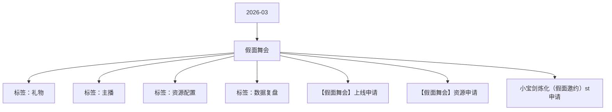

# 假面舞会 活动知识图谱

## 核心信息

- 月份：2026-03
- 活动时间：3.19-3.22
- 活动 Wiki：https://wiki.inkept.cn/pages/viewpage.action?pageId=483795095
- 活动页面 ID：483795095
- 关联资料数：3
- 标签：礼物、主播、资源配置、数据复盘

## 优化总结

### 活动概览

- 二、活动目标：（来源：活动主页面）
- 初级舞会1000PK背景*4天公聊皮肤*4天（来源：活动主页面）
- 背包资源假面舞会PK背景2074（来源：活动主页面）
- 【假面舞会】恭喜宝宝进入初级舞会，完成主播任务一，获得假面舞会PK背景*4天，奖励已下发，快去查看吧～（来源：活动主页面）
- PK背景假面舞会PK背景（来源：【假面舞会】资源申请）
- 派对背景假面舞会派对背景（来源：【假面舞会】资源申请）
- 一、活动目标：（来源：小宝剑炼化（假面邀约）st申请）

### 活动时间

- 起始时间：2026-03-16 18:29:28（来源：活动主页面）
- 结束时间：2027-03-16 18:29:28（来源：活动主页面）
- 起始时间：2026-03-16 18:27:32（来源：活动主页面）
- 结束时间：2027-03-16 18:27:32（来源：活动主页面）
- 一、活动时间（来源：活动主页面）
- 首个送礼达10000钻的用户将直接冠名主播的直播间（即：用户的头像和昵称显示在主播的H5页面上），并获得专属进房提示（时间截至3月23日23:59:59）。（来源：活动主页面）
- 活动时间：3月19日18:00:00-3月22日23:59:59（来源：活动主页面）
- 活动时间：3.19-3.22（来源：活动主页面）

### 玩法规则

- 四、活动玩法（来源：活动主页面）
- 核心玩法：主播任务--假面舞会进行时（来源：活动主页面）
- 活动期间，主播收礼开启舞会。舞会分为初级舞会和高级舞会。主播活动期间累计收礼达20000钻，可以由初级舞会升级至高级舞会，该升级玩法单项不循环。（来源：活动主页面）
- 关卡任务值资源类型资源名称资源id时长数量私信内容（来源：活动主页面）
- 【假面舞会】恭喜宝宝进入初级舞会，完成主播任务二，获得假面舞会贴纸*4天，奖励已下发，快去查看吧～（来源：活动主页面）
- 【假面舞会】恭喜宝宝进入初级舞会，完成主播任务三，获得假面舞会头像框*4天，奖励已下发，快去查看吧～（来源：活动主页面）
- 【假面舞会】恭喜宝宝进入高级舞会，完成主播任务四，获得流光捕手称号*4天，奖励已下发，快去查看吧～（来源：活动主页面）
- 【假面舞会】恭喜宝宝进入高级舞会，完成主播任务五，获得假面舞会主页挂件*4天，奖励已下发，快去查看吧～（来源：活动主页面）
- 【假面舞会】恭喜宝宝进入高级舞会，完成主播任务六，获得假面舞会主页浮屏*4天，奖励已下发，快去查看吧～（来源：活动主页面）
- 【假面舞会】恭喜宝宝进入初级舞会，完成嘉宾任务一，获得假面舞会公聊皮肤*4天，奖励已下发，快去查看吧～（来源：活动主页面）
- 【假面舞会】恭喜宝宝进入初级舞会，完成嘉宾任务二，获得假面舞会麦序框*4天，奖励已下发，快去查看吧～（来源：活动主页面）
- 【假面舞会】恭喜宝宝进入初级舞会，完成嘉宾任务三，获得假面舞会上麦动效*4天，奖励已下发，快去查看吧～（来源：活动主页面）
- 【假面舞会】恭喜宝宝进入高级舞会，完成嘉宾任务四，获得流光捕手称号*4天，奖励已下发，快去查看吧～（来源：活动主页面）
- 【假面舞会】恭喜宝宝进入高级舞会，完成嘉宾任务五，获得假面舞会主页挂件*4天，奖励已下发，快去查看吧～（来源：活动主页面）
- 【假面舞会】恭喜宝宝进入高级舞会，完成嘉宾任务六，获得假面舞会主页浮屏*4天，奖励已下发，快去查看吧～（来源：活动主页面）
- 若送出一个大礼物，阶段值直接拉满，则直接将用户送出的所有钻石数直接在主播当前所处的最新阶段进行抽奖。（来源：活动主页面）
- 用户--贡献榜单（来源：活动主页面）
- 主播开启高级舞会，即可开启用户贡献总榜榜单奖励，用户活动期间贡献钻石数达到TOP3即可获得以下资源奖励。（来源：活动主页面）

### 奖励与资源

- 您申请的操作对象为：映币，请把对应的soucetype提供给“主播运营组(礼物墙管理)”，用于配置背包礼物；（来源：活动主页面）
- 您申请的SourceType: [背包礼物-赠送-活动运营-10钻版宝剑炼化-2026-03-16] 已经审批完成（来源：活动主页面）
- 您申请的操作对象为：背包礼物，请把对应的soucetype提供给“活动业务组”，用于下发背包礼物；（来源：活动主页面）
- 所有礼物id统计：24209,21111,24210,24211,24212,24213,24214,24215,24216,24217,24218,24219,24220,24221,24222（来源：活动主页面）
- 礼物墙id统计：24209,21111,24210,24211,24212,24213,24214,24215,24216,24217,24218,24219（来源：活动主页面）
- 礼物墙礼物礼物名称价格idurl备注（来源：活动主页面）
- 假面邀约1024209https://img.ikstatic.cn/MTc3MzY1NTMxMDM0MCMyOTUjcG5n.png新，幸 不参与全礼物打折,5级以下不可见 全凭用户送给主播，主播获得1热力值，剩余参与假面的邀约，邀约最高可获得20倍礼物暴击。（来源：活动主页面）
- 喷钞机小映-礼物B资源名称资源id价值图片url（来源：活动主页面）
- 假面邀约-礼物B，BB礼物，5天有效期礼物名称价格礼物idBB ID备注（来源：活动主页面）
- 蒙面侍从50242206854BB礼物，5天有效期（来源：活动主页面）
- 假面贵族100242216855BB礼物，5天有效期（来源：活动主页面）
- 暗夜公爵200242226856BB礼物，5天有效期（来源：活动主页面）
- 活动期间，累计主播收礼映币数，得对应档位的资源奖励。（来源：活动主页面）
- 背包资源假面舞会贴纸2374（来源：活动主页面）
- 背包资源假面舞会头像框98894（来源：活动主页面）
- 背包资源假面舞会主页挂件68554（来源：活动主页面）
- 背包资源假面舞会主页浮屏68574（来源：活动主页面）
- 背包资源假面舞会公聊皮肤71884（来源：活动主页面）

### 入口与链接

- 您申请的SourceType: [增加映币-赠送-活动运营-10钻版宝剑炼化-2026-03-16] 已经审批完成（来源：活动主页面）
- SourceType:5392（来源：活动主页面）
- APP账单记录文案：【假面邀约】活动获得（来源：活动主页面）
- 是否计入送礼流水：是（来源：活动主页面）
- 是否计入基准流水：是（来源：活动主页面）
- 是否计入无背包基准映币：否（来源：活动主页面）
- 否计入实际映币收入：是（来源：活动主页面）
- 是否为赠送钻石：否（来源：活动主页面）
- SourceType Hash:aa7092259273546824834b33b9e315ed（来源：活动主页面）
- HASH使用时请保持小写，请及时关注SourceType预警邮件。（来源：活动主页面）
- SourceType:4360（来源：活动主页面）
- SourceType Hash:561b82e55829c11c5145bcf68bdf210e（来源：活动主页面）

### 上线配置

- Dear all，（来源：【假面舞会】上线申请）
- 辛苦 @叶导 审批，（来源：【假面舞会】上线申请）
- 标题：假面舞会（来源：【假面舞会】上线申请）
- 色值：linear-gradient(90deg, #150d08 0%, #150d08 100%)（来源：【假面舞会】上线申请）
- 位置：第一位，23日后移（来源：【假面舞会】上线申请）
- 标题：假面邀约（来源：【假面舞会】上线申请）
- 色值： linear-gradient(90deg, #150d08 0%, #150d08 100%)（来源：【假面舞会】上线申请）
- 位置：第二位（来源：【假面舞会】上线申请）
- 二、icon（来源：【假面舞会】上线申请）
- 标题：假面舞会（强挂）（来源：【假面舞会】上线申请）
- 文案：日榜TOP1上『全站开屏』（来源：【假面舞会】上线申请）
- 类型：普通，电台交友，视频交友（来源：【假面舞会】上线申请）
- 位置：第一位（来源：【假面舞会】上线申请）
- 三、首页banner（来源：【假面舞会】上线申请）

### 数据与复盘

- 日均消耗100万钻（来源：小宝剑炼化（假面邀约）st申请）

### 其他关键信息

- Hi all，（来源：小宝剑炼化（假面邀约）st申请）
- 辛苦@叶导 确认；（来源：小宝剑炼化（假面邀约）st申请）
- 辛苦@成武核对（来源：小宝剑炼化（假面邀约）st申请）
- sourcetype限额：（来源：小宝剑炼化（假面邀约）st申请）
- 本次需申请2个source type，分别功能为作为（来源：小宝剑炼化（假面邀约）st申请）
- 增加映币（来源：小宝剑炼化（假面邀约）st申请）
- 辛苦FMS后台审批；（来源：小宝剑炼化（假面邀约）st申请）
- 以上，感谢！（来源：小宝剑炼化（假面邀约）st申请）
- 如有疑问钉钉联系~​（来源：小宝剑炼化（假面邀约）st申请）

## 资料关系图

## 资料来源

- [活动主页面](https://wiki.inkept.cn/pages/viewpage.action?pageId=483795095)
- [【假面舞会】上线申请](https://wiki.inkept.cn/pages/viewpage.action?pageId=488347145)
- [【假面舞会】资源申请](https://wiki.inkept.cn/pages/viewpage.action?pageId=488346856)
- [小宝剑炼化（假面邀约）st申请](https://wiki.inkept.cn/pages/viewpage.action?pageId=488346905)
