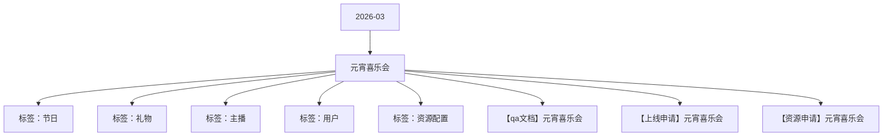

# 元宵喜乐会 活动知识图谱

## 核心信息

- 月份：2026-03
- 活动时间：3.2-3.3
- 活动 Wiki：https://wiki.inkept.cn/pages/viewpage.action?pageId=478981921
- 活动页面 ID：478981921
- 关联资料数：3
- 标签：节日、礼物、主播、用户、资源配置

## 优化总结

### 活动时间

- 活动时间（来源：活动主页面）
- 喜迎元宵麦序框 没有写时间（来源：活动主页面）
- 活动时间（来源：【qa文档】元宵喜乐会）
- 喜迎元宵麦序框 没有写时间（来源：【qa文档】元宵喜乐会）
- 时间：3月2日00:00:00-12月1日23:59:59（来源：【上线申请】元宵喜乐会）
- 时间：3月2日00:00:00-3月3日23:59:59（来源：【上线申请】元宵喜乐会）
- 添加称号链接，修改上线时间及白名单配置修改为否（来源：【上线申请】元宵喜乐会）

### 玩法规则

- 活动逻辑（来源：活动主页面）
- 活动期间设置迎神玩法，活动期间用户送出活动专属礼物有机会迎接神仙的到来，设置1位神仙，迎接到到神仙后，用户主播双方会概率获得直播间内曝光和专属神仙资源奖励（资源上限15天）（来源：活动主页面）
- 活动逻辑（来源：【qa文档】元宵喜乐会）
- 活动期间设置迎神玩法，活动期间用户送出活动专属礼物有机会迎接福气，已经到福气后，用户主播双方会概率获得直播间内曝光和专属神仙资源奖励（资源上限15天）（来源：【qa文档】元宵喜乐会）

### 奖励与资源

- 礼物名称钻石数礼物id机会礼物id（来源：活动主页面）
- 获得奖励，则获得仅自己可见的直播间公聊消息（来源：活动主页面）
- 【元宵喜乐会】恭喜用户昵称元宵喜乐获得奖励名称，快去看看吧～（来源：活动主页面）
- 序号资源类型资源名称-主播、用户、嘉宾都发这个奖励背包ID时长数量价值权重全站广播H5跑马灯用户上限全站每日上限图片url私信内容（来源：活动主页面）
- 礼物名称钻石数机会（来源：【qa文档】元宵喜乐会）
- 获得奖励，则获得仅自己可见的直播间公聊消息（来源：【qa文档】元宵喜乐会）
- 【元宵喜乐会】恭喜用户昵称元宵喜乐获得奖励名称，快去看看吧～（来源：【qa文档】元宵喜乐会）
- 序号资源类型资源名称-主播、用户、嘉宾都发这个奖励时长（来源：【qa文档】元宵喜乐会）
- 【元宵喜乐会】活动将于3月2日00:00:00-3月3日23:59:59上线，现申请相关上线配置。（来源：【上线申请】元宵喜乐会）
- 辛苦@灿灿 配置。（来源：【上线申请】元宵喜乐会）
- 具体需求如下（资源图钉钉提供）：（来源：【上线申请】元宵喜乐会）
- 文案：解锁元宵专属奖励（来源：【上线申请】元宵喜乐会）
- 文案：【元宵喜乐会】元宵节快乐！快来参与解锁特权奖励！（来源：【上线申请】元宵喜乐会）
- 七 、礼物墙（来源：【上线申请】元宵喜乐会）
- 所有专属礼物均配置礼物墙banner（来源：【上线申请】元宵喜乐会）
- 礼物名称钻石数礼物id（来源：【上线申请】元宵喜乐会）
- Hi all，（来源：【资源申请】元宵喜乐会）
- 【元宵喜乐会】活动即将进入测试阶段，现申请相关资源、礼物配置。（来源：【资源申请】元宵喜乐会）

### 入口与链接

- 原型图：https://modao.cc/proto/BJqWm6nKt9gmsf8jdcOG7D/sharing?view_mode=read_only&screen=rbpV9OJ73ZanWhsmS #未命名原型-分享（来源：活动主页面）
- 月2日-3月3日（来源：活动主页面）
- 黑芝麻元宵10240490.20%https://img.ikstatic.cn/MTY0NDgwODMzNzkzMyM0MzQjcG5n.png（来源：活动主页面）
- 指尖星光99240502.00%https://img.ikstatic.cn/MTc3MDM2MjA0MjE4NSM2ODMjcG5n.png（来源：活动主页面）
- 爱意定格5202405110.00%https://img.ikstatic.cn/MTc3MDM2MjA3ODEzNiM0NTAjcG5n.png（来源：活动主页面）
- 时光恋人13142405225.00%https://img.ikstatic.cn/MTc2NzA4NTc4OTcxMiM5MDAjcG5n.png（来源：活动主页面）
- 凤凰之约520024053100.00%https://img.ikstatic.cn/MTc2NTk0MTU5MjY1NiM3MTQjcG5n.png（来源：活动主页面）
- 窈窕佳人1314024054100.00%https://img.ikstatic.cn/MTc2NjY1MjY0ODkwNyM5MzUjcG5n.png（来源：活动主页面）
- 玫瑰骑士5200024057100.00%https://img.ikstatic.cn/MTc0NTU2MjQyMjMyNCM5MDQjcG5n.png（来源：活动主页面）
- 时代传奇9999924056100.00%https://img.ikstatic.cn/MTc2NTk0MTc2NzM3NSMgMjYjcG5n.png（来源：活动主页面）
- 直播间弹幕-45%直播间公聊-45%（来源：活动主页面）
- 全站悬浮公聊-5%上电视-5%（来源：活动主页面）

### 上线配置

- Hi all，（来源：【上线申请】元宵喜乐会）
- 辛苦@叶导 审批，（来源：【上线申请】元宵喜乐会）
- 标题：元宵喜乐会（来源：【上线申请】元宵喜乐会）
- 色值：linear-gradient(90deg, #ff802b 0%, #ff802b 100%)；（来源：【上线申请】元宵喜乐会）
- 位置：第二位，（来源：【上线申请】元宵喜乐会）
- 二、icon（来源：【上线申请】元宵喜乐会）
- 位置：第二位（来源：【上线申请】元宵喜乐会）
- 三、首页banner（来源：【上线申请】元宵喜乐会）
- 四、全站私信（来源：【上线申请】元宵喜乐会）
- 月2日00:00:00（来源：【上线申请】元宵喜乐会）
- 五 、开屏（来源：【上线申请】元宵喜乐会）
- 黑芝麻元宵1024049（来源：【上线申请】元宵喜乐会）
- 指尖星光9924050（来源：【上线申请】元宵喜乐会）
- 爱意定格52024051（来源：【上线申请】元宵喜乐会）

### 其他关键信息

- 月2日-3月3日（来源：【qa文档】元宵喜乐会）
- 黑芝麻元宵100.20%（来源：【qa文档】元宵喜乐会）
- 指尖星光992.00%（来源：【qa文档】元宵喜乐会）
- 爱意定格52010.00%（来源：【qa文档】元宵喜乐会）
- 时光恋人131425.00%（来源：【qa文档】元宵喜乐会）
- 凤凰之约5200100.00%（来源：【qa文档】元宵喜乐会）
- 窈窕佳人13140100.00%（来源：【qa文档】元宵喜乐会）
- 玫瑰骑士52000100.00%（来源：【qa文档】元宵喜乐会）
- 时代传奇99999100.00%（来源：【qa文档】元宵喜乐会）
- 全站悬浮公聊-5%上电视-5%（来源：【qa文档】元宵喜乐会）

## 资料关系图

## 资料来源

- [活动主页面](https://wiki.inkept.cn/pages/viewpage.action?pageId=478981921)
- [【qa文档】元宵喜乐会](https://wiki.inkept.cn/pages/viewpage.action?pageId=483793836)
- [【上线申请】元宵喜乐会](https://wiki.inkept.cn/pages/viewpage.action?pageId=483793661)
- [【资源申请】元宵喜乐会](https://wiki.inkept.cn/pages/viewpage.action?pageId=483793314)
